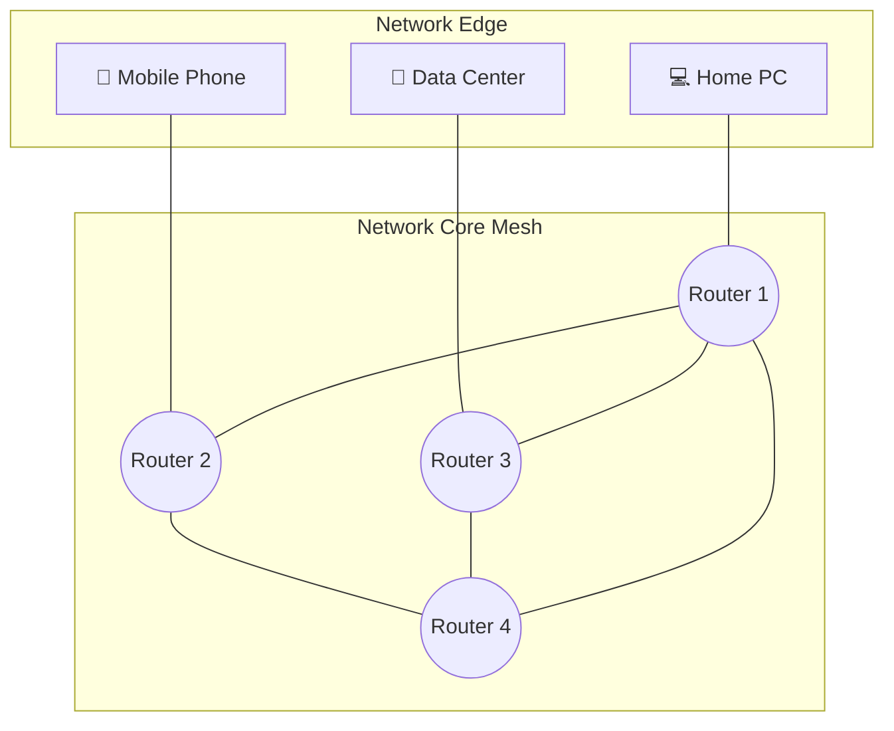

# 🌐 Chapter 01: Internet Architecture & Network Core Switching

---

## 1. Overview (Topic Introduction)
The Internet is a complex network of networks connecting billions of computing devices worldwide. Structurally, it is decomposed into two distinct realms:
* **The Network Edge:** Hosts, end systems (computers, smartphones, IoT sensors, servers), and access networks (Ethernet, WiFi, cellular) that generate and consume data.
* **The Network Core:** The interconnected mesh of packet switches, routers, and communication links that transport data from source to destination.

At the heart of the network core lies the fundamental question of **how data moves across intermediate nodes**. Historically and conceptually, this is solved by two competing paradigms: **Circuit Switching** (reserved, dedicated paths) and **Packet Switching** (dynamic, shared store-and-forward).

---

## 2. Learning Objectives
After studying this chapter, you will be able to:
* Distinguish between Network Edge devices and Network Core devices.
* Explain the inner workings of **Circuit Switching** through **Frequency Division Multiplexing (FDM)** and **Time Division Multiplexing (TDM)**.
* Understand **Packet Switching** and why statistical multiplexing enables far greater user density than circuit switching.
* Solve mathematical problems calculating file transmission times over TDM circuits.
* Apply the **Binomial Distribution formula** to calculate the probability of link congestion when $N$ bursty users share a packet-switched link.

---

## 3. Core Concepts

### 3.1 Network Edge vs. Network Core
* **End Systems (Hosts):** Run application programs (e.g., Web browser, email client). Hosts sit strictly at the *edge* of the network.
* **Network Core:** A mesh of routers and switches interconnected by communication links (optical fiber, copper wire, satellite). The core's sole job is to move data across intermediate hops toward its final destination.
* **Routing vs. Forwarding:**
  * **Routing (Decision):** Network-wide process that uses routing algorithms (e.g., Dijkstra, Bellman-Ford) to determine the end-to-end optimal path across routers.
  * **Forwarding / Switching (Action):** Local per-router action that transfers a packet from an incoming interface link to the appropriate outgoing interface link based on the router's forwarding table.

```
Routing  = Decision Making (Global Algorithm -> Generates Routing Table)
Switching/Forwarding = Execution (Local Router Action -> Uses Table)
```

---

### 3.2 Circuit Switching: Dedicated Resource Allocation
In circuit switching, the resources (buffers, bandwidth) needed along a path between two communicating end systems are **strictly reserved and dedicated** for the entire duration of the communication session.
* **Guaranteed Bandwidth:** Constant transmission speed, zero queuing delay.
* **Inefficiency:** If a user pauses or does not transmit, the allocated bandwidth remains idle and cannot be utilized by other users.
* **Primary Use Case:** Traditional Public Switched Telephone Networks (PSTN), legacy 2G/3G voice calls.

Circuit switching divides link capacity using two multiplexing techniques:
1. **Frequency Division Multiplexing (FDM):** The frequency spectrum of a link is split into distinct narrow bands. Each call is allocated a dedicated frequency band for its entire duration (like radio stations).
2. **Time Division Multiplexing (TDM):** Time is divided into discrete, periodic frames of fixed duration. Each frame is subdivided into a fixed number of time slots. Each call is allocated a dedicated recurring time slot in every frame.

---

### 3.3 Packet Switching: Statistical Multiplexing & Store-and-Forward
In packet switching, end-to-end data streams are divided into chunks of bits called **packets**. Packets share network links on-demand:
* **Store-and-Forward:** A packet switch must receive the entire packet before it can begin transmitting the first bit onto the outbound link.
* **Statistical Multiplexing:** Users transmit in bursts rather than continuously. Multiple users share the same channel dynamically without fixed reservations.
* **Queuing Delay & Packet Loss:** If packets arrive at a router faster than the outbound link's transmission rate, they enter an output buffer (queue). If the buffer fills completely, arriving packets are dropped (**packet loss**).

---

## 4. Visual Explanation (Diagrams)

### 4.1 Network Architecture Mesh


### 4.2 FDM vs. TDM Visual Representation
```
FDM (Frequency Division Multiplexing):
Frequency ^
          │  ┌───────────────────────────────────────────────┐
  B2-B3   │  │ Channel 3: Frequency Band 3 (User 3)          │
          │  ├───────────────────────────────────────────────┤
  B1-B2   │  │ Channel 2: Frequency Band 2 (User 2)          │
          │  ├───────────────────────────────────────────────┤
  B0-B1   │  │ Channel 1: Frequency Band 1 (User 1)          │
          └──┴───────────────────────────────────────────────┴──> Time

TDM (Time Division Multiplexing):
Frequency ^
          │  ┌────────┬────────┬────────┬────────┬────────┬────────┐
  Full    │  │ Slot 1 │ Slot 2 │ Slot 3 │ Slot 1 │ Slot 2 │ Slot 3 │
  Band    │  │ User 1 │ User 2 │ User 3 │ User 1 │ User 2 │ User 3 │
          └──┴────────┴────────┴────────┴────────┴────────┴────────┴──> Time
             <------ 1 Frame ------> <------ 1 Frame ------>
```

---

## 5. Step-by-Step Mechanism

### Circuit Switching Lifecycle:
1. **Circuit Establishment:** Signaling messages travel end-to-end to reserve frequency bands or time slots at every intermediate switch. (Introduces setup delay, e.g., 500 ms).
2. **Data Transfer:** Data flows continuously with zero queuing delay.
3. **Circuit Teardown:** Resources are released along all switches.

### Packet Switching Lifecycle:
1. **Packetization:** Application message is broken into packets at the edge.
2. **Hop-by-hop Transmission:** Each router receives the entire packet, checks for errors, inspects the destination address in the header, and queues it for the outbound link.
3. **Store-and-Forward:** Packet is transmitted onto the link at full link bandwidth $R$.

---

## 6. Real-Life Example
* **Circuit Switching Analogy (Reserved Train Carriage):** You book an entire private train compartment from Dhaka to Chittagong. Even if you sleep and use only one seat, nobody else is allowed inside. Bandwidth is guaranteed, but space is wasted if idle.
* **Packet Switching Analogy (Highway Traffic):** Thousands of cars and delivery trucks share the highway. When traffic is light, everyone drives at top speed. During peak rush hours, traffic jams (queues) form, and cars must wait.

---

## 7. Practical Implementation (Math & Python Simulation)

### Mathematical Formulation:
1. **Allocated Bandwidth per TDM Slot:**
   $$\text{Bandwidth}_{\text{slot}} = \frac{\text{Total Link Bandwidth}}{\text{Number of Slots per Second}}$$
2. **Transmission Time over Circuit:**
   $$\text{Time}_{\text{total}} = \text{Setup Time} + \frac{\text{File Size (bits)}}{\text{Bandwidth}_{\text{slot}}}$$
3. **Binomial Probability of $k$ active users among $N$ total users (each active with probability $p$):**
   $$P(X = k) = \binom{N}{k} p^k (1 - p)^{N - k} = \frac{N!}{k!(N - k)!} p^k (1 - p)^{N - k}$$

### Python Verification Script:
```python
import math

def tdm_transmission_time(file_size_bits, link_rate_bps, num_slots, setup_time_s):
    slot_rate = link_rate_bps / num_slots
    tx_time = file_size_bits / slot_rate
    total_time = setup_time_s + tx_time
    return slot_rate, tx_time, total_time

def binomial_prob(n, k, p):
    comb = math.comb(n, k)
    return comb * (p ** k) * ((1 - p) ** (n - k))

def prob_more_than_k(n, k, p):
    return sum(binomial_prob(n, i, p) for i in range(k + 1, n + 1))

# Test Case matching UIU Class Lecture 03:
# Link: 1.536 Mbps, 24 slots/sec, File: 640,000 bits, Setup: 500 ms (0.5 s)
slot_bw, tx, total = tdm_transmission_time(640000, 1.536e6, 24, 0.5)
print(f"Slot Bandwidth: {slot_bw} bps | Tx Time: {tx} s | Total: {total} s")

# Test Case: 15 users, link supports 8 users simultaneously, active 20% of time
p_congestion = prob_more_than_k(15, 8, 0.20)
print(f"Probability of congestion (>8 users transmitting): {p_congestion:.6f}")
```

---

## 8. Common Mistakes & Pitfalls
> [!WARNING]
> * **Unit Confusion (b vs. B):** Bandwidth is specified in **bits per second (bps)**, while file sizes are often written in **Bytes (B)**. Always multiply Bytes by 8 before calculating delays! ($1\text{ Byte} = 8\text{ bits}$).
> * **Metric vs. Binary Prefixes:** In Computer Networking, link speeds use metric multipliers:
>   - $1\text{ kbps} = 10^3\text{ bps}$
>   - $1\text{ Mbps} = 10^6\text{ bps}$
>   - $1\text{ Gbps} = 10^9\text{ bps}$
> * **Neglecting Circuit Setup Time:** In circuit switching problems, do not forget to add the initial circuit establishment delay to the transmission time!

---

## 9. Practice Problems & Exam Walkthroughs

### 📝 Problem 1 (From Class Lecture 03 Notes, Exercise 4)
**Question:** How long does it take to send a file of $640,000\text{ bits}$ from Host A to Host B over a circuit-switched network?
* All links are $1.536\text{ Mbps}$ ($1.536 \times 10^6\text{ bps}$).
* Each link uses TDM with $24\text{ slots/second}$.
* Circuit establishment takes $500\text{ msec}$ ($0.5\text{ s}$).

**Step-by-Step Solution:**
1. **Find Allocated Bandwidth per Slot:**
   $$\text{Slot Bandwidth} = \frac{1.536 \times 10^6\text{ bps}}{24} = 64,000\text{ bps}$$
2. **Calculate File Transmission Time:**
   $$\text{Tx Time} = \frac{640,000\text{ bits}}{64,000\text{ bps}} = 10\text{ seconds}$$
3. **Add Circuit Establishment Delay:**
   $$\text{Total Time} = 10\text{ s} + 0.5\text{ s} = \mathbf{10.5\text{ seconds}}$$

---

### 📝 Problem 2 (From Class Lecture 03 Notes, Exercise 6)
**Question:** Users share a link of capacity $200\text{ Mbps}$. Each user requires $25\text{ Mbps}$ when transmitting, but only transmits $20\%$ of the time ($p = 0.2$).
1. When circuit switching is used, how many users can be supported?
2. If packet switching is used with $15\text{ users}$, what is the probability that all 15 users transmit simultaneously?
3. What is the probability that more than 8 users transmit simultaneously?

**Step-by-Step Solution:**
1. **Circuit Switching User Capacity:**
   $$N_{cs} = \frac{\text{Total Capacity}}{\text{Per-User Rate}} = \frac{200\text{ Mbps}}{25\text{ Mbps}} = \mathbf{8\text{ users}}$$
2. **Probability that all 15 users transmit at the same time:**
   $$P(X = 15) = (0.2)^{15} \approx \mathbf{3.28 \times 10^{-11}}$$
3. **Probability that more than 8 users transmit simultaneously:**
   Since the link can only serve up to 8 users simultaneously without queuing, having $>8$ users active will cause queuing delay and potential packet drops:
   $$P(X > 8) = \sum_{i=9}^{15} \binom{15}{i} (0.2)^i (1 - 0.2)^{15 - i} \approx \mathbf{0.000372} \ (0.037\%)$$
   *Conclusion:* In packet switching, 15 users can be supported with a negligible probability ($<0.04\%$) of queue overload, whereas circuit switching strictly limits support to only 8 users!

---

## 10. Knowledge Check (MCQ & Quizzes)

#### Q1. Why does Packet Switching support more users than Circuit Switching?
- [ ] A) Packet switching links have higher physical bandwidth.
- [x] B) Most users transmit data in intermittent bursts, allowing statistical multiplexing of link capacity.
- [ ] C) Packet switching eliminates propagation delay.
- [ ] D) Packet switches do not require memory buffers.
*Explanation:* Because user traffic is bursty, statistical multiplexing dynamically allocates capacity only to active users, supporting 2x to 3x more users than static reservations.

#### Q2. In a TDM circuit with 10 slots per frame and a total link rate of 100 Mbps, what rate does an individual user experience?
- [ ] A) 100 Mbps continuously
- [x] B) 10 Mbps effective continuous rate (or 100 Mbps during their 1/10th time slot)
- [ ] C) 1 Gbps
- [ ] D) 50 Mbps
*Explanation:* $100\text{ Mbps} / 10\text{ slots} = 10\text{ Mbps}$ dedicated bandwidth.

---

#### Q3. In packet switching, if 1 Mbps link supports users who each require 100 kbps but are active only 10% of the time, how many simultaneous users can be supported versus circuit switching?
- [ ] A) Same as circuit switching: 10 users
- [x] B) Far more than 10 users — up to 35+ users with low congestion probability (Binomial probability analysis)
- [ ] C) 100 users with guaranteed QoS
- [ ] D) Exactly 10 users since link rate is fixed
*Explanation:* Circuit switching hard-allocates bandwidth: `1 Mbps / 100 kbps = 10 users`. Packet switching can serve far more because users are rarely all active simultaneously. With N=35 users each active 10% of the time, the probability all 35 transmit simultaneously is astronomically small.

#### Q4. What is the fundamental difference between the network edge and the network core?
- [x] A) Edge contains end-systems (hosts) running applications; Core contains packet switches (routers) that forward data
- [ ] B) Edge is faster than the core
- [ ] C) Edge uses circuit switching; core uses packet switching
- [ ] D) They are the same — edge and core are synonymous terms
*Explanation:* The **network edge** (access network) hosts end-user devices (laptops, phones, servers). The **network core** is the mesh of interconnected packet switches and links that moves data from source to destination. No end-user applications run in the core.

#### Q5. Which type of network uses store-and-forward transmission at every intermediate node?
- [ ] A) Circuit-switched networks
- [ ] B) Frequency Division Multiplexing networks
- [x] C) Packet-switched networks
- [ ] D) Time Division Multiplexing networks
*Explanation:* In **packet-switched networks**, every router must receive the **complete packet** before it can begin forwarding it onto the next link. This is the store-and-forward principle. Circuit-switched networks create a dedicated end-to-end pipe — bits flow through without buffering at intermediate nodes.

#### Q6. Why do ISPs (Internet Service Providers) at the same hierarchical level (Tier-1) connect directly via peering links rather than through a paying transit provider?
- [ ] A) Legal requirements mandate peering between Tier-1 ISPs
- [ ] B) Peering links are always faster than transit links
- [x] C) Settlement-free peering eliminates transit costs — data flows between peers for free, reducing operational expenses
- [ ] D) Tier-1 ISPs cannot purchase transit from anyone since they are at the top level
*Explanation:* Tier-1 ISPs (e.g., AT&T, NTT) have global reach. By establishing **settlement-free peering agreements**, they exchange traffic directly without paying each other, significantly reducing costs compared to purchasing upstream transit bandwidth.

#### Q7. What is a "Point of Presence" (PoP) in the context of ISP architecture?
- [ ] A) A special type of end-host in the access network
- [x] B) A group of routers in a provider's network where customer ISPs can connect to the provider's backbone
- [ ] C) The physical location of a DNS root server
- [ ] D) The geographic center of an Autonomous System
*Explanation:* A **PoP (Point of Presence)** is a geographic location where a provider ISP has routers that lower-level ISPs can connect into. It is the entry point into an ISP's backbone network.


## 11. Summary & Revision Sheet
* **Network Edge:** End systems (PCs, phones, servers) running distributed applications.
* **Network Core:** Mesh of packet switches (routers) forwarding packets across hops.
* **Circuit Switching:** Dedicated reservation (FDM/TDM). Zero queuing delay, guaranteed throughput, but bandwidth wasted during silence periods.
* **Packet Switching:** On-demand store-and-forward sharing. High resource utilization, supports many bursty users, but introduces queuing delay and packet loss risk.
* **Capacity Formula:**
  $$N_{cs} = \left\lfloor \frac{\text{Link Capacity}}{\text{User Rate}} \right\rfloor$$

---

---

## 🔗 Related Topics

> Connect your understanding — explore these closely related chapters:

- 📖 [Network Attacks & Defense](../02-network-security-fundamentals/02-network-attacks-and-defense.md) — Threats that exploit the packet-switched Internet core
- 📖 [Delay, Loss & Throughput](02-delay-loss-and-throughput.md) — Quantifying performance of the network core
- 📖 [Layering & Encapsulation](03-layering-and-encapsulation.md) — How the 5-layer stack organizes the Internet

## 12. References & Further Reading
* Kurose, J. F., & Ross, K. W. *Computer Networking: A Top-Down Approach* (8th Edition), Chapter 1.
* Kleinrock, L. (1976). *Queueing Systems: Volume II — Computer Applications*. John Wiley & Sons.


---

<div align="center">

| [⬅️ Previous](README.md) | [🏠 Module Index](README.md) | [Next ➡️](02-delay-loss-and-throughput.md) |
|:---:|:---:|:---:|

</div>
