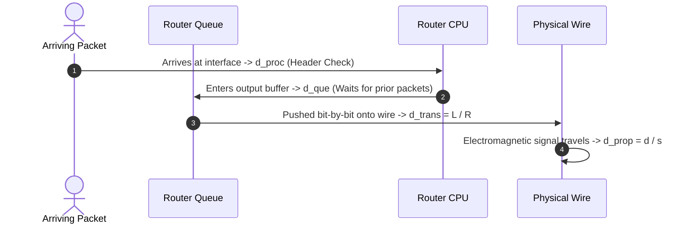

# ⏱️ Chapter 02: Delay, Loss, and Throughput in Packet-Switched Networks

---

## 1. Overview (Topic Introduction)
When a packet travels from a source host, across intermediate network routers, to a destination host, it suffers from several distinct types of delay at each node along its path. Understanding the mathematical breakdown of **nodal delay**, the conditions under which **packet loss** occurs, and how **bottleneck links** limit end-to-end **throughput** is essential for analyzing network performance and designing high-efficiency transport protocols.

---

## 2. Learning Objectives
After studying this chapter, you will be able to:
* Identify and calculate the four fundamental components of **Total Nodal Delay**: Processing, Queuing, Transmission, and Propagation delay.
* Understand the intuitive physics of networking through the classic **Caravan Analogy**.
* Differentiate between delays dependent on the router hardware versus those dependent on the physical transmission medium.
* Calculate end-to-end multi-hop delays across heterogenous transmission links.
* Compute the queuing delay for an arriving packet based on the current queue depth.
* Identify the **bottleneck link** and calculate maximum end-to-end effective throughput.

---

## 3. Core Concepts

### 3.1 The 4 Components of Nodal Delay
At every packet switch (router), a packet experiences four distinct delays:

$$d_{\text{nodal}} = d_{\text{proc}} + d_{\text{que}} + d_{\text{trans}} + d_{\text{prop}}$$

```
┌──────────────┐     ┌─────────────┐     ┌────────────────┐     ┌────────────────┐
│  Processing  │ ──> │   Queuing   │ ──> │  Transmission  │ ──> │  Propagation   │
│ Delay (dproc)│     │ Delay (dque)│     │  Delay (dtrans)│     │ Delay (dprop)  │
└──────────────┘     └─────────────┘     └────────────────┘     └────────────────┘
 Router CPU check     Buffer wait time    Push bits to wire      Flight time over wire
 (Header / Checksum)  (Function of queue) L / R (Link Rate)      d / s (Speed of light)
```

1. **Nodal Processing Delay ($d_{\text{proc}}$):**
   * Time required by the router CPU to inspect the packet header, verify the checksum for bit errors, and determine the outbound interface link from its routing table.
   * *Property:* Typically microseconds or less; depends on router hardware speed.
2. **Queuing Delay ($d_{\text{que}}$):**
   * Time the packet waits in the output buffer queue before it can begin transmission.
   * *Property:* Variable! Depends on network traffic intensity. If $n$ packets are ahead in the queue:
     $$d_{\text{que}} = n \times \frac{L}{R}$$
3. **Transmission Delay ($d_{\text{trans}}$):**
   * Time required to push (pump) all of the packet's bits onto the physical link.
   * *Formula:*
     $$d_{\text{trans}} = \frac{L}{R}$$
     where $L$ is the packet length in bits, and $R$ is the link transmission rate in bits/sec (bps).
   * *Property:* Dependent strictly on packet size and router interface link speed; independent of geographical distance!
4. **Propagation Delay ($d_{\text{prop}}$):**
   * Time required for a single bit to physically travel from the beginning of the link to the destination router across the physical medium (fiber optic, copper, air).
   * *Formula:*
     $$d_{\text{prop}} = \frac{d}{s}$$
     where $d$ is the link length (distance in meters), and $s$ is the propagation speed in the medium ($s \approx 2 \times 10^8\text{ to } 3 \times 10^8\text{ m/s}$).
   * *Property:* Dependent strictly on distance and physical medium; independent of packet size and link bandwidth!

---

### 3.2 The Caravan Analogy
Consider a caravan of 10 cars (representing 10 bits of a packet) traveling down a 100 km highway between two toll booths (representing routers):
* **Toll Booth Service Time (Transmission Delay):** The toll collector takes 12 seconds to service each car and release it onto the highway. Total time to service all 10 cars = $10 \times 12\text{ s} = 120\text{ seconds}$ ($d_{\text{trans}}$).
* **Highway Travel Time (Propagation Delay):** Once released, each car cruises at $100\text{ km/h}$. The travel time over $100\text{ km}$ = $1\text{ hour}$ ($d_{\text{prop}}$).
* **Store-and-Forward Rule:** The caravan cannot proceed past the second toll booth until the entire caravan of 10 cars has arrived and assembled!

---

### 3.3 Throughput & Bottleneck Links
* **Throughput:** The rate (bits per unit time, e.g., bps) at which bits are transferred from sender to receiver.
* **Bottleneck Link:** The link on the end-to-end path that provides the minimum transmission capacity:
  $$\text{Throughput} = \min(R_1, R_2, \dots, R_N)$$
* If a backbone link of $R_{\text{shared}}$ is shared equally among $M$ active connections, each user gets $\frac{R_{\text{shared}}}{M}$.

---

## 4. Visual Explanation (Diagrams)

### 4.1 Packet Delay Pipeline at a Router


### 4.2 Bottleneck Link Pipeline
```
[Sender Host] === R1 (100 Mbps) ===> [Router] === R2 (10 Mbps) ===> [Router] === R3 (1 Gbps) ===> [Receiver Host]
                                                ▲
                                                │ Bottleneck Link!
                                                └─ Throughput = min(100, 10, 1000) = 10 Mbps
```

---

## 5. Step-by-Step Multi-Hop Delay Calculation

For a path with $N$ links and $N-1$ intermediate routers:
1. **Source Host:** Computes $d_{\text{trans1}} = \frac{L}{R_1}$. (Note: hosts typically have negligible $d_{\text{proc}}$ and $d_{\text{que}}$ for outbound traffic).
2. **Link 1:** Propagates signal $d_{\text{prop1}} = \frac{d_1}{s}$.
3. **Router 1:**
   - Incurs processing delay $d_{\text{proc1}}$.
   - Incurs queuing delay $d_{\text{que1}}$ (if other packets are in buffer).
   - Incurs transmission delay $d_{\text{trans2}} = \frac{L}{R_2}$.
4. **Intermediate Links:** Repeats for each intermediate hop.
5. **Destination Host:** Receives the final bit; total delay is the sum of all components:
   $$d_{\text{end-to-end}} = \sum_{i=1}^{N} \left( \frac{L}{R_i} + \frac{d_i}{s_i} \right) + \sum_{j=1}^{N-1} (d_{\text{proc}, j} + d_{\text{que}, j})$$

---

## 6. Real-Life Example
* **Water Pipe Network:**
  - Pumping 100 liters of water through a funnel into a hose = **Transmission delay** (volume / pump speed).
  - The time the water droplets take to travel 50 meters through the garden hose to wet the flowers = **Propagation delay** (distance / water velocity).
  - Even with a massive fire hose at the source and destination, if there is a tiny 1-cm diameter connector in the middle, water flows at the rate of that tiny connector (**Bottleneck link**).

---

## 7. Practical Implementation (Python Calculation Engine)

```python
class NetworkPath:
    def __init__(self, packet_size_bytes, prop_speed=3e8):
        self.L_bits = packet_size_bytes * 8
        self.prop_speed = prop_speed
        self.hops = []

    def add_hop(self, distance_meters, bandwidth_bps, d_proc_s=0.0, queue_packets=0):
        self.hops.append({
            'd': distance_meters,
            'R': bandwidth_bps,
            'd_proc': d_proc_s,
            'q': queue_packets
        })

    def calculate_total_delay(self):
        total_dtrans = 0
        total_dprop = 0
        total_dproc = 0
        total_dque = 0

        for i, hop in enumerate(self.hops):
            # Transmission delay on this link
            d_trans = self.L_bits / hop['R']
            # Propagation delay on this link
            d_prop = hop['d'] / self.prop_speed
            # Queuing delay if queue exists
            d_que = hop['q'] * (self.L_bits / hop['R'])
            # Processing delay at this hop (only for routers, hop 0 is sender)
            d_proc = hop['d_proc']

            total_dtrans += d_trans
            total_dprop += d_prop
            total_dproc += d_proc
            total_dque += d_que

        end_to_end = total_dtrans + total_dprop + total_dproc + total_dque
        bottleneck_bw = min(hop['R'] for hop in self.hops)

        return {
            'end_to_end_delay_ms': end_to_end * 1000,
            'transmission_delay_ms': total_dtrans * 1000,
            'propagation_delay_ms': total_dprop * 1000,
            'queuing_delay_ms': total_dque * 1000,
            'processing_delay_ms': total_dproc * 1000,
            'bottleneck_throughput_mbps': bottleneck_bw / 1e6
        }

# Verify UIU Class Note 1, Page 7 (Content 1: 8 Problem):
# Packet L = 16,000 bits. 3 Links:
# Link 1: 2 km, 1000 Mbps
# Link 2: 500 km, 10 Mbps
# Link 3: 3 km, 100 Mbps
path = NetworkPath(packet_size_bytes=16000//8, prop_speed=3e8)
path.add_hop(distance_meters=2000, bandwidth_bps=1000e6)
path.add_hop(distance_meters=500e3, bandwidth_bps=10e6)
path.add_hop(distance_meters=3000, bandwidth_bps=100e6)

res = path.calculate_total_delay()
print("End-to-End Delay:", res['end_to_end_delay_ms'], "ms")
print("Bottleneck Throughput:", res['bottleneck_throughput_mbps'], "Mbps")
```

---

## 8. Common Mistakes & Pitfalls
> [!CAUTION]
> 1. **Applying Processing Delay at the Sender:** A sender host does not experience router processing delay $d_{\text{proc}}$ for outbound traffic; $d_{\text{proc}}$ occurs at intermediate routers examining incoming headers!
> 2. **Confusing Bandwidth with Signal Speed:** A $10\text{ Gbps}$ fiber link does NOT send bits faster across the distance than a $10\text{ Mbps}$ fiber link! Both transmit electromagnetic waves at the same physical speed of light ($s \approx 2 \times 10^8\text{ m/s}$). Higher bandwidth simply means bits are pushed closer together in time ($d_{\text{trans}} = L/R$ is shorter).
> 3. **Fractional Packets in Queuing:** If a question states that 200 full packets and half of another packet are in the queue, $n = 200.5$ packets!

---

## 9. Practice Problems & Exam Walkthroughs

### 📝 Problem 1 (From CN Class Note 1, Page 7: Content 1.8)
**Question:** A packet of size $L = 16,000\text{ bits}$ is sent from Host A to Host B across 3 links separated by 2 routers. Propagation speed $s = 3 \times 10^8\text{ m/s}$. Neglect queuing and processing delays.
* **Link 1:** $d_1 = 2\text{ km}$, $R_1 = 1000\text{ Mbps}$
* **Link 2:** $d_2 = 500\text{ km}$, $R_2 = 10\text{ Mbps}$
* **Link 3:** $d_3 = 3\text{ km}$, $R_3 = 100\text{ Mbps}$
Calculate the total end-to-end delay.

**Step-by-Step Solution:**
1. **Link 1 Delay:**
   $$d_{\text{trans1}} = \frac{16,000}{1000 \times 10^6} = 1.6 \times 10^{-5}\text{ s} = 0.016\text{ ms}$$
   $$d_{\text{prop1}} = \frac{2 \times 10^3}{3 \times 10^8} = 6.67 \times 10^{-6}\text{ s} = 0.00667\text{ ms}$$
2. **Link 2 Delay:**
   $$d_{\text{trans2}} = \frac{16,000}{10 \times 10^6} = 1.6 \times 10^{-3}\text{ s} = 1.6\text{ ms}$$
   $$d_{\text{prop2}} = \frac{500 \times 10^3}{3 \times 10^8} = 1.667 \times 10^{-3}\text{ s} = 1.667\text{ ms}$$
3. **Link 3 Delay:**
   $$d_{\text{trans3}} = \frac{16,000}{100 \times 10^6} = 1.6 \times 10^{-4}\text{ s} = 0.16\text{ ms}$$
   $$d_{\text{prop3}} = \frac{3 \times 10^3}{3 \times 10^8} = 1.0 \times 10^{-5}\text{ s} = 0.010\text{ ms}$$
4. **End-to-End Total Delay:**
   $$d_{\text{total}} = (0.016 + 0.00667) + (1.6 + 1.667) + (0.16 + 0.010) = \mathbf{3.45967\text{ ms}}$$

---

### 📝 Problem 2 (From CN Class Note 1, Page 8: Q.4)
**Question:** A packet arrives at a router buffer where 200 packets and half of another packet are currently queued awaiting transmission. Packet size $L = 64\text{ Bytes}$, link rate $R = 10\text{ Mbps}$. What is the queuing delay experienced by this arriving packet?

**Step-by-Step Solution:**
1. **Number of packets ahead in queue:**
   $$n = 200 + 0.5 = 200.5\text{ packets}$$
2. **Transmission time per packet:**
   $$\frac{L}{R} = \frac{64 \times 8\text{ bits}}{10 \times 10^6\text{ bps}} = \frac{512}{10^7} = 5.12 \times 10^{-5}\text{ s} = 0.0512\text{ ms}$$
3. **Queuing Delay ($d_{\text{que}}$):**
   $$d_{\text{que}} = 200.5 \times \frac{L}{R} = 200.5 \times (5.12 \times 10^{-5}\text{ s}) = 0.0102656\text{ s} = \mathbf{10.2656\text{ ms}}$$

---

### 📝 Problem 3 (From CN Class Note 1, Page 10: Q.253(c))
**Question:** A server transmits a file of size $1\text{ Gb}$ ($1 \times 10^9\text{ bits}$). The server link has rate $R_s = 200\text{ Mbps}$, the client link has rate $R_c = 50\text{ Mbps}$. They are connected across a core network link of $100\text{ Mbps}$ that is shared equally among $25\text{ users}$. What is the transmission time of the file?

**Step-by-Step Solution:**
1. **Calculate per-user capacity on the shared core link:**
   $$R_{\text{shared-per-user}} = \frac{100\text{ Mbps}}{25} = 4\text{ Mbps}$$
2. **Identify the Bottleneck Link Capacity:**
   $$R_{\min} = \min(R_s, R_{\text{shared-per-user}}, R_c) = \min(200\text{ Mbps}, 4\text{ Mbps}, 50\text{ Mbps}) = \mathbf{4\text{ Mbps}}$$
3. **Calculate File Transmission Time:**
   $$\text{Tx Time} = \frac{L}{R_{\min}} = \frac{1 \times 10^9\text{ bits}}{4 \times 10^6\text{ bps}} = \mathbf{250\text{ seconds}}$$

---

## 10. Knowledge Check (MCQ & Quizzes)

#### Q1. If you double the physical length of a cable without changing bandwidth or packet size, which delay doubles?
- [ ] A) Transmission delay ($d_{\text{trans}}$)
- [x] B) Propagation delay ($d_{\text{prop}}$)
- [ ] C) Processing delay ($d_{\text{proc}}$)
- [ ] D) Queuing delay ($d_{\text{que}}$)
*Explanation:* $d_{\text{prop}} = d / s$. Doubling distance $d$ directly doubles propagation delay.

#### Q2. A link has bandwidth $R = 100\text{ Mbps}$. An arriving packet has length $L = 1250\text{ Bytes}$. What is $d_{\text{trans}}$?
- [ ] A) $0.1\text{ ms}$
- [x] B) $0.1\text{ ms}$ ($100\text{ }\mu\text{s}$)
- [ ] C) $12.5\text{ ms}$
- [ ] D) $1\text{ ms}$
*Explanation:* $L = 1250 \times 8 = 10,000\text{ bits}$. $d_{\text{trans}} = 10,000 / (100 \times 10^6) = 10^{-4}\text{ s} = 0.1\text{ ms} = 100\text{ }\mu\text{s}$.

---

#### Q3. For a 150 km fiber link with propagation speed $s = 2 \times 10^8$ m/s and a 1 Gbps link rate sending a 12,000-bit packet, which delay type dominates?
- [ ] A) Transmission delay dominates: $d_{\text{trans}} = 12,000 / 10^9 = 12\ \mu\text{s}$ vs $d_{\text{prop}} = 0.75\ \text{ms}$
- [x] B) Propagation delay dominates: $d_{\text{prop}} = (150 \times 10^3) / (2 \times 10^8) = 0.75\ \text{ms}$ vs $d_{\text{trans}} = 12\ \mu\text{s}$
- [ ] C) They are approximately equal
- [ ] D) Processing delay dominates over both
*Explanation:* $d_{\text{trans}} = 12,000 / (10^9) = 12\ \mu\text{s}$. $d_{\text{prop}} = 150,000 / (2 \times 10^8) = 0.75\ \text{ms} = 750\ \mu\text{s}$. Propagation delay is **62.5× larger** than transmission delay on this long-distance high-bandwidth link.

#### Q3. The traffic intensity $\rho = La/R$. What happens as $\rho \to 1$?
- [ ] A) Queuing delay approaches zero
- [ ] B) Queuing delay equals exactly one transmission delay $L/R$
- [x] C) Average queuing delay approaches infinity — the queue grows without bound
- [ ] D) Packet loss stops occurring
*Explanation:* Traffic intensity $\rho = La/R$ where $L$ = packet length, $a$ = packet arrival rate, $R$ = link bandwidth. When $\rho \geq 1$, packets arrive faster than they can be served. The queue **grows unboundedly** and average queuing delay $\to \infty$. This is why $\rho < 1$ is a fundamental design requirement.

#### Q4. What is the effective end-to-end throughput for a file transfer where $R_s = 500\ \text{Mbps}$, $R_c = 20\ \text{Mbps}$, and 10 other flows share a 100 Mbps core link?
- [ ] A) $500\ \text{Mbps}$ (server capacity)
- [x] B) $10\ \text{Mbps}$ (shared core link bottleneck: $100/10 = 10\ \text{Mbps per flow}$)
- [ ] C) $20\ \text{Mbps}$ (client capacity)
- [ ] D) $1\ \text{Gbps}$ (maximum theoretical)
*Explanation:* Core link: $100\ \text{Mbps} \div 10\ \text{flows} = 10\ \text{Mbps per flow}$. Bottleneck $= \min(500, 10, 20) = \mathbf{10\ \text{Mbps}}$. The shared core link is the bottleneck, not the server or client access link.

#### Q5. Packet loss at a router occurs when:
- [ ] A) The propagation delay exceeds 1 second
- [ ] B) The link bandwidth is greater than 1 Gbps
- [x] C) The output buffer is completely full and a new packet arrives
- [ ] D) The processing delay exceeds the queuing delay
*Explanation:* Every router has a **finite output buffer (queue)**. When the queue is 100% full and a new packet arrives, the router has no space to store it and **drops the packet**. This is called **packet loss**. The packet is simply discarded — no notification to the sender (TCP detects loss and retransmits; UDP does not).


## 11. Summary & Revision Sheet
| Delay Component | Formula | Dependent On | Hardware / Physics |
|---|---|---|---|
| **Processing ($d_{\text{proc}}$)** | Fixed by CPU | Router processor, header complexity | Router Hardware |
| **Queuing ($d_{\text{que}}$)** | $n \times (L / R)$ | Buffer congestion, arrival traffic | Dynamic Traffic Load |
| **Transmission ($d_{\text{trans}}$)** | $L / R$ | Packet length ($L$), Link Bandwidth ($R$) | Network Interface Speed |
| **Propagation ($d_{\text{prop}}$)** | $d / s$ | Distance ($d$), Medium speed ($s$) | Physical Medium Physics |
| **Bottleneck Throughput** | $\min(R_1, \dots, R_N)$ | Weakest link on end-to-end path | Topology Constrained |

---

---

## 🔗 Related Topics

> Connect your understanding — explore these closely related chapters:

- 📖 [Internet & Network Core](01-internet-and-network-core.md) — Architecture that creates these delays
- 📖 [TCP Congestion Control](../04-transport-layer-and-reliability/05-tcp-flow-and-congestion-control.md) — How TCP reacts to delay and loss signals
- 📖 [IPv4 Fragmentation](../05-network-layer-and-routing/02-ipv4-and-fragmentation.md) — How large packets add extra delay at fragmentation points

## 12. References & Further Reading
* RFC 1242: *Benchmarking Terminology for Network Interconnection Devices*.
* Kurose & Ross, *Computer Networking*, Chapter 1.4: *Delay, Loss, and Throughput in Packet-Switched Networks*.


---

<div align="center">

| [⬅️ Previous](01-internet-and-network-core.md) | [🏠 Module Index](README.md) | [Next ➡️](03-layering-and-encapsulation.md) |
|:---:|:---:|:---:|

</div>
