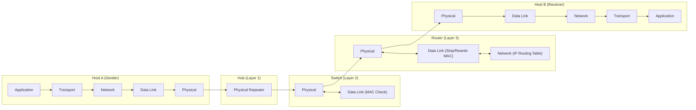

# 📦 Chapter 03: Layered Architecture, Encapsulation, and Addressing

---

## 1. Overview (Topic Introduction)
Computer networks are extraordinarily complex systems comprising diverse hardware, communication media, operating systems, and distributed applications. To manage this immense complexity, network designers organize network protocols into **hierarchical layers**. Each layer provides specific services to the layer above it while relying on the services of the layer below. As application data travels down the protocol stack, it undergoes **encapsulation** (adding headers/trailers) and, at the receiving end, **decapsulation**.

---

## 2. Learning Objectives
After studying this chapter, you will be able to:
* Explain the benefits of layering: **Modularity**, **Ease of Troubleshooting**, and **Function Reuse**.
* Compare the **OSI 7-Layer Reference Model** with the **TCP/IP 5-Layer Model**.
* Distinguish the protocol stack depth processed by **Hubs (Layer 1)**, **Switches (Layer 2)**, and **Routers (Layer 3)**.
* Trace the encapsulation of application data into Transport segments, Network datagrams, and Data Link frames.
* Understand the three distinct levels of addressing: **Process-to-Process (Port)**, **Host-to-Host (IP)**, and **Hop-to-Hop (MAC)**.
* Calculate segment count, maximum payload, and overhead percentages under varying **Maximum Transmission Unit (MTU)** constraints.

---

## 3. Core Concepts

### 3.1 Why Layering?
1. **Modularity:** Decomposes a monolithic networking system into manageable, independent functional modules.
2. **Ease of Troubleshooting:** If a link cable breaks, engineers troubleshoot Layer 1 without modifying web browser application code (Layer 5).
3. **Function Reuse (Framework):** Multiple diverse applications (HTTP, FTP, SMTP) reuse the same underlying Transport (TCP/UDP) and Network (IP) layers.

---

### 3.2 OSI 7-Layer Model vs. TCP/IP 5-Layer Model

```
       OSI 7-Layer Model                     TCP/IP 5-Layer Model
┌──────────────────────────────┐          ┌──────────────────────────────┐
│  7. Application Layer        │ ──┐      │  5. Application Layer        │
├──────────────────────────────┤   ├────> │     (HTTP, SMTP, DNS)        │
│  6. Presentation Layer       │   │      └──────────────────────────────┘
├──────────────────────────────┤   │      ┌──────────────────────────────┐
│  5. Session Layer            │ ──┘      │  4. Transport Layer          │
├──────────────────────────────┤ ───────> │     (TCP, UDP)               │
│  4. Transport Layer          │          └──────────────────────────────┘
├──────────────────────────────┤          ┌──────────────────────────────┐
│  3. Network Layer            │ ───────> │  3. Network Layer            │
├──────────────────────────────┤          │     (IPv4, IPv6, Routing)    │
│  2. Data Link Layer          │ ───────> ├──────────────────────────────┤
├──────────────────────────────┤          │  2. Data Link Layer (MAC)    │
│  1. Physical Layer           │ ───────> ├──────────────────────────────┤
└──────────────────────────────┘          │  1. Physical Layer (Bits)    │
                                          └──────────────────────────────┘
```

* *Note:* In the Internet (TCP/IP), Presentation (encryption, compression) and Session (connection session management) duties are implemented directly inside application software if needed.

---

### 3.3 Addressing at Each Layer

| Level | Name | Scope & Purpose | Does it change across hops? |
|---|---|---|---|
| **Layer 4** | **Port Number** (16-bit) | **Process-to-Process:** Identifies the specific application process running on the host (e.g., Port 80 HTTP, Port 53 DNS). | ❌ **No** (Remains static end-to-end, unless NAT intervenes) |
| **Layer 3** | **IP Address** (32-bit IPv4) | **Host-to-Host:** Globally identifies the source host and destination host across the global Internet. | ❌ **No** (Remains constant from source to destination) |
| **Layer 2** | **MAC Address** (48-bit) | **Hop-to-Hop:** Identifies physical interfaces on the immediate local link. | ✅ **YES!** (Rewritten at every intermediate router interface!) |

---

### 3.4 Devices Operating at Different Layers
* **Hub (Layer 1):** Physical-layer repeater. Receives raw bits on one port and blindly electrical-broadcasts them to all other ports. Does not read frames or IP packets.
* **Switch (Layer 2):** Data link device. Inspects incoming frames up to the Layer 2 MAC header. Forwards frames selectively to target devices based on MAC tables.
* **Router (Layer 3):** Network device. Inspects packets up to the Layer 3 IP header. Strips the incoming Layer 2 frame header, inspects the destination IP address, consults its routing table, decrements TTL, and encapsulates the packet into a brand-new Layer 2 frame for the next hop.

---

## 4. Visual Explanation (Diagrams)

### 4.1 Encapsulation and Data Units
```
Application Layer:    [ Application Message M: "Hello" ]
                               │
Transport Layer:      [ H_T (Port) | M ]                  ==> Segment
                               │
Network Layer:        [ H_N (IP)   | H_T | M ]            ==> Datagram / Packet
                               │
Data Link Layer:      [ H_D (MAC)  | H_N | H_T | M | T_D ]==> Frame (Header + CRC Trailer)
                               │
Physical Layer:       0 1 1 0 1 0 0 1 0 1 1 1 ...         ==> Signals / Bits
```

### 4.2 End-to-End Hop-by-Hop Traversal Pipeline (From CN Class Note 1, Page 13)


---

## 5. Step-by-Step Traversal Walkthrough

Tracing a packet from Sender (IP: `100`, MAC: `sen`, Port: `c`) to Receiver (IP: `200`, MAC: `Rec`, Port: `z`) via Router (MAC: `ROU`):

1. **At Sender Host:**
   * Application generates message `"Hello"`.
   * Transport layer prepends port header: `[Src: c | Dst: z | "Hello"]`.
   * Network layer prepends IP header: `[Src: 100 | Dst: 200 | PortHeader | "Hello"]`.
   * Data link layer prepends MAC header: `[Src: sen | Dst: ROU | IPHeader | PortHeader | "Hello"]`.
2. **On Physical Wire 1:** Transmitted as physical electromagnetic bits to the Router.
3. **At Intermediate Router:**
   * Layer 1 receives bits $\to$ delivers to Layer 2.
   * Layer 2 checks `Dst: ROU`. Since it matches the router's interface MAC, it strips the MAC header and passes the IP datagram to Layer 3.
   * Layer 3 inspects `Dst: 200`. Consults routing table: Next hop is Host B directly.
   * Layer 3 passes the datagram back down to Layer 2.
   * **Crucial Step:** Layer 2 constructs a **new frame** with:
     `[Src: ROU | Dst: Rec | SrcIP: 100 | DstIP: 200 | PortHeader | "Hello"]`.
4. **At Receiver Host:**
   * Layer 2 matches `Dst: Rec`, strips MAC header.
   * Layer 3 matches `Dst: 200`, strips IP header.
   * Layer 4 matches `Dst Port: z` (e.g., WhatsApp process), delivers clean message `"Hello"` to the application!

---

## 6. Real-Life Example (Postal Mail Analogy)
* **Application Data:** Ashik writes a confidential handwritten letter to Khan.
* **Transport Layer (Envelope):** Ashik puts the letter in an envelope and writes Khan’s department/room number (**Port**).
* **Network Layer (Postal Address):** He writes Khan’s building street address and city (**IP Address**).
* **Data Link Layer (Mail Truck Hops):** The envelope is put into a delivery pouch tagged from Ashik's local post office to the Central Sorting Hub (**Hop 1 MAC**). At the sorting hub, it is moved to another truck tagged to Khan’s regional depot (**Hop 2 MAC**). The truck tags change at every facility, but the recipient's name and city never change!

---

## 7. Practical Implementation (Segmentation & Overhead Calculation)

```python
import math

def calculate_segmentation(data_size_bytes, mtu_bytes, transport_h=20, network_h=20, link_h=14, link_t=4):
    link_overhead_per_frame = link_h + link_t       # 14 + 4 = 18 bytes
    total_header_per_segment = transport_h + network_h + link_overhead_per_frame # 20 + 20 + 18 = 58 bytes

    # Maximum application payload per physical frame:
    max_payload = mtu_bytes - total_header_per_segment
    num_segments = math.ceil(data_size_bytes / max_payload)

    # Calculate overhead
    total_overhead = num_segments * total_header_per_segment
    total_transmitted = data_size_bytes + total_overhead
    overhead_percentage = (total_overhead / total_transmitted) * 100

    return {
        'max_payload_per_segment': max_payload,
        'num_segments': num_segments,
        'overhead_per_segment': total_header_per_segment,
        'total_overhead_bytes': total_overhead,
        'overhead_percentage': round(overhead_percentage, 2)
    }

# Test Case from CN Class Note 1, Page 15:
# Data = 4000 B, Transport = 20 B, Network = 20 B, DataLink = 14 B header + 4 B trailer = 18 B.
# Case 1: MTU = 1518 Bytes
case1 = calculate_segmentation(4000, 1518)
print("Case 1 (MTU 1518):", case1)

# Case 2: MTU = 1200 Bytes
case2 = calculate_segmentation(4000, 1200)
print("Case 2 (MTU 1200):", case2)
```

---

## 8. Common Mistakes & Pitfalls
> [!WARNING]
> * **Assuming IP addresses change at routers:** IP addresses ($100 \to 200$) remain strictly constant across all standard routers from source to destination. Only MAC addresses are rewritten at each hop! (The only exception is NAT routers, studied in Module 05).
> * **Forgetting the Frame Trailer:** Ethernet Data Link frames have both a **14-byte Header** and a **4-byte CRC Trailer**, giving a total link layer overhead of $18\text{ Bytes}$.

---

## 9. Practice Problems & Exam Walkthroughs

### 📝 Problem 1 (From CN Class Note 1, Page 15 & Midterm 261 Q1(c))
**Question:** Host A wants to send an application data message of size $4,000\text{ Bytes}$ to Host B.
* Application layer message: $4,000\text{ Bytes}$.
* Transport layer header ($H_T$): $20\text{ Bytes}$.
* Network layer header ($H_N$): $20\text{ Bytes}$.
* Data link layer: Header ($H_D$) = $14\text{ Bytes}$, Trailer ($T_D$) = $4\text{ Bytes}$.
1. If the maximum frame capacity (MTU) is $1,518\text{ Bytes}$, find the number of segments required and total overhead bytes.
2. If the path capacity changes such that the maximum frame size is reduced to $1,200\text{ Bytes}$, how many segments are required and what is the new total overhead?

**Step-by-Step Solution:**
1. **Total Overhead per Segment:**
   $$\text{Overhead} = H_D + H_N + H_T + T_D = 14 + 20 + 20 + 4 = \mathbf{58\text{ Bytes}}$$
2. **Case 1 (Frame Capacity = $1,518\text{ Bytes}$):**
   * Maximum original data payload per segment:
     $$\text{Payload}_{\max} = 1518 - 58 = 1460\text{ Bytes}$$
   * Number of segments:
     $$\text{Segments} = \left\lceil \frac{4000}{1460} \right\rceil = \lceil 2.74 \rceil = \mathbf{3\text{ segments}}$$
     *(Breakdown: Segment 1 = 1460 B, Segment 2 = 1460 B, Segment 3 = 1080 B)*
   * Total overhead added:
     $$\text{Total Overhead} = 3 \times 58\text{ Bytes} = \mathbf{174\text{ Bytes}}$$
3. **Case 2 (Frame Capacity = $1,200\text{ Bytes}$):**
   * Maximum original data payload per segment:
     $$\text{Payload}_{\max} = 1200 - 58 = 1142\text{ Bytes}$$
   * Number of segments:
     $$\text{Segments} = \left\lceil \frac{4000}{1142} \right\rceil = \lceil 3.50 \rceil = \mathbf{4\text{ segments}}$$
   * Total overhead added:
     $$\text{Total Overhead} = 4 \times 58\text{ Bytes} = \mathbf{232\text{ Bytes}}$$

---

## 10. Knowledge Check (MCQ & Quizzes)

#### Q1. When a router forwards a packet from one Ethernet link to another, which fields change?
- [ ] A) Source IP and Destination IP
- [ ] B) Source Port and Destination Port
- [x] C) Source MAC and Destination MAC
- [ ] D) Application Payload
*Explanation:* Standard routers inspect IP headers to make forwarding decisions, decrement TTL, and encapsulate the packet in a new Data Link frame with the router's outbound interface MAC as Source MAC and the next-hop interface MAC as Destination MAC.

#### Q2. A Layer 2 Switch inspects packet headers up to which layer?
- [ ] A) Physical (Layer 1) only
- [x] B) Data Link (Layer 2)
- [ ] C) Network (Layer 3)
- [ ] D) Transport (Layer 4)
*Explanation:* Switches operate at Layer 2 (Data Link), reading destination MAC addresses to switch frames to appropriate switch ports.

---

#### Q3. When a router forwards an IP datagram between two Ethernet segments, which layers does it process?
- [ ] A) All 7 layers (Application through Physical)
- [ ] B) Only the Physical layer (Layer 1)
- [x] C) Layers 1 and 2 (Physical + Data Link) to receive the frame, then Layer 3 (Network) to route and forward
- [ ] D) Only Layer 3 (Network layer)
*Explanation:* A router is a **Layer 3 device**. It processes from Physical (L1) → Data Link (L2) to receive the incoming frame, strips the L2 header to extract the IP datagram, reads the L3 IP header to determine the forwarding path, then encapsulates in a **new** L2 frame for the outgoing interface. It does NOT process L4-L7.

#### Q4. What is the correct term for the data unit at each layer when moving top-down through the Internet protocol stack?
- [ ] A) Message → Datagram → Segment → Frame → Bit
- [x] B) Message → Segment → Datagram → Frame → Bit
- [ ] C) Frame → Datagram → Segment → Message → Bit
- [ ] D) Bit → Frame → Segment → Datagram → Message
*Explanation:* Application layer creates a **Message**. Transport layer adds its header → **Segment** (TCP) or **Datagram** (UDP). Network layer adds IP header → **Datagram**. Link layer adds frame header/trailer → **Frame**. Physical layer transmits → **Bits**.

#### Q5. Why does the Internet model have only 5 layers while the OSI reference model has 7?
- [ ] A) The Internet model is older and hasn't been updated
- [x] B) The Internet model merges Presentation (encryption/compression) and Session (connection management) into the Application layer, since these are handled by applications as needed
- [ ] C) OSI adds 2 extra layers for security reasons
- [ ] D) The Internet model excludes the Physical layer entirely
*Explanation:* The **OSI model** (1984) added the **Presentation Layer** (data encoding, encryption, compression) and **Session Layer** (session management, synchronization) as explicit separate layers. In the **Internet model**, these functions are implemented inside Application layer protocols as needed (e.g., TLS/SSL handles encryption, HTTP handles session state via cookies), so they aren't formalized as separate layers.

#### Q6. What is the purpose of a "trailer" in a Data Link layer frame, and which error-detection value is typically stored there?
- [ ] A) The trailer stores routing information for the next hop
- [x] B) The trailer stores the CRC (Cyclic Redundancy Check) checksum for error detection on the link
- [ ] C) The trailer contains the destination MAC address
- [ ] D) The trailer is always empty and exists only for byte alignment
*Explanation:* The Ethernet frame **trailer** contains the **FCS (Frame Check Sequence)** — typically a 4-byte CRC-32 value. The receiver recomputes the CRC over the received frame and compares it with the FCS. A mismatch indicates a bit error occurred on the link, and the frame is silently dropped (the sender's higher-layer protocol handles retransmission).


## 11. Summary & Revision Sheet
* **OSI 7 Layers:** Physical $\to$ Data Link $\to$ Network $\to$ Transport $\to$ Session $\to$ Presentation $\to$ Application.
* **TCP/IP 5 Layers:** Physical $\to$ Data Link $\to$ Network $\to$ Transport $\to$ Application.
* **Data Unit Names:**
  - Transport Layer $\to$ **Segment**
  - Network Layer $\to$ **Datagram / Packet**
  - Data Link Layer $\to$ **Frame**
  - Physical Layer $\to$ **Bits**
* **Addressing Summary:**
  - Port (16-bit) = Process on Host
  - IP (32-bit) = Host on Internet
  - MAC (48-bit) = Interface on Local Link

---

---

## 🔗 Related Topics

> Connect your understanding — explore these closely related chapters:

- 📖 [Internet & Network Core](01-internet-and-network-core.md) — Devices operating at different layers
- 📖 [Link Layer & Error Detection](../06-data-link-layer-and-lan/01-link-layer-and-error-detection.md) — The lowest software layer in detail
- 📖 [TCP Principles](../04-transport-layer-and-reliability/04-tcp-principles-and-handshake.md) — Application of Layer 4 transport services

## 12. References & Further Reading
* RFC 791: *Internet Protocol (IP) Specification*.
* Kurose & Ross, Chapter 1.5: *Protocol Layers and Their Service Models*.


---

<div align="center">

| [⬅️ Previous](02-delay-loss-and-throughput.md) | [🏠 Module Index](README.md) | [Next ➡️](../02-network-security-fundamentals/README.md) |
|:---:|:---:|:---:|

</div>
