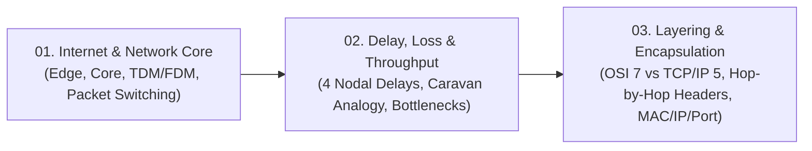

# 📦 Module 01: Network Basics & Architecture

Welcome to **Module 01: Network Basics & Architecture**. This foundational module establishes how the global Internet is physically structured, how data travels across the network core via circuit and packet switching, how delays and bottlenecks occur, and how layered architectures (OSI & TCP/IP) enable multi-vendor interoperability through encapsulation.

---

## 🗺️ Module Learning Roadmap

---

## 📚 Chapter Breakdown

| Chapter File | Topics Covered | Key Visualizations | Real-World & Math Focus |
|---|---|---|---|
| **[01-internet-and-network-core.md](./01-internet-and-network-core.md)** | Network Edge vs Core, Mesh topology, Circuit Switching (FDM vs TDM), Packet Switching (Statistical Multiplexing, Buffering) | Network Core Mesh, TDM time slotting, FDM frequency spectrum bands | TDM transmission time calculation, Binomial probability formula $\sum \binom{N}{i} p^i(1-p)^{N-i}$ |
| **[02-delay-loss-and-throughput.md](./02-delay-loss-and-throughput.md)** | Processing, Queuing, Transmission, and Propagation Delays; Packet Loss; Bottleneck link capacity | 4 Nodal Delays pipeline diagram, Caravan Analogy (toll booths vs highway), Multi-hop router chain | End-to-end delay math across multiple links, Queuing delay with packet buffer queues, Bottleneck throughput $\min(R_i)$ |
| **[03-layering-and-encapsulation.md](./03-layering-and-encapsulation.md)** | Layering principles, Modularity, OSI 7-Layer vs TCP/IP 5-Layer models, Encapsulation & Decapsulation | Postal letter analogy, End-to-end device traversal (Hub L1, Switch L2, Router L3), Layer header stack | Hop-by-hop MAC address rewrite vs static End-to-End IP/Port addressing, MTU segmentation overhead calculation |

---

## 🎯 Key Competencies Acquired

By completing this module, you will be able to:
1. Differentiate precisely between dedicated circuit switching and shared packet switching.
2. Calculate transmission time over TDM slots and evaluate packet switching user capacity using Binomial distributions.
3. Compute exact nodal and end-to-end delays across complex multi-router paths ($d_{nodal} = d_{proc} + d_{que} + d_{trans} + d_{prop}$).
4. Identify bottleneck links in networks and compute end-to-end effective throughput.
5. Trace a data payload as it gets encapsulated with Transport, Network, and Data Link headers, understanding exactly which fields change at intermediate switches and routers.

