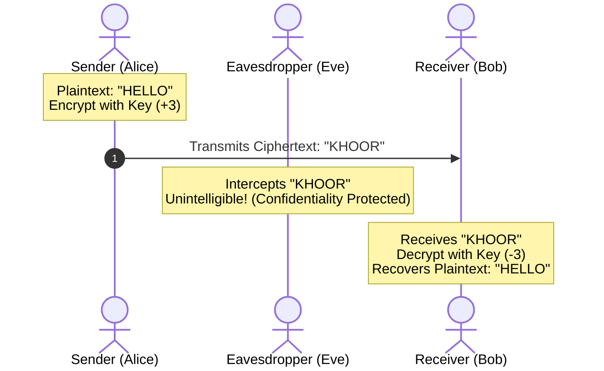
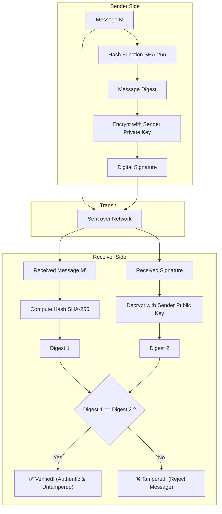

# 🛡️ Chapter 01: The CIA Triad and Cryptographic Foundations

---

## 1. Overview (Topic Introduction)
In any distributed computing environment where data traverses untrusted public infrastructure, ensuring security is paramount. The entire discipline of information and network security rests upon a foundational three-pillar framework known as the **CIA Triad**: **Confidentiality**, **Integrity**, and **Availability**. To enforce these properties, modern networking utilizes cryptographic primitives including symmetric and asymmetric encryption, cryptographic hashes, and digital signatures.

---

## 2. Learning Objectives
After studying this chapter, you will be able to:
* Define and contrast the three pillars of the **CIA Triad**.
* Explain how **Encryption and Decryption** provide message Confidentiality.
* Demonstrate the mathematical mechanics of classical substitution ciphers (e.g., **Caesar Cipher**).
* Understand how **Cryptographic Hashes** and **Digital Signatures** guarantee message Integrity and non-repudiation.
* Distinguish between symmetric-key cryptography (shared secret) and public-key cryptography (public/private key pairs).

---

## 3. Core Concepts

### 3.1 The CIA Triad

```
             ┌─────────────────────────┐
             │    C: Confidentiality   │
             │   (Only sender/receiver │
             │    can understand text) │
             └────────────┬────────────┘
                          │
            ▲             │             ▲
           ╱ ╲            ▼            ╱ ╲
          ╱   ╲                       ╱   ╲
         ╱     ╲                     ╱     ╲
┌───────┴───────┴───────┐   ┌───────┴───────┴───────┐
│      I: Integrity     │   │    A: Availability    │
│  (Data not altered    │───│ (Services accessible  │
│   in transit)         │   │  to legitimate users) │
└───────────────────────┘   └───────────────────────┘
```

1. **Confidentiality:**
   * *Definition:* Ensures that only the intended sender and receiver can understand the contents of the transmitted message. An eavesdropper who intercepts the transmission should only see unintelligible ciphertext.
   * *Enforced By:* **Encryption** (Plaintext $\to$ Ciphertext) and **Decryption** (Ciphertext $\to$ Plaintext).
2. **Integrity:**
   * *Definition:* Ensures that the message is not altered, tampered with, or injected with malicious content while in transit from source to destination.
   * *Enforced By:* **Cryptographic Hashes (SHA-256)**, **Message Authentication Codes (MAC)**, and **Digital Signatures**.
3. **Availability:**
   * *Definition:* Ensures that network services, servers, and bandwidth remain accessible and responsive to legitimate users at all times.
   * *Threatened By:* Denial-of-Service (DoS) and Distributed Denial-of-Service (DDoS) attacks.

---

### 3.2 Cryptographic Primitives

#### 1. Caesar Cipher (Classical Substitution):
The simplest historic encryption algorithm shifts every letter of the alphabet forward by a fixed key offset $K$ (modulo 26):
$$C = (P + K) \pmod{26}$$
$$P = (C - K) \pmod{26}$$

*Example from Class Note 1 (Page 17):* Key $K = +3$
$$\text{Plaintext: } \mathbf{H \ E \ L \ L \ O}$$
- $H \to K$
- $E \to H$
- $L \to O$
- $L \to O$
- $O \to R$
$$\text{Ciphertext: } \mathbf{K \ H \ O \ O \ R}$$

#### 2. Symmetric vs. Asymmetric Cryptography:
* **Symmetric-Key Cryptography (e.g., AES, DES):** The sender and receiver share the **same secret key**. Very fast, ideal for encrypting bulk data. Challenge: Secure key exchange.
* **Public-Key Cryptography (e.g., RSA, ECC):** Each entity has a mathematically linked key pair:
  * **Public Key ($K_B^+$):** Shared openly with the world.
  * **Private Key ($K_B^-$):** Kept strictly secret by the owner.
  * *Confidentiality:* Sender encrypts with Bob's Public Key $K_B^+$. Only Bob's Private Key $K_B^-$ can decrypt it!

#### 3. Digital Signatures (Providing Integrity & Authenticity):
* To prove identity and guarantee the message was not modified, Alice signs the message hash with her **Private Key** $K_A^-$:
  $$\text{Signature} = \text{Encrypt}_{K_A^-}(\text{Hash}(M))$$
* Anyone can verify the signature using Alice's **Public Key** $K_A^+$. Because only Alice knows $K_A^-$, she cannot deny having sent it (**Non-Repudiation**).

---

## 4. Visual Explanation (Diagrams)

### 4.1 Encryption / Decryption Pipeline


### 4.2 Digital Signature Workflow


---

## 5. Step-by-Step Signing & Verification Mechanism
1. **Hashing:** Sender passes message $M$ through a cryptographic hash function (e.g., SHA-256) to produce a fixed-length digest $H(M)$.
2. **Signing:** Sender encrypts $H(M)$ using their Private Key $K_{\text{private}}$ to generate the Digital Signature.
3. **Packaging:** Sender transmits both the original message $M$ and the Digital Signature.
4. **Verification:** Receiver decrypts the signature using the sender's Public Key $K_{\text{public}}$ to recover $H(M)$. Simultaneously, the receiver independently hashes the received message to produce $H(M')$.
5. **Comparison:** If $H(M) == H(M')$, the receiver is mathematically certain:
   - The message was not altered in transit (**Integrity**).
   - The message originated from the claimed sender (**Authenticity**).

---

## 6. Real-Life Example
* **Wax Seal on Royal Letters:** In medieval times, kings stamped hot wax with their personal signet ring (**Digital Signature**). If the seal was unbroken upon arrival, the recipient knew the contents had not been tampered with (**Integrity**) and that the letter genuinely came from the king (**Authenticity**). Writing the letter in code ensured that rival spies could not read it (**Confidentiality**).

---

## 7. Practical Implementation (Python Cryptography Lab)

```python
import hashlib

def caesar_encrypt(plaintext, shift=3):
    ciphertext = ""
    for char in plaintext:
        if char.isalpha():
            base = ord('A') if char.isupper() else ord('a')
            ciphertext += chr((ord(char) - base + shift) % 26 + base)
        else:
            ciphertext += char
    return ciphertext

def caesar_decrypt(ciphertext, shift=3):
    return caesar_encrypt(ciphertext, -shift)

def compute_sha256(data_str):
    return hashlib.sha256(data_str.encode('utf-8')).hexdigest()

# 1. Caesar Cipher Verification
plain = "HELLO"
cipher = caesar_encrypt(plain, shift=3)
decrypted = caesar_decrypt(cipher, shift=3)
print(f"Plaintext: {plain} -> Ciphertext: {cipher} -> Decrypted: {decrypted}")

# 2. Integrity Verification via Hashing
msg_original = "Transfer $1,000 to Bob"
msg_tampered = "Transfer $9,000 to Bob"

hash1 = compute_sha256(msg_original)
hash2 = compute_sha256(msg_tampered)

print(f"\nOriginal Hash : {hash1}")
print(f"Tampered Hash : {hash2}")
print("Integrity Check Passed?", hash1 == hash2)
```

---

## 8. Common Mistakes & Pitfalls
> [!WARNING]
> * **Confusing Confidentiality with Integrity:** Encrypting a message does NOT guarantee it cannot be tampered with. An attacker could flip random bits in the ciphertext. Without an integrity check (hash / MAC), the receiver would decrypt corrupted garbage!
> * **Encrypting with the Wrong Key for Signatures:** 
>   - To encrypt for **Confidentiality**: Use the **Receiver's Public Key** (anyone can send, only receiver can read).
>   - To create a **Digital Signature**: Use the **Sender's Private Key** (only sender can sign, anyone can verify).

---

## 9. Practice Problems & Exam Walkthroughs

### 📝 Problem 1 (From Midterm 261 Q2(c) & Class Note 1 Page 17)
**Question:** Explain how the three components of the CIA triad can be achieved in network communications. Provide an example of how symmetric encryption and digital signatures satisfy two of these goals.

**Step-by-Step Solution:**
1. **Confidentiality:** Achieved using symmetric encryption (e.g., AES) or asymmetric public-key encryption. By transforming plaintext into ciphertext using an encryption key, only parties possessing the corresponding decryption key can read the message.
2. **Integrity:** Achieved using cryptographic hashing (e.g., SHA-256) combined with digital signatures. If an adversary alters even a single bit of the packet during transit, the receiver's computed hash will not match the decrypted signature digest, immediately alerting the recipient to discard the packet.
3. **Availability:** Achieved using redundant infrastructure, load balancers, rate limiters, firewalls, and DDoS mitigation scrubbing centers to prevent servers from being overwhelmed.

---

## 10. Knowledge Check (MCQ & Quizzes)

#### Q1. Which cryptographic tool provides both Integrity and Non-Repudiation?
- [ ] A) Symmetric-key AES encryption
- [ ] B) Caesar substitution cipher
- [x] C) Digital Signature using Private Key
- [ ] D) Cyclic Redundancy Check (CRC-32)
*Explanation:* A digital signature is created using the sender's private key, meaning only they could have signed it (Non-repudiation), and verifies that the message has not changed (Integrity).

#### Q2. In the Caesar cipher with $K = 4$, what does the word "NETWORK" encrypt to?
- [ ] A) OGVXPSL
- [x] B) RIWASVO
- [ ] C) QHWZRUN
- [ ] D) SDXBTOV
*Explanation:* N(+4)=R, E(+4)=I, T(+4)=X(W), W(+4)=A, O(+4)=S, R(+4)=V, K(+4)=O $\implies$ `RIWASVO`.

---

#### Q3. Alice sends Bob a message encrypted with Bob's **public key**. What security property does this provide?
- [ ] A) Authentication — proves the message came from Alice
- [x] B) Confidentiality — only Bob's private key can decrypt it, so only Bob can read it
- [ ] C) Integrity — the message cannot be modified in transit
- [ ] D) Non-repudiation — Alice cannot deny sending it
*Explanation:* Encrypting with the **recipient's public key** provides **Confidentiality**: only the holder of the matching private key (Bob) can decrypt it. It does NOT prove the message came from Alice (anyone could have used Bob's public key).

#### Q4. Alice sends Bob a message signed with her **private key**. What security property does this provide?
- [ ] A) Confidentiality — the message is encrypted
- [ ] B) Availability — the message will always reach Bob
- [x] C) Authentication and Non-repudiation — only Alice's private key could have created this signature, proven by her public key
- [ ] D) Integrity only — the message hash is verified
*Explanation:* A **digital signature** created with Alice's private key can be verified by anyone using Alice's public key. This provides **Authentication** (the message came from Alice) and **Non-repudiation** (Alice cannot deny signing it). Signing with a private key does NOT encrypt the message for confidentiality.

#### Q5. What is the fundamental difference between symmetric and asymmetric cryptography in terms of key distribution?
- [x] A) Symmetric cryptography requires a shared secret key to be securely exchanged beforehand (key distribution problem); asymmetric cryptography eliminates this by using public/private key pairs
- [ ] B) Symmetric is always faster but asymmetric is more secure
- [ ] C) Symmetric uses two keys; asymmetric uses one key
- [ ] D) There is no practical difference — both face identical key distribution challenges
*Explanation:* The core **key distribution problem** in symmetric cryptography: how do Alice and Bob securely share the secret key? Asymmetric cryptography solves this — Bob publishes his public key (anyone can have it), and only Bob holds his private key. No prior secure channel is needed for key exchange. In practice, asymmetric crypto (expensive) establishes a session key, then symmetric crypto (fast) encrypts the data.

#### Q6. TLS/HTTPS uses a **hybrid** cryptographic approach. What is the correct sequence?
- [ ] A) Symmetric key exchange → Asymmetric session encryption
- [x] B) Asymmetric key exchange (RSA/ECDH) to establish a shared session key → Symmetric encryption (AES) for data transfer
- [ ] C) Only asymmetric encryption throughout the entire session
- [ ] D) Hash-only approach with no encryption for performance
*Explanation:* TLS uses asymmetric cryptography (RSA, ECDHE) to securely establish a **shared session key** during the handshake. All subsequent application data is encrypted with fast **symmetric AES** using that session key. This hybrid approach gets the best of both: security of asymmetric key exchange + speed of symmetric bulk encryption.


## 11. Summary & Revision Sheet
* **Confidentiality:** Eavesdroppers cannot read data $\to$ **Encryption**.
* **Integrity:** Attackers cannot modify data undetected $\to$ **Hashes / Digital Signatures**.
* **Availability:** Services remain up and responsive $\to$ **DDoS Mitigation & Firewalls**.
* **Public Key Rules:**
  - Encrypt with **Receiver's Public Key** for Confidentiality.
  - Sign with **Sender's Private Key** for Integrity & Authenticity.

---

---

## 🔗 Related Topics

> Connect your understanding — explore these closely related chapters:

- 📖 [Network Attacks & Defense](02-network-attacks-and-defense.md) — Attacks that violate the CIA triad
- 📖 [HTTP & Web Caching](../03-application-layer-and-protocols/02-http-and-web-caching.md) — TLS/HTTPS secures HTTP using asymmetric cryptography
- 📖 [TCP Handshake](../04-transport-layer-and-reliability/04-tcp-principles-and-handshake.md) — TLS handshake builds on top of TCP connection establishment

## 12. References & Further Reading
* Stallings, W. *Cryptography and Network Security: Principles and Practice*. Pearson.
* RFC 4949: *Internet Security Glossary, Version 2*.


---

<div align="center">

| [⬅️ Previous](../01-network-basics-and-architecture/README.md) | [🏠 Module Index](README.md) | [Next ➡️](02-network-attacks-and-defense.md) |
|:---:|:---:|:---:|

</div>
