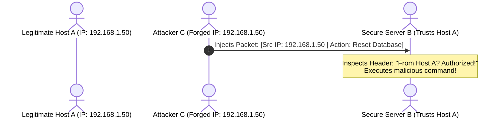
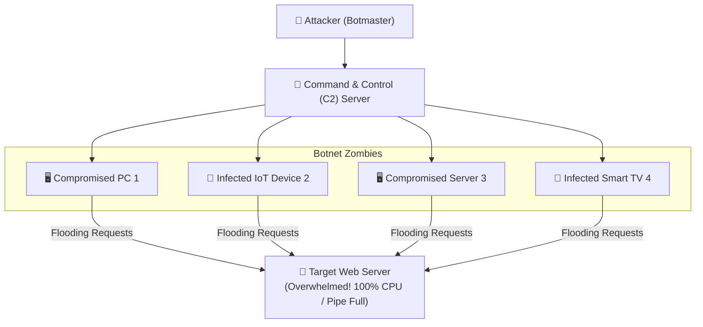

# 🚨 Chapter 02: Network Attacks and Defense Mechanisms

---

## 1. Overview (Topic Introduction)
Because early Internet protocols operated on implicit trust without built-in cryptographic authentication, modern networks are constantly vulnerable to malicious actors. Network attacks range from stealthy passive observation to active packet manipulation and massive distributed floods. Securing modern infrastructure requires an in-depth understanding of how attackers execute **Packet Sniffing**, **IP Spoofing**, and **Denial of Service (DoS/DDoS)** attacks, and how perimeter defenses like **Firewalls** mitigate these threats.

---

## 2. Learning Objectives
After studying this chapter, you will be able to:
* Categorize network attacks into **Passive Attacks** (e.g., Sniffing) and **Active Attacks** (e.g., Spoofing, DoS).
* Explain how **Packet Sniffing** works using Network Interface Cards (NIC) in promiscuous mode.
* Trace the mechanics of **IP Spoofing** and explain why IP's stateless nature facilitates impersonation.
* Analyze the anatomy of **Denial-of-Service (DoS)** and **Distributed DoS (DDoS)** attacks orchestrated via botnets.
* Understand the architecture and filtering rules of **Packet-Filtering Firewalls** and **Stateful Inspection Firewalls**.

---

## 3. Core Concepts

### 3.1 Passive vs. Active Attacks
* **Passive Attacks:** The attacker does not modify data streams or disrupt network operation; they secretly listen to and record transmitted traffic.
  - *Primary Example:* **Packet Sniffing / Wiretapping**.
  - *Defense:* End-to-end encryption (TLS, HTTPS, SSH, IPSec).
* **Active Attacks:** The attacker injects false packets, alters data in transit, impersonates legitimate hosts, or disables services.
  - *Examples:* **IP Spoofing**, **Man-in-the-Middle (MitM)**, **DoS / DDoS**.
  - *Defense:* Cryptographic authentication, firewalls, intrusion detection systems (IDS/IPS).

---

### 3.2 Anatomy of Key Network Attacks

#### 1. Packet Sniffing (Eavesdropping):
* *Mechanism:* In broadcast media (Ethernet hubs, unencrypted WiFi), every frame passes by every connected NIC. Normally, a host's NIC discards frames whose destination MAC does not match its own.
* In **Promiscuous Mode**, the NIC passes *all* incoming frames to the operating system regardless of the destination address.
* Tools like Wireshark and `tcpdump` intercept unencrypted credentials, emails, and sensitive data.

#### 2. IP Spoofing (Impersonation):
* *Mechanism:* The standard IPv4 header contains a 32-bit `Source IP Address` field. However, standard IP software does not verify whether the sender legitimately owns that IP address!
* An attacker can craft raw IP packets with a forged source address (e.g., inserting the IP address of an authorized server `A`) to trick destination `B` into trusting the payload.

#### 3. Denial of Service (DoS) & Distributed DoS (DDoS):
* *DoS:* A single attacking machine overwhelms a target server’s processing capacity, memory, or link bandwidth by sending a deluge of bogus requests (e.g., SYN flood, Ping flood).
* *DDoS (Distributed):* A single attacker (Botmaster) controls thousands of malware-infected compromised devices (**Botnet / Zombies**). The attacker commands the entire botnet to simultaneously target a single server from thousands of distinct IP addresses across the globe, rendering IP-based blacklisting virtually impossible.

---

### 3.3 Defense: Firewalls
A **Firewall** acts as a perimeter barrier between an untrusted external network (Internet) and a trusted internal private network (LAN):
* **Packet-Filtering Firewall (Stateless):** Inspects individual packets independently at Layer 3 and Layer 4 based on:
  - Source IP and Destination IP
  - Source Port and Destination Port
  - Protocol type (TCP, UDP, ICMP)
* **Stateful Inspection Firewall:** Tracks the state of active TCP connections (e.g., SYN sent, established, closed). Only permits incoming packets that belong to an established session initiated by an internal host.

---

## 4. Visual Explanation (Diagrams)

### 4.1 Packet Sniffing Diagram (From CN Class Note 1, Page 18)
```
Host A ─────────────[ Switch / Link ]─────────────> Host B
                           │ (Copies Message M)
                           ▼
                    [ Attacker C ] (Sniffing NIC in Promiscuous Mode)
```

### 4.2 IP Spoofing Diagram


### 4.3 Botnet DDoS Coordinated Flood


---

## 5. Step-by-Step Attack Mitigation Workflow
1. **At Ingress Router:** Deploy **Ingress Filtering (BCP 38)** to verify that outbound packets leaving a network have source IPs belonging strictly to that network's allocated prefix, stopping spoofing at the boundary.
2. **At Perimeter Firewall:** Block all unsolicited inbound connection requests (drop `TCP SYN` packets targeting internal hosts).
3. **At Server Infrastructure:**
   - Deploy **SYN Cookies** to defend against TCP SYN flood attacks without exhausting kernel connection tables.
   - Route traffic through Content Delivery Networks (CDN) and DDoS Scrubbing Centers (e.g., Cloudflare, Akamai) that absorb multi-terabit volumetric floods.

---

## 6. Real-Life Example
* **DDoS Analogy (Flash Mob Blocking a Bank Door):** If one troublemaker blocks a bank door (**DoS**), security guards quickly escort them away. But if a criminal rings up 500 unsuspecting strangers from around the city to all run into the bank lobby at the exact same second asking silly questions (**DDoS via Botnet**), genuine customers cannot enter, and the bank shuts down.

---

## 7. Practical Implementation (Python Packet Inspection & Filtering)

```python
class Packet:
    def __init__(self, src_ip, dst_ip, src_port, dst_port, protocol, payload=""):
        self.src_ip = src_ip
        self.dst_ip = dst_ip
        self.src_port = src_port
        self.dst_port = dst_port
        self.protocol = protocol
        self.payload = payload

class StatelessFirewall:
    def __init__(self, default_policy="DROP"):
        self.rules = []
        self.default_policy = default_policy

    def add_rule(self, action, src_ip="*", dst_port="*", protocol="*"):
        self.rules.append({
            'action': action,
            'src_ip': src_ip,
            'dst_port': dst_port,
            'protocol': protocol
        })

    def inspect(self, pkt):
        for rule in self.rules:
            ip_match = (rule['src_ip'] == "*" or rule['src_ip'] == pkt.src_ip)
            port_match = (rule['dst_port'] == "*" or rule['dst_port'] == pkt.dst_port)
            proto_match = (rule['protocol'] == "*" or rule['protocol'] == pkt.protocol)

            if ip_match and port_match and proto_match:
                return rule['action']
        return self.default_policy

# Setup Firewall: Allow Web traffic (Port 80/443), drop others
fw = StatelessFirewall(default_policy="DROP")
fw.add_rule(action="ALLOW", dst_port=80, protocol="TCP")
fw.add_rule(action="ALLOW", dst_port=443, protocol="TCP")

# Test Packets
p_valid = Packet("192.168.1.10", "103.4.5.6", 54321, 80, "TCP")
p_malicious_telnet = Packet("192.168.1.10", "103.4.5.6", 54321, 23, "TCP")

print("Web Packet Status   :", fw.inspect(p_valid))           # ALLOW
print("Telnet Packet Status:", fw.inspect(p_malicious_telnet)) # DROP
```

---

## 8. Common Mistakes & Pitfalls
> [!WARNING]
> * **Believing Firewalls Prevent Sniffing:** Firewalls guard network perimeters; they CANNOT prevent packet sniffing occurring inside an unencrypted internal LAN! Only transport/application layer encryption (TLS/HTTPS) protects against sniffing.
> * **Assuming All DoS Attacks are Volumetric:** Some DoS attacks consume very little bandwidth by exploiting software vulnerabilities (e.g., "Ping of Death", Slowloris HTTP attack, or TCP SYN exhaustion).

---

## 9. Practice Problems & Exam Walkthroughs

### 📝 Problem 1 (From CN Class Note 1, Page 18 & Midterm 261)
**Question:** Compare Packet Sniffing and IP Spoofing in terms of attack category (active vs. passive) and the primary cryptographic defenses used to nullify them.

**Step-by-Step Solution:**
1. **Packet Sniffing:**
   - *Category:* Passive Attack (does not modify data; silently intercepts frames).
   - *Primary Defense:* **End-to-End Encryption (TLS / HTTPS / SSH)**. Even if an eavesdropper captures frames in promiscuous mode, the content appears as random high-entropy ciphertext.
2. **IP Spoofing:**
   - *Category:* Active Attack (crafts and injects forged packet headers).
   - *Primary Defense:* **Cryptographic Authentication (Digital Signatures / HMAC)** and network-layer **Ingress Filtering (RFC 2827 / BCP 38)** to discard packets with spoofed source addresses.

---

## 10. Knowledge Check (MCQ & Quizzes)

#### Q1. When a network adapter is switched into "Promiscuous Mode", what behavior changes?
- [ ] A) It transmits data at double bandwidth.
- [ ] B) It automatically encrypts all outbound frames.
- [x] C) It passes all frames seen on the wire to the OS, regardless of destination MAC address.
- [ ] D) It drops all broadcast frames.
*Explanation:* Promiscuous mode bypasses the hardware MAC address filter, forwarding every observed frame to packet capturing software.

#### Q2. What makes a Distributed Denial of Service (DDoS) attack significantly harder to mitigate than a standard DoS attack?
- [ ] A) DDoS attacks use higher encryption keys.
- [x] B) Traffic originates from thousands of distinct, legitimate-looking global IP addresses in a botnet.
- [ ] C) DDoS packets do not contain IP headers.
- [ ] D) Firewalls cannot inspect TCP packets.
*Explanation:* Because requests come from thousands of distributed compromised machines, simple IP-based blacklisting drops traffic from innocent third parties and fails to stop the flood.

---

#### Q3. What makes a Distributed Denial of Service (DDoS) attack significantly harder to defend against compared to a standard DoS attack?
- [ ] A) DDoS uses encrypted traffic that firewalls cannot inspect
- [ ] B) DDoS attacks only target Layer 7 (Application) so Layer 3 firewalls are ineffective
- [x] C) DDoS originates from thousands of compromised hosts (botnet) simultaneously, making it impossible to block by simply blacklisting a single source IP
- [ ] D) DDoS attacks are undetectable until the server crashes
*Explanation:* In a **DoS attack**, traffic originates from a single source — blocking that IP stops the attack. In a **DDoS attack**, a **botnet** of thousands of compromised machines (zombies) floods the target simultaneously from diverse, legitimate-looking IPs distributed globally. Rate limiting and IP blacklisting become ineffective at scale.

#### Q4. How does IP Spoofing enable a Reflective DDoS attack?
- [ ] A) The attacker directly sends traffic to the victim using the victim's own IP
- [x] B) The attacker sends requests to legitimate servers with the victim's IP as the spoofed source address; the servers send amplified responses to the victim
- [ ] C) IP Spoofing allows the attacker to intercept and replay packets
- [ ] D) IP Spoofing is only possible on IPv6 networks, not IPv4
*Explanation:* In a **Reflective DDoS (amplification attack)**: 1) Attacker sends DNS/NTP requests to open servers with the **victim's IP as the spoofed source address**. 2) Servers send amplified responses (DNS response is 10-100× larger than request) to the **victim's IP**. 3) Victim receives massive unsolicited traffic. The attacker's real IP is hidden; legitimate servers act as involuntary amplifiers.

#### Q5. A stateful firewall is superior to a packet filter firewall primarily because:
- [ ] A) It operates faster by processing headers without inspecting the payload
- [x] B) It tracks the state of active TCP connections and only allows packets that belong to an established, legitimate connection — blocking unsolicited inbound packets
- [ ] C) It can decrypt TLS-encrypted traffic for deep inspection
- [ ] D) It operates at Layer 7 (Application layer) while packet filters only work at Layer 4
*Explanation:* A **stateful firewall** maintains a **connection state table** tracking all established TCP connections. An inbound packet is only allowed if it corresponds to a connection that was **initiated from inside the network**. This blocks port scans and unsolicited SYN packets that a simple packet filter (which only inspects individual packets in isolation) might permit based on port number alone.

#### Q6. What is the difference between a worm and a virus in network security context?
- [ ] A) Worms are more dangerous because they encrypt files; viruses only delete files
- [x] B) A worm self-propagates autonomously across networks without requiring a host file or user interaction; a virus requires attaching to a legitimate executable and needs user action to spread
- [ ] C) There is no practical difference — the terms are used interchangeably
- [ ] D) Worms only affect servers; viruses only affect end-user devices
*Explanation:* A **virus** attaches itself to a legitimate program or file and spreads when the infected file is executed or shared. A **worm** is self-contained and self-replicating — it autonomously scans for and exploits vulnerabilities on networked hosts without user interaction. The Morris Worm (1988) demonstrated this by scanning for Unix vulnerabilities and self-propagating across ARPANET.


## 11. Summary & Revision Sheet
* **Sniffing:** Passive observation $\to$ Prevented by **TLS / HTTPS Encryption**.
* **Spoofing:** Forging Source IP $\to$ Prevented by **Ingress Filtering & Cryptographic Signatures**.
* **DoS/DDoS:** Exhausting resources / bandwidth $\to$ Mitigated by **Firewalls, SYN Cookies, CDNs**.
* **Stateless vs. Stateful Firewalls:** Stateful firewalls track TCP three-way handshake states, rejecting unsolicited incoming packets.

---

---

## 🔗 Related Topics

> Connect your understanding — explore these closely related chapters:

- 📖 [CIA Triad & Cryptography](01-cia-triad-and-cryptography.md) — Cryptographic defenses against these attacks
- 📖 [DNS](../03-application-layer-and-protocols/04-dns-domain-name-system.md) — DNS amplification attacks and DNS cache poisoning
- 📖 [Network Layer Overview](../05-network-layer-and-routing/01-network-layer-overview.md) — IP-layer attacks (spoofing, DDoS, sniffing)

## 12. References & Further Reading
* RFC 2827: *Network Ingress Filtering: Defeating Denial of Service Attacks which employ IP Source Address Spoofing*.
* Kurose & Ross, Chapter 1.6: *Networks Under Attack*.


---

<div align="center">

| [⬅️ Previous](01-cia-triad-and-cryptography.md) | [🏠 Module Index](README.md) | [Next ➡️](../03-application-layer-and-protocols/README.md) |
|:---:|:---:|:---:|

</div>
