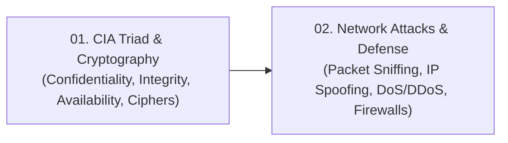

# 🔐 Module 02: Network Security Fundamentals

Welcome to **Module 02: Network Security Fundamentals**. The Internet was originally conceived in an academic environment among mutually trusting researchers. As a result, security was not built into core IP protocols from inception. This module covers the foundational principles of the **CIA Triad**, cryptographic techniques to secure communications, the anatomy of major network attacks (**Sniffing, Spoofing, and DDoS**), and baseline defense mechanisms such as firewalls.

---

## 🗺️ Module Learning Roadmap

---

## 📚 Chapter Breakdown

| Chapter File | Topics Covered | Key Visualizations | Real-World & Math Focus |
|---|---|---|---|
| **[01-cia-triad-and-cryptography.md](./01-cia-triad-and-cryptography.md)** | CIA Triad definitions, Symmetric vs Asymmetric encryption, Caesar Cipher ($K = 3$), Message Integrity, Digital Signatures | CIA Venn diagram, Encryption/Decryption pipeline, Digital Signature verification flow | Substitution cipher mathematics, Public/Private key signing mechanics |
| **[02-network-attacks-and-defense.md](./02-network-attacks-and-defense.md)** | Passive vs Active Attacks, Packet Sniffing (Promiscuous mode), IP Spoofing, Denial of Service (DoS) and Distributed DoS (DDoS) | Sniffing tap diagram, Spoofed header injection flow, Botnet DDoS coordinated flood | Mitigation strategies, Stateful inspection firewalls, Ingress packet filtering |

---

## 🎯 Key Competencies Acquired

By completing this module, you will be able to:
1. Formulate network security requirements using the **Confidentiality, Integrity, and Availability (CIA)** triad.
2. Differentiate between encryption (achieving Confidentiality) and digital signatures/hashes (achieving Integrity).
3. Trace how a packet sniffer intercepts unencrypted traffic on shared media.
4. Explain how IP address spoofing bypasses simple authentication mechanisms.
5. Contrast localized single-source DoS attacks with botnet-orchestrated Distributed Denial of Service (DDoS) floods.

