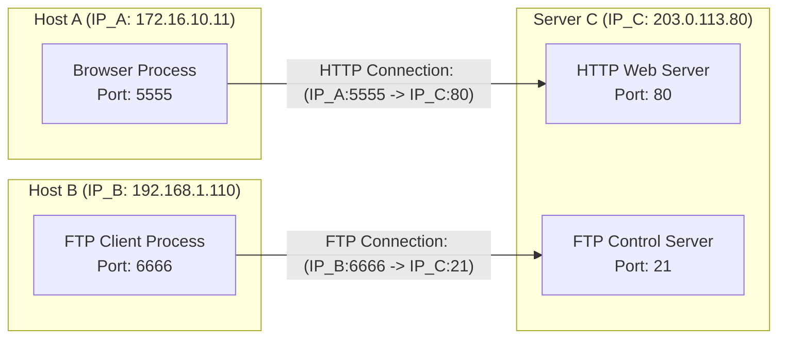

# 🚪 Chapter 01: Application Architectures, Sockets, and Addressing

---

## 1. Overview (Topic Introduction)
At the Application Layer, network applications consist of programs running on separate end systems that communicate with each other over the network. Developing a network application requires choosing an architectural model (**Client-Server** or **Peer-to-Peer**) and interfacing with the operating system’s transport layer protocols via the **Socket API**.

---

## 2. Learning Objectives
After studying this chapter, you will be able to:
* Contrast the **Client-Server Architecture** with the **Peer-to-Peer (P2P) Architecture**.
* Understand the concept of **P2P Self-Scalability**.
* Define what a **Socket** is and how it functions as the software interface ("door") between application processes and the transport protocol.
* Map process-to-process communication using the **(IP Address, Port Number)** tuple.
* Trace concurrent client connections multiplexed into different service ports on a single host.

---

## 3. Core Concepts

### 3.1 Network Application Architectures

```
     Client-Server Architecture                        Peer-to-Peer (P2P) Architecture
          ┌──────────────┐                                ┌─────────┐
          │ Always-on    │                                │  Peer   │◀────────┐
          │ Server Host  │                                └────┬────┘         │
          │ (Fixed IP)   │                                     │              │
          └───┬───┬───┬──┘                                     ▼              ▼
       ┌──────┘   │   └──────┐                            ┌─────────┐    ┌─────────┐
       ▼          ▼          ▼                            │  Peer   │───▶│  Peer   │
  ┌────────┐ ┌────────┐ ┌────────┐                        └─────────┘    └─────────┘
  │ Client │ │ Client │ │ Client │                        Arbitrary, dynamically connected
  │  (PC)  │ │ (Phone)│ │(Laptop)│                        peers with changing IP addresses
  └────────┘ └────────┘ └────────┘                        (Self-Scalable!)
```

#### 1. Client-Server Architecture:
* **Server:** Always-on host with a permanent, well-known IP address. Handles requests from many client hosts (e.g., Google Web Search, Netflix, Web Servers).
  - *Bottleneck:* If traffic surges dramatically, the central server or its data center bandwidth can become overwhelmed.
* **Clients:** End systems (browsers, mobile apps) that initiate communication. Clients do not communicate directly with one another; they communicate strictly through the central server. Clients often have dynamic IP addresses assigned on boot.

#### 2. Peer-to-Peer (P2P) Architecture:
* No dedicated always-on central server.
* Arbitrary pairs of connected end systems, called **Peers**, communicate directly with one another.
* **Self-Scalability:** As new peers join the network to download files, they simultaneously upload file chunks to other peers. Each new peer brings new service capacity as well as new service demand!
* *Examples:* BitTorrent, Skype (originally), Bitcoin blockchain.

---

### 3.2 What is a Socket?
* A process on one host sends messages into, and receives messages from, the network through a software interface called a **Socket**.
* **The "Door" Analogy:** A process is like a house, and its socket is its front door. When a process wants to send a message to another process on another host, it pushes the message out its socket door into the street (transport layer). The underlying network infrastructure carries the message to the destination house's door (destination socket).

```
┌────────────────────────────────────────────────────────┐
│  Application Layer (Process: Chrome Browser / Python)  │
│                                                        │
│                  ┌─────────────────┐                   │
│                  │  SOCKET (Door)  │                   │
└──────────────────┴────────┬────────┴───────────────────┘
                            │ API Control Boundary
┌───────────────────────────┴────────────────────────────┐
│  Transport Layer Protocol (TCP / UDP)                  │
│  (Managed by Operating System Kernel)                  │
└────────────────────────────────────────────────────────┘
```

---

### 3.3 Addressing Processes: IP + Port
An IP address alone is insufficient to send a packet to a program because a single computer runs multiple network programs simultaneously (e.g., Web browser, Spotify, Zoom, Discord).
* **IP Address (32-bit):** Identifies the host computer on the global Internet. (Like the postal address of a multi-story apartment building).
* **Port Number (16-bit, values 0 to 65535):** Identifies the specific receiving application process inside that host computer. (Like the apartment room number!).
* **Socket Address:** The unique combination of `(IP Address : Port Number)`.

---

## 4. Visual Explanation (Diagrams)

### 4.1 Concurrent Socket Mapping (From CN Class Note 1, Page 21: Mid 252 Q2(b))


---

## 5. Step-by-Step Socket Establishment
1. **Server Binds & Listens:** The server creates a socket, binds it to a well-known port (e.g., Port 80), and listens for incoming connections.
2. **Client Initiates Connection:** The client creates a socket and asks the operating system for a temporary, dynamic **ephemeral port** (e.g., Port 5555).
3. **Transport Handshake:** The client's OS initiates a TCP 3-way handshake targeting `(Server_IP : 80)`.
4. **Accept & Communication:** Once connected, both processes read and write byte streams through their respective socket descriptors.

---

## 6. Real-Life Example
* **Office Building Analogy:** 
  - To reach the HR Department at Google HQ:
  - `1600 Amphitheatre Pkwy, Mountain View, CA` = **IP Address** (locates the building).
  - `Suite #402 (HR Desk)` = **Port Number** (locates the specific department).
  - The mailbox slot on the door of Suite 402 = **Socket** (the interface through which letters are dropped and retrieved).

---

## 7. Practical Implementation (Python TCP Socket Client & Server)

### Server (`server.py`):
```python
import socket

server_ip = "127.0.0.1"
server_port = 8080

# 1. Create a TCP socket (AF_INET = IPv4, SOCK_STREAM = TCP)
with socket.socket(socket.AF_INET, socket.SOCK_STREAM) as s:
    s.bind((server_ip, server_port))
    s.listen(5)
    print(f"[*] Server listening on {server_ip}:{server_port}")

    conn, addr = s.accept()
    with conn:
        print(f"[+] Connection accepted from {addr}")
        data = conn.recv(1024)
        print(f"[*] Received message: {data.decode('utf-8')}")
        conn.sendall(b"HTTP/1.1 200 OK\r\n\r\nHello from Python Server!")
```

### Client (`client.py`):
```python
import socket

server_ip = "127.0.0.1"
server_port = 8080

with socket.socket(socket.AF_INET, socket.SOCK_STREAM) as s:
    s.connect((server_ip, server_port))
    s.sendall(b"GET / HTTP/1.1\r\nHost: localhost\r\n\r\n")
    response = s.recv(1024)
    print("[*] Server Response:\n", response.decode('utf-8'))
```

---

## 8. Common Mistakes & Pitfalls
> [!WARNING]
> * **Assuming Port Numbers Must Match:** A client connecting from Port 5555 to a server's Port 80 is completely normal. The source port and destination port are independent 16-bit integers!
> * **Confusing Sockets with Ports:** A port is a 16-bit number; a socket is the software endpoint object instantiated by the OS that binds a process to a specific port and IP.

---

## 9. Practice Problems & Exam Walkthroughs

### 📝 Problem 1 (From CN Class Note 1, Page 21: Midterm 252 Q2(b))
**Question:** Host A has IP address `IP_A` and runs a web browser using port `5555`. Host B has IP address `IP_B` and runs an FTP client using port `6666`. Both connect simultaneously to Server C with IP address `IP_C`, which runs a Web service (port 80) and an FTP service (port 21).
1. Specify the source and destination socket addresses `(IP, Port)` for the connection from Host A to Server C.
2. Specify the source and destination socket addresses for the connection from Host B to Server C.
3. How does Server C differentiate between the incoming packets?

**Step-by-Step Solution:**
1. **Connection 1 (Host A $\to$ Server C Web Service):**
   - Source Socket: `(IP_A : 5555)`
   - Destination Socket: `(IP_C : 80)`
2. **Connection 2 (Host B $\to$ Server C FTP Service):**
   - Source Socket: `(IP_B : 6666)`
   - Destination Socket: `(IP_C : 21)`
3. **Differentiation at Server C:**
   - Server C’s transport layer inspects the destination port in the TCP header:
     - Packets arriving with destination port `80` are directed to the HTTP daemon process socket.
     - Packets arriving with destination port `21` are directed to the FTP daemon process socket.

---

## 10. Knowledge Check (MCQ & Quizzes)

#### Q1. Which statement best describes the self-scalability property of P2P architectures?
- [ ] A) P2P networks require more expensive routers.
- [x] B) Peers add service capacity by uploading chunks at the same time they create demand by downloading.
- [ ] C) P2P does not require TCP/IP protocol support.
- [ ] D) P2P servers have static IP addresses.
*Explanation:* In P2P, every consumer is also a producer, meaning system capacity scales naturally with the user base.

#### Q2. What is the standard well-known port number for secure HTTPS web traffic?
- [ ] A) 21
- [ ] B) 25
- [ ] C) 80
- [x] D) 443
*Explanation:* Standard HTTP uses port 80; TLS-encrypted HTTPS uses port 443.

---

## 11. Summary & Revision Sheet
* **Client-Server:** Centralized, always-on server, clients initiate communication.
* **Peer-to-Peer:** Distributed, self-scaling, no central server required.
* **Socket:** Software interface door connecting application processes to OS transport protocols.
* **Addressing:** `(IP : Port)` uniquely identifies an application process endpoint on the Internet.

---

---

## 🔗 Related Topics

> Connect your understanding — explore these closely related chapters:

- 📖 [HTTP & Web Caching](02-http-and-web-caching.md) — The dominant Client-Server application protocol
- 📖 [DNS](04-dns-domain-name-system.md) — Application-layer infrastructure that enables hostname resolution
- 📖 [Transport Multiplexing](../04-transport-layer-and-reliability/01-transport-multiplexing.md) — Socket APIs that application layer uses

## 12. References & Further Reading
* Kurose & Ross, Chapter 2.1: *Principles of Network Applications*.
* Stevens, W. R. *Unix Network Programming, Volume 1: The Sockets Networking API*.


---

<div align="center">

| [⬅️ Previous](../02-network-security-fundamentals/README.md) | [🏠 Module Index](README.md) | [Next ➡️](02-http-and-web-caching.md) |
|:---:|:---:|:---:|

</div>
