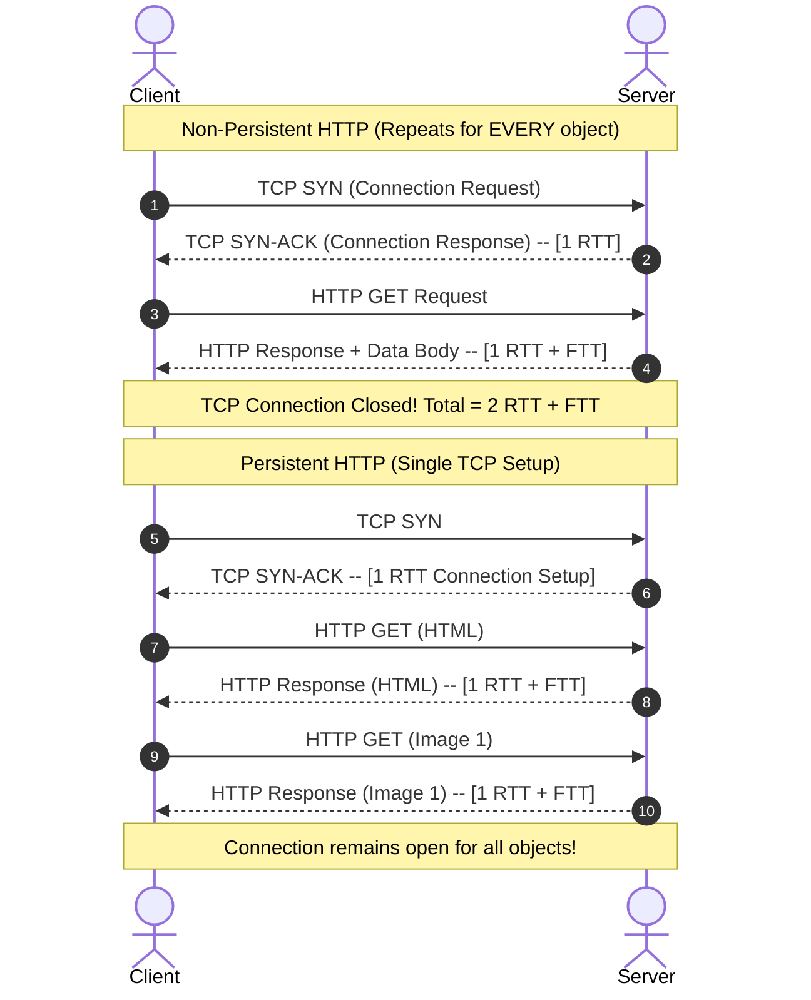

# 🌐 Chapter 02: HTTP and Web Caching Mechanics

---

## 1. Overview (Topic Introduction)
The **HyperText Transfer Protocol (HTTP)** is the network backbone of the World Wide Web. Operating over TCP (port 80 for HTTP, port 443 for HTTPS), HTTP defines how Web clients request Web pages and how Web servers transfer them. A deep understanding of HTTP requires analyzing the performance impact of **Non-Persistent vs. Persistent Connections**, session management via **Cookies**, and network bandwidth conservation via **Web Caching (Proxy Servers)**.

---

## 2. Learning Objectives
After studying this chapter, you will be able to:
* Explain why HTTP is fundamentally a **stateless protocol** and how **Cookies** maintain state across transactions.
* Contrast the performance of **Non-Persistent HTTP (HTTP/1.0)** with **Persistent HTTP (HTTP/1.1)**.
* Calculate exact web page download times involving base HTML and multiple embedded objects (CSS, images).
* Analyze how **Web Caching / Forward Proxies** reduce access link utilization, propagation delay, and server load.
* Understand the **Conditional GET** header (`If-Modified-Since`) and the `304 Not Modified` response code.

---

## 3. Core Concepts

### 3.1 HTTP Overview & Characteristics
* **Port:** 80 (standard HTTP) over reliable TCP.
* **Client-Server Model:** Web browser (Client) issues `HTTP Request`; Web server replies with `HTTP Response`.
* **Statelessness:** An HTTP server maintains **no information** about past client requests. If a client requests the same web page twice in two seconds, the server treats the second request completely independently.
* **Cookies (Making HTTP Stateful):** To support shopping carts, logins, and personalization, HTTP uses cookies:
  1. Server sends `Set-cookie: 1678` in HTTP response header.
  2. Client browser stores the cookie on disk.
  3. In subsequent requests to that domain, client sends `Cookie: 1678` in the request header.

---

### 3.2 Non-Persistent vs. Persistent HTTP

#### 1. Non-Persistent HTTP (HTTP/1.0):
* A **brand-new TCP connection** is opened and closed for **each and every individual web object** (HTML file, CSS, JavaScript, image).
* For each object:
  - $1\text{ RTT}$ to establish the TCP 3-way handshake.
  - $1\text{ RTT}$ to send the HTTP request and receive the first bytes of the response.
  - $\text{FTT}$ (File Transmission Time) to transmit the file bytes.
* **Total Time per Object:**
  $$\text{Time}_{\text{object}} = 2\text{RTT} + \text{FTT}$$
* **Total Download Time for $N$ objects (Sequential):**
  $$\text{Total Time}_{\text{Non-Persistent}} = \sum_{i=1}^{N} (2\text{RTT}_i + \text{FTT}_i)$$

#### 2. Persistent HTTP (HTTP/1.1):
* The server leaves the TCP connection open after sending a response. Subsequent requests and responses between the same client and server are sent over the **same existing connection**.
* The initial connection setup takes $1\text{ RTT}$. Each subsequent object requires only $1\text{ RTT} + \text{FTT}$!
* **Total Download Time for $N$ objects (Persistent without pipelining):**
  $$\text{Total Time}_{\text{Persistent}} = 1\text{RTT}_{\text{connection}} + \sum_{i=1}^{N} (1\text{RTT}_i + \text{FTT}_i)$$
* **File Transmission Time (FTT) Formula:**
  $$\text{FTT} = \frac{\text{Object Size (bits)}}{\text{Bandwidth (bps)}} = \frac{\text{Object Size (Bytes)} \times 8}{\text{Link Speed (bps)}}$$

---

### 3.3 Web Caching (Proxy Servers)
A **Web Cache (Proxy Server)** is a network entity that satisfies HTTP requests on behalf of an origin Web server:
1. Browser is configured to send all HTTP requests to the local proxy cache.
2. If the requested object is in the cache (**Cache Hit**): The proxy immediately returns the object to the client. (Extremely low latency!).
3. If not in the cache (**Cache Miss**): The proxy opens a connection to the origin server, retrieves the object, saves a local copy, and delivers it to the client.

#### Conditional GET (`If-Modified-Since`):
To prevent serving stale cached content, the proxy issues an HTTP GET with the header:
```http
If-Modified-Since: Wed, 21 Oct 2026 07:28:00 GMT
```
* If unchanged: Origin server responds with `HTTP/1.1 304 Not Modified` (no message body!). Saves bandwidth!
* If modified: Origin server responds with `HTTP/1.1 200 OK` and sends the updated file body.

---

## 4. Visual Explanation (Diagrams)

### 4.1 Non-Persistent vs. Persistent HTTP Timing Ladder (From CN Class Note 1, Page 22)


### 4.2 Web Cache Architecture (From CN Class Note 1, Page 24)
```mermaid
graph LR
    subgraph Local LAN (Fast / Low RTT)
        C1["Client 1"]
        C2["Client 2"]
        Proxy["💾 Web Cache / Proxy Server"]
        C1 <--> Proxy
        C2 <--> Proxy
    end

    subgraph Internet (Slow / High RTT)
        Proxy <=== High Delay Bottleneck Link ===> Origin["🏢 Origin Web Server"]
    end
```

---

## 5. Step-by-Step Retrieval Walkthrough
Tracing a web page consisting of `index.html` referencing 2 CSS files and 8 Images:
1. **Under Non-Persistent HTTP:**
   - 1 TCP connection for `index.html` ($2\text{RTT} + \text{FTT}_{\text{html}}$).
   - 2 sequential TCP connections for CSS ($2 \times (2\text{RTT} + \text{FTT}_{\text{css}})$).
   - 8 sequential TCP connections for Images ($8 \times (2\text{RTT} + \text{FTT}_{\text{img}})$).
   - Total = 11 separate TCP handshakes and teardowns!
2. **Under Persistent HTTP:**
   - Single TCP connection created ($1\text{ RTT}$).
   - `index.html` fetched ($1\text{ RTT} + \text{FTT}_{\text{html}}$).
   - Both CSS fetched over same connection ($2 \times (1\text{ RTT} + \text{FTT}_{\text{css}})$).
   - All 8 images fetched over same connection ($8 \times (1\text{ RTT} + \text{FTT}_{\text{img}})$).
   - Massive time savings!

---

## 6. Real-Life Example
* **Grocery Store Trip Analogy:**
  - **Non-Persistent HTTP:** You go to the supermarket, drive through the parking gate, enter the store, buy *one apple*, drive home, and park. Then you realize you need milk, drive all the way back, pay the gate, buy milk, and drive home.
  - **Persistent HTTP:** You drive to the supermarket once, enter the store, and buy the apple, milk, bread, and eggs in one single visit before driving home.

---

## 7. Practical Implementation (Python HTTP Download Time Calculator)

```python
def calculate_http_time(rtt_s, objects, link_bandwidth_bps, persistent=False):
    """
    objects: list of dicts with {'name': str, 'size_bytes': int, 'count': int}
    """
    total_time = 0.0

    if persistent:
        # 1 RTT initial connection setup
        total_time += rtt_s

        for obj in objects:
            ftt = (obj['size_bytes'] * 8) / link_bandwidth_bps
            time_per_item = rtt_s + ftt
            total_time += obj['count'] * time_per_item
    else:
        for obj in objects:
            ftt = (obj['size_bytes'] * 8) / link_bandwidth_bps
            time_per_item = 2 * rtt_s + ftt
            total_time += obj['count'] * time_per_item

    return total_time * 1000 # Return in milliseconds

# Test Case matching Midterm 261 Q2(b) & Class Note 1, Page 7 & 23:
# RTT = 0.2 ms = 0.0002 s, Bandwidth = 1 Gbps = 1e9 bps
# HTML: 100 KB = 100 * 10^3 Bytes
# CSS : 2 files, 150 KB each
# Image: 8 files, 2 MB each = 2 * 10^6 Bytes
web_objects = [
    {'name': 'HTML',  'size_bytes': 100e3, 'count': 1},
    {'name': 'CSS',   'size_bytes': 150e3, 'count': 2},
    {'name': 'Image', 'size_bytes': 2e6,   'count': 8}
]

t_non_persistent = calculate_http_time(0.0002, web_objects, 1e9, persistent=False)
t_persistent     = calculate_http_time(0.0002, web_objects, 1e9, persistent=True)

print(f"Non-Persistent Total Time: {t_non_persistent:.2f} ms")
print(f"Persistent Total Time    : {t_persistent:.2f} ms")
```

---

## 8. Common Mistakes & Pitfalls
> [!WARNING]
> * **Forgetting the Initial TCP RTT in Persistent HTTP:** Remember the $+1\text{ RTT}$ at the beginning for the connection setup!
> * **Unit Conversion Errors:** When computing $\text{FTT} = \frac{\text{Bytes} \times 8}{\text{bps}}$, ensure that $1\text{ Gbps} = 10^9\text{ bps}$, $1\text{ MB} = 10^6\text{ Bytes}$, and $\text{RTT} = 0.2\text{ ms} = 0.0002\text{ seconds}$.

---

## 9. Practice Problems & Exam Walkthroughs

### 📝 Problem 1 (From CN Class Note 1, Page 7 & 23: Midterm 261 Q2(b))
**Question:** A client is downloading a web page consisting of:
* $1\text{ base HTML file}$ of size $100\text{ KB}$ ($100 \times 10^3\text{ Bytes}$).
* $2\text{ CSS files}$ of size $150\text{ KB}$ each ($150 \times 10^3\text{ Bytes}$).
* $8\text{ Image files}$ of size $2\text{ MB}$ each ($2 \times 10^6\text{ Bytes}$).
Given link bandwidth $R = 1\text{ Gbps} = 10^9\text{ bps}$ and $\text{RTT} = 0.2\text{ ms}$. Calculate total retrieval time for:
1. Non-persistent HTTP
2. Persistent HTTP (without pipelining)

**Step-by-Step Solution:**
1. **Calculate FTT for each object type:**
   * $\text{FTT}_{\text{HTML}} = \frac{100 \times 10^3 \times 8}{10^9} = \frac{800,000}{10^9} = 0.0008\text{ s} = \mathbf{0.8\text{ ms}}$
   * $\text{FTT}_{\text{CSS}} = \frac{150 \times 10^3 \times 8}{10^9} = \frac{1,200,000}{10^9} = 0.0012\text{ s} = \mathbf{1.2\text{ ms}}$
   * $\text{FTT}_{\text{Image}} = \frac{2 \times 10^6 \times 8}{10^9} = \frac{16,000,000}{10^9} = 0.016\text{ s} = \mathbf{16.0\text{ ms}}$

2. **Case 1: Non-Persistent HTTP ($2\text{RTT} + \text{FTT}$ per object):**
   * HTML: $(2 \times 0.2) + 0.8 = 0.4 + 0.8 = 1.2\text{ ms}$
   * 2 CSS: $2 \times [(2 \times 0.2) + 1.2] = 2 \times [0.4 + 1.2] = 2 \times 1.6 = 3.2\text{ ms}$
   * 8 Images: $8 \times [(2 \times 0.2) + 16] = 8 \times [0.4 + 16] = 8 \times 16.4 = 131.2\text{ ms}$
   $$\text{Total Time} = 1.2 + 3.2 + 131.2 = \mathbf{135.6\text{ ms}}$$

3. **Case 2: Persistent HTTP ($1\text{RTT}_{\text{conn}} + \sum(1\text{RTT} + \text{FTT})$):**
   * TCP Connection Setup: $1\text{ RTT} = 0.2\text{ ms}$
   * HTML: $0.2 + 0.8 = 1.0\text{ ms}$
   * 2 CSS: $2 \times (0.2 + 1.2) = 2 \times 1.4 = 2.8\text{ ms}$
   * 8 Images: $8 \times (0.2 + 16) = 8 \times 16.2 = 129.6\text{ ms}$
   $$\text{Total Time} = 0.2 + 1.0 + 2.8 + 129.6 = \mathbf{133.6\text{ ms}}$$

---

## 10. Knowledge Check (MCQ & Quizzes)

#### Q1. What HTTP status code is returned when a cached object on a proxy is still fresh and unmodified?
- [ ] A) `200 OK`
- [ ] B) `404 Not Found`
- [x] C) `304 Not Modified`
- [ ] D) `301 Moved Permanently`
*Explanation:* A conditional GET using `If-Modified-Since` receives a `304 Not Modified` response with an empty body, saving bandwidth.

#### Q2. Why is HTTP called a "Stateless" protocol?
- [ ] A) It cannot transmit multimedia objects.
- [x] B) The server preserves no state or history about past client requests.
- [ ] C) It operates exclusively over UDP.
- [ ] D) It does not require an IP address.
*Explanation:* HTTP servers process each request independently without retaining memory of previous transactions from the same client.

---

#### Q3. A web page contains 1 base HTML file and 8 embedded objects. With non-persistent HTTP (no parallel connections) and RTT = 100 ms, file transmission time is negligible. What is the total retrieval time?
- [ ] A) $200\ \text{ms}$ (1 RTT for base + 1 RTT shared for all objects)
- [ ] B) $900\ \text{ms}$ (9 × RTT)
- [x] C) $1800\ \text{ms}$ (9 objects × 2 RTT each = 18 RTT × 100 ms)
- [ ] D) $1000\ \text{ms}$ (1 RTT for TCP setup + 9 RTT for objects)
*Explanation:* Non-persistent HTTP: each object requires **2 RTT** (1 RTT for TCP handshake + 1 RTT for HTTP GET/response). Total = 9 objects × 2 RTT = 18 RTT = 18 × 100 ms = **1800 ms**.

#### Q4. What is the purpose of the HTTP `If-Modified-Since` header in conditional GET requests?
- [ ] A) To specify how long the browser should cache the object
- [ ] B) To request a specific version of an object by its hash
- [x] C) To allow the browser/proxy cache to validate its cached copy without re-downloading the full object — server replies 304 Not Modified if unchanged
- [ ] D) To tell the server to send the response before the client's connection is established
*Explanation:* The **conditional GET** mechanism: the browser sends `If-Modified-Since: <date of cached copy>`. If the object hasn't changed, the server returns HTTP **304 Not Modified** (no body) — saving bandwidth. If changed, server returns HTTP **200 OK** with the full new object. This is the core cache validation mechanism.

#### Q5. What is the fundamental difference between HTTP/1.1 persistent connections with pipelining versus without pipelining?
- [x] A) Without pipelining: client waits for each response before sending the next request (sequential). With pipelining: client sends multiple requests without waiting, dramatically reducing total retrieval time
- [ ] B) Pipelining opens multiple TCP connections simultaneously
- [ ] C) Pipelining only works with encrypted HTTPS connections
- [ ] D) Without pipelining uses UDP; with pipelining uses TCP
*Explanation:* **Without pipelining**: Request 1 → Response 1 → Request 2 → Response 2 (each transaction sequential). **With pipelining**: Request 1, Request 2, Request 3 sent back-to-back without waiting → Response 1, Response 2, Response 3. Total retrieval time ≈ 1 RTT for all pipelined requests (versus N RTTs without pipelining). HTTP/2 extended this further with multiplexing.

#### Q6. How does a Web Cache (proxy server) reduce both end-user delay AND origin server load simultaneously?
- [ ] A) It compresses responses to reduce file sizes
- [ ] B) It pre-fetches content before users request it
- [x] C) By serving locally cached copies to clients without contacting the origin server — the client experiences LAN-speed delivery, and the origin server receives fewer requests
- [ ] D) It performs DNS resolution locally to speed up name lookups
*Explanation:* When a request is a **cache hit**, the web proxy serves the cached copy immediately at LAN speed (much faster than WAN RTT to origin). When a **cache miss** occurs, the proxy fetches from the origin, caches it, and serves it. Net effect: clients get faster responses; the institutional link to the Internet is less congested; origin servers handle fewer requests.


## 11. Summary & Revision Sheet
* **Non-Persistent HTTP:** $n \times (2\text{RTT} + \text{FTT})$
* **Persistent HTTP:** $\text{RTT}_{\text{conn}} + \sum (1\text{RTT} + \text{FTT})$
* **Cookies:** Enable stateful sessions (e.g., shopping carts) over stateless HTTP via `Set-Cookie` and `Cookie` headers.
* **Web Caches:** Proxies sit between clients and origin servers, reducing latency and saving access link bandwidth.

---

---

## 🔗 Related Topics

> Connect your understanding — explore these closely related chapters:

- 📖 [Application Architectures](01-application-architectures.md) — Client-Server model that HTTP is built on
- 📖 [DNS](04-dns-domain-name-system.md) — DNS resolution that happens before every HTTP connection
- 📖 [Cryptography](../02-network-security-fundamentals/01-cia-triad-and-cryptography.md) — TLS/HTTPS secure transport for HTTP

## 12. References & Further Reading
* RFC 2616: *Hypertext Transfer Protocol -- HTTP/1.1*.
* Kurose & Ross, Chapter 2.2: *The Web and HTTP*.


---

<div align="center">

| [⬅️ Previous](01-application-architectures.md) | [🏠 Module Index](README.md) | [Next ➡️](03-email-protocols-smtp.md) |
|:---:|:---:|:---:|

</div>
