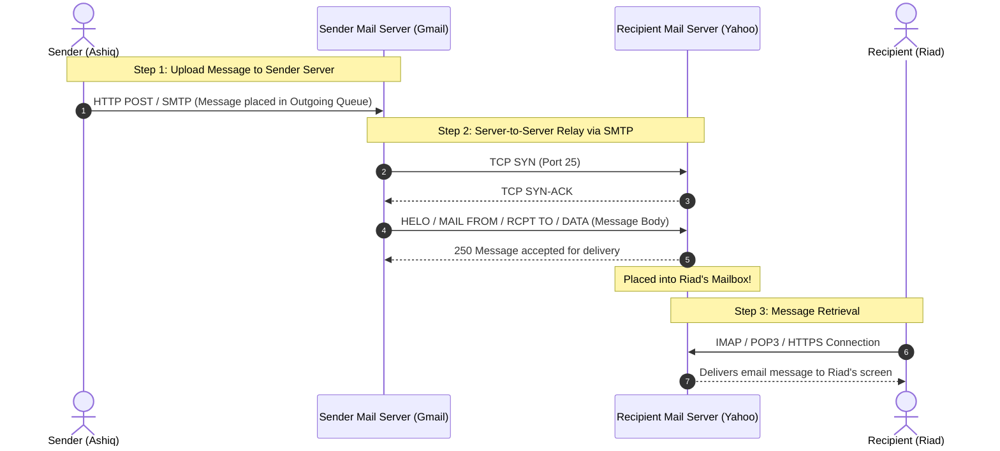

# ✉️ Chapter 03: Electronic Mail Architecture and SMTP

---

## 1. Overview (Topic Introduction)
Electronic mail is one of the earliest and most fundamental distributed applications on the Internet. Unlike the Web (which is predominantly a client-driven **pull** architecture), email operates as a multi-stage **store-and-forward push** architecture. Understanding email requires dissecting the interaction between **User Agents (UAs)**, **Mail Servers**, the **Simple Mail Transfer Protocol (SMTP)**, and mail access retrieval protocols (**POP3, IMAP, and HTTP**).

---

## 2. Learning Objectives
After studying this chapter, you will be able to:
* Identify the key architectural components of the email system: **User Agents (MUA)**, **Mail Servers (MTA)**, **Mailboxes**, and **Outgoing Message Queues**.
* Explain the role and mechanics of the **Simple Mail Transfer Protocol (SMTP)** over TCP port 25.
* Contrast **SMTP (Push Protocol)** with **HTTP (Pull Protocol)**.
* Trace the protocols used at each hop when an email is sent from a web-based client (e.g., Gmail) to a destination mail server and retrieved by a recipient.
* Differentiate between **POP3** (download-and-delete) and **IMAP** (server-synchronized folder hierarchy).

---

## 3. Core Concepts

### 3.1 Email System Architecture

```
┌─────────────┐      HTTP / SMTP      ┌─────────────────────────┐
│ User Agent  │ ────────────────────> │  Sender's Mail Server   │
│ (Ashiq PC)  │                       │  (e.g., smtp.gmail.com) │
└─────────────┘                       │ ┌─────────┐ ┌─────────┐ │
                                      │ │ Mailbox │ │ Message │ │
                                      │ │         │ │  Queue  │ │
                                      │ └─────────┘ └────┬────┘ │
                                      └──────────────────┼──────┘
                                                         │
                                                         │ SMTP (Push)
                                                         │ Port 25
                                                         ▼
┌─────────────┐      POP3 / IMAP /    ┌─────────────────────────┐
│ User Agent  │ <──────────────────── │ Receiver's Mail Server  │
│  (Riad PC)  │          HTTP         │  (e.g., mail.yahoo.com) │
└─────────────┘                       │ ┌─────────┐ ┌─────────┐ │
                                      │ │ Mailbox │ │ Message │ │
                                      │ │         │ │  Queue  │ │
                                      │ └─────────┘ └─────────┘ │
                                      └─────────────────────────┘
```

1. **User Agent (Mail Reader):** Software that allows users to compose, send, and read messages (e.g., Outlook, Apple Mail, Webmail like Gmail web interface).
2. **Mail Server (Core Infrastructure):**
   * **Mailbox:** Stores incoming messages destined for local users on that domain.
   * **Message Queue:** Holds outgoing messages waiting to be transmitted to remote mail servers.
3. **SMTP (Simple Mail Transfer Protocol):**
   * Used to transfer mail from the sender's mail server to the recipient's mail server.
   * Runs over **TCP (Port 25)**.
   * A strictly **Push Protocol**: The sending server initiates the connection and pushes the message to the receiving server.
   * Legacy constraint: Originally restricted message bodies to **7-bit ASCII**. Multimedia attachments are encoded into ASCII via **MIME (Multipurpose Internet Mail Extensions)**.

---

### 3.2 HTTP vs. SMTP Comparison

| Feature | HTTP (HyperText Transfer Protocol) | SMTP (Simple Mail Transfer Protocol) |
|---|---|---|
| **Primary Direction** | **Pull Protocol:** Client pulls data from the server on demand. | **Push Protocol:** Sending mail server pushes data to the receiving server. |
| **Port & Transport** | Port 80 (HTTP) / 443 (HTTPS) over TCP | Port 25 (Server-to-Server SMTP) over TCP |
| **Data Encoding** | Encapsulates binary data natively (images, video, audio) in response body. | Originally restricted to 7-bit ASCII; binary requires MIME encoding. |
| **Object Handling** | Each object is encapsulated in its own HTTP response message. | All objects (body text + attachments) are packaged into a single multipart message. |

---

### 3.3 Mail Access Protocols: Retrieving Email from Mailboxes
SMTP is designed strictly as a *push* protocol; it cannot be used by a recipient to pull emails from their mailbox because the recipient's machine is typically not an always-on server with a public IP address! Special retrieval protocols are required:
1. **POP3 (Post Office Protocol Version 3 - Port 110):**
   - Simple download-and-delete model. Downloads emails to the local client and removes them from the server.
   - Limitation: Cannot synchronize read/unread states or folders across multiple devices (phone vs laptop).
2. **IMAP (Internet Message Access Protocol - Port 143):**
   - Advanced server-synchronized model. Keeps all messages permanently on the server.
   - Allows users to organize messages into folders, search remotely, and sync state across all devices.
3. **HTTP / Webmail:**
   - User interacts with their mailbox via a web browser using standard HTTPS.

---

## 4. Visual Explanation (Diagrams)

### 4.1 End-to-End Email Transmission Flow (From CN Class Note 1, Page 25)


---

## 5. Step-by-Step SMTP Dialogue Example
A direct SMTP exchange between mail servers over TCP:
```
S: 220 mail.yahoo.com Simple Mail Transfer Service Ready
C: HELO mail.gmail.com
S: 250 Hello mail.gmail.com
C: MAIL FROM: <ashiq@gmail.com>
S: 250 2.1.0 Sender OK
C: RCPT TO: <riad@yahoo.com>
S: 250 2.1.5 Recipient OK
C: DATA
S: 354 Start mail input; end with <CRLF>.<CRLF>
C: Subject: Computer Networks Exam Notes
C: Hi Riad, here are the solved class notes.
C: .
S: 250 2.0.0 OK: message queued 12345
C: QUIT
S: 221 Closing transmission channel
```

---

## 6. Real-Life Example
* **Physical Post Office Relay:**
  - You write a letter and drop it in the local blue collection box (**HTTP/SMTP to Sender Server**).
  - The local post office truck transports and delivers the letter bags to the destination city sorting hub (**SMTP Server-to-Server transfer**).
  - The destination post office puts the letter in the recipient’s physical P.O. Box (**Mailbox**).
  - The recipient drives to the post office with their key to unlock their box and pick up the letter (**IMAP/POP3 retrieval**).

---

## 7. Practical Implementation (Python SMTP Sending Simulation)

```python
import smtplib
from email.mime.text import MIMEText
from email.mime.multipart import MIMEMultipart

def simulate_email_send(sender, receiver, subject, body):
    # Construct MIME multipart message
    msg = MIMEMultipart()
    msg['From'] = sender
    msg['To'] = receiver
    msg['Subject'] = subject
    msg.attach(MIMEText(body, 'plain'))

    print("[*] Email Message Constructed:")
    print(f"    From   : {msg['From']}")
    print(f"    To     : {msg['To']}")
    print(f"    Subject: {msg['Subject']}")
    print("    Payload:\n", msg.as_string())

    # Simulated SMTP interaction:
    print("[+] Connecting to SMTP server over TCP port 25...")
    print(f"[+] Handshaking: MAIL FROM:<{sender}> -> RCPT TO:<{receiver}>")
    print("[+] Status 250: Message accepted for delivery!")

simulate_email_send(
    sender="ashiq@gmail.com",
    receiver="riad@yahoo.com",
    subject="CSE3711 Class Notes",
    body="Hey! All diagrams and formulas are analyzed."
)
```

---

## 8. Common Mistakes & Pitfalls
> [!WARNING]
> * **Assuming SMTP is Used to Read Mail:** SMTP is strictly a **Push Protocol** used to *send* mail. It CANNOT be used by an end-user to *read* or download mail from a server mailbox! That requires POP3, IMAP, or HTTP.
> * **Confusing Mailbox with Message Queue:** The *Mailbox* stores incoming mail waiting for the local user to read; the *Message Queue* holds outgoing mail waiting to be sent to remote servers.

---

## 9. Practice Problems & Exam Walkthroughs

### 📝 Problem 1 (From CN Class Note 1, Page 8 & 27: Midterm Exam Scenario)
**Question:** Rahman sends an email from his web-based Gmail account on his laptop to his friend Karim, who uses a Mozilla Thunderbird desktop mail client to read his Yahoo email.
1. Identify the application-layer protocols used across each hop of the communication.
2. Explain two key differences between HTTP and SMTP.

**Step-by-Step Solution:**
1. **Hop-by-Hop Protocols:**
   * **Hop 1 (Rahman's Laptop $\to$ Gmail Mail Server):** **HTTP / HTTPS**. Since Rahman uses a web-based client in a browser, he communicates with the Gmail web server over HTTP.
   * **Hop 2 (Gmail Mail Server $\to$ Yahoo Mail Server):** **SMTP** (over TCP Port 25). Server-to-server mail relay is universally handled by SMTP.
   * **Hop 3 (Yahoo Mail Server $\to$ Karim's Thunderbird Client):** **IMAP** (or **POP3**). Because Karim uses a desktop email client, he pulls his messages from the Yahoo mailbox using IMAP.
2. **Two Key Differences:**
   * **Pull vs. Push:** HTTP is primarily a *pull* protocol where clients request data from a server; SMTP is a *push* protocol where the sending server pushes data to the receiving server.
   * **Data Handling:** HTTP allows arbitrary binary data in the response body; SMTP was originally designed for 7-bit ASCII text and requires MIME encoding for binary attachments.

---

## 10. Knowledge Check (MCQ & Quizzes)

#### Q1. Which protocol is used by an intermediate mail server to forward an email to the recipient's mail server?
- [ ] A) POP3
- [ ] B) IMAP
- [x] C) SMTP
- [ ] D) HTTP
*Explanation:* Server-to-server email forwarding across the Internet is performed exclusively by SMTP over TCP port 25.

#### Q2. Why is IMAP generally preferred over POP3 on modern devices?
- [ ] A) IMAP uses less bandwidth than POP3.
- [ ] B) IMAP encrypts emails automatically while POP3 cannot.
- [x] C) IMAP keeps emails synchronized on the server across multiple devices (phone, laptop).
- [ ] D) IMAP operates over UDP.
*Explanation:* IMAP maintains the folder hierarchy and message read/unread status on the central server, allowing seamless multi-device synchronization.

---

## 11. Summary & Revision Sheet
* **SMTP (Port 25):** Push protocol used by clients to send mail and by mail servers to relay mail to other servers.
* **POP3 (Port 110):** Download-and-delete retrieval protocol.
* **IMAP (Port 143):** Server-synchronized retrieval protocol.
* **Webmail:** Uses HTTP/HTTPS between browser and local mail server, but underlying server-to-server transfer remains standard SMTP!

---

---

## 🔗 Related Topics

> Connect your understanding — explore these closely related chapters:

- 📖 [HTTP](02-http-and-web-caching.md) — Comparison of push (SMTP) vs pull (HTTP) architecture
- 📖 [DNS](04-dns-domain-name-system.md) — MX records used by SMTP to find mail server addresses
- 📖 [Application Architectures](01-application-architectures.md) — Email as a classic Client-Server model

## 12. References & Further Reading
* RFC 5321: *Simple Mail Transfer Protocol (SMTP)*.
* RFC 3501: *Internet Message Access Protocol - Version 4rev1 (IMAP4)*.


---

<div align="center">

| [⬅️ Previous](02-http-and-web-caching.md) | [🏠 Module Index](README.md) | [Next ➡️](04-dns-domain-name-system.md) |
|:---:|:---:|:---:|

</div>
