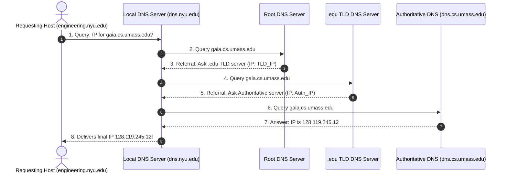

# 🌐 Chapter 04: The Domain Name System (DNS)

---

## 1. Overview (Topic Introduction)
Humans prefer mnemonic, readable hostnames like `www.google.com` or `ucam.uiu.ac.bd`, whereas routers and packet switches navigate using fixed-length numerical IP addresses like `142.251.211.78`. The **Domain Name System (DNS)** is the Internet’s global, distributed directory service that translates human-friendly hostnames into machine-routable IP addresses. Running at the Application Layer over **UDP (Port 53)**, DNS is a masterclass in hierarchical database design, distributed scalability, and caching.

---

## 2. Learning Objectives
After studying this chapter, you will be able to:
* Explain why DNS is implemented as a **distributed, hierarchical database** rather than a single centralized server.
* Navigate the DNS hierarchy: **Root DNS Servers**, **Top-Level Domain (TLD) Servers**, and **Authoritative DNS Servers**.
* Trace the complete 8-step resolution sequence of an **Iterative DNS Query** versus a **Recursive DNS Query**.
* Understand why recursive queries create severe vulnerabilities and excessive load on Root DNS servers.
* Construct and interpret the four fundamental **DNS Resource Records (RR)**: **Type A**, **Type NS**, **Type CNAME**, and **Type MX**.
* Analyze how **Local DNS Caching** eliminates repetitive global query overhead.

---

## 3. Core Concepts

### 3.1 Why a Distributed Database?
A centralized DNS server with a single giant database of all mappings would fail catastrophically due to:
* **Single Point of Failure:** If the central server crashes, the entire global Internet goes offline.
* **Traffic Volume:** Trillions of queries per day would overwhelm any single data center.
* **Distant Centralized Database:** Queries from Bangladesh to a server in California would suffer huge propagation delays.
* **Maintenance Nightmare:** Millions of domain records update every day.

---

### 3.2 The DNS Hierarchy

```
                               ┌─────────────┐
                               │  Root DNS   │
                               │   Servers   │
                               └──────┬──────┘
             ┌────────────────────────┼────────────────────────┐
             ▼                        ▼                        ▼
       ┌───────────┐            ┌───────────┐            ┌───────────┐
       │ .com TLD  │            │ .edu TLD  │            │  .bd TLD  │
       └─────┬─────┘            └─────┬─────┘            └─────┬─────┘
             │                        │                        │
             ▼                        ▼                        ▼
     ┌───────────────┐        ┌───────────────┐        ┌───────────────┐
     │  google.com   │        │   nyu.edu     │        │   uiu.ac.bd   │
     │ Authoritative │        │ Authoritative │        │ Authoritative │
     └───────────────┘        └───────────────┘        └───────────────┘
```

1. **Root DNS Servers:** Over 1,000 replicated instances worldwide organized under 13 logical root authorities (managed by ICANN). Returns referrals to appropriate TLD servers.
2. **Top-Level Domain (TLD) Servers:** Responsible for generic top-level domains (`.com`, `.org`, `.net`, `.edu`) and country-code top-level domains (`.bd`, `.uk`, `.jp`).
3. **Authoritative DNS Servers:** Owned and maintained by organizations or service providers. Holds the actual definitive mappings for public hosts (e.g., UIU’s server holds mappings for `ucam.uiu.ac.bd`).
4. **Local DNS Server (Default Name Server):** Each ISP, university, or home router has a local DNS server (e.g., `8.8.8.8` Google DNS, `1.1.1.1` Cloudflare). The local DNS server acts as the client’s proxy, executing the resolution on its behalf.

---

### 3.3 Iterative vs. Recursive Queries

#### 1. Iterative Query (Standard Industry Practice):
* The queried server replies with the **address of the next server to consult** rather than finding the answer itself:
  - "I don't know the IP, but ask this TLD server!"
* The **Local DNS server** does all the legwork, traveling from Root $\to$ TLD $\to$ Authoritative.

#### 2. Recursive Query:
* The contacted server assumes the burden of fully resolving the name itself, recursing up and down the chain and returning the final answer to the client.
* **Why Recursive Queries are Discouraged at Root/TLD:**
  - Puts an **excessive processing load** on Root servers.
  - Leaves root servers highly vulnerable to denial-of-service and cache-poisoning attacks.

---

### 3.4 DNS Resource Records (RR)
DNS servers store mappings in 4-tuple Resource Records:
$$\mathbf{(Name, \ Value, \ Type, \ TTL)}$$

| Type | Meaning | Format of Name and Value | Example Record |
|---|---|---|---|
| **A** | Hostname to IPv4 Address | `Name` = Hostname<br/>`Value` = IPv4 Address | `(www.google.com, 142.251.211.78, A, IN)` |
| **NS** | Authoritative Name Server for Domain | `Name` = Domain<br/>`Value` = Hostname of Name Server | `(uiu.ac.bd, ns1.uiu.ac.bd, NS, IN)` |
| **CNAME** | Canonical (True) Name for an Alias | `Name` = Alias (Nickname)<br/>`Value` = Canonical Hostname | `(sch.goo.gl, scholar.google.com, CNAME, IN)` |
| **MX** | Mail Server for Domain | `Name` = Mail Domain<br/>`Value` = Hostname of Mail Server | `(gmail.com, alt1.gmail-smtp-in.l.google.com, MX, IN)` |

---

## 4. Visual Explanation (Diagrams)

### 4.1 The 8-Step Iterative Query Ladder (From CN Class Note 1, Page 27)


---

## 5. Step-by-Step Resolution Walkthrough
1. **Host initiates lookup:** User types `www.cisco.com` into Safari. The OS checks local cache; on a miss, sends a query to the Local DNS server (`dns.uiu.ac.bd`).
2. **Local to Root:** Local DNS queries a Root DNS server.
3. **Root referral:** Root returns an NS record pointing to `.com` TLD servers.
4. **Local to TLD:** Local DNS queries the `.com` TLD server.
5. **TLD referral:** TLD returns an NS record pointing to Cisco's authoritative server (`ns1.cisco.com`).
6. **Local to Authoritative:** Local DNS queries `ns1.cisco.com`.
7. **Authoritative response:** Authoritative server returns a Type A record: `(www.cisco.com, 72.163.4.161)`.
8. **Caching & Delivery:** Local DNS caches the mapping for the duration of its **TTL (Time to Live)** and delivers the IP to Safari.

---

## 6. Real-Life Example
* **Global Telephone Directory Assistance:**
  - You want the private phone number of Dr. John at Stanford Hospital.
  - You call the national operator (**Root**). The operator doesn't have local doctor numbers, but gives you the phone number for California Medical Board (**TLD**).
  - You call California Medical Board. They give you the switchboard number for Stanford Hospital (**Authoritative**).
  - You call Stanford Hospital switchboard. They look up their internal directory and give you Dr. John's direct extension (**Final IP**).

---

## 7. Practical Implementation (Python DNS Resolver)

```python
import socket

def resolve_hostname(hostname):
    try:
        ip_address = socket.gethostbyname(hostname)
        canonical_name, aliases, ip_list = socket.gethostbyname_ex(hostname)
        return {
            'query_host': hostname,
            'canonical_name': canonical_name,
            'aliases': aliases,
            'ip_addresses': ip_list
        }
    except socket.gaierror as e:
        return {'error': str(e)}

# Test resolution for major domains
for host in ['google.com', 'cisco.com', 'uiu.ac.bd']:
    info = resolve_hostname(host)
    print(f"[*] Query: {host}")
    if 'error' in info:
        print(f"    Failed: {info['error']}")
    else:
        print(f"    Canonical: {info['canonical_name']}")
        print(f"    IPs      : {info['ip_addresses']}\n")
```

---

## 8. Common Mistakes & Pitfalls
> [!WARNING]
> * **Confusing CNAME with Type A:** A Type A record maps a hostname directly to an **IP Address** (`foo.com -> 1.2.3.4`). A Type CNAME record maps an alias hostname to another **Hostname** (`foo.com -> bar.com`).
> * **Assuming Root Servers return IP Addresses:** Root servers almost NEVER return the final host IP! They return referrals (delegations) to TLD servers.

---

## 9. Practice Problems & Exam Walkthroughs

### 📝 Problem 1 (From CN Class Note 1, Page 29: Midterm 253 Q2)
**Question:** An application running on a host makes an iterative DNS query for `www.university.net`. Trace the queries and construct the resulting **Local DNS Cache Table** given:
* Root DNS IP: `123.4.5.6`
* `.net` TLD Name Server: `admin.university.net`, IP: `111.5.6.30`
* Authoritative Name Server: `ns1.university.net`, IP: `203.0.113.2`
* Target Host IP: `www.university.net`, IP: `203.0.113.10`

**Step-by-Step Solution:**
1. **Query Sequence:**
   - Step 1: Client queries Local DNS server.
   - Step 2: Local DNS queries Root DNS (`123.4.5.6`).
   - Step 3: Root replies with referral to `.net` TLD (`111.5.6.30`).
   - Step 4: Local DNS queries `.net` TLD server (`111.5.6.30`).
   - Step 5: TLD replies with referral to Authoritative server `ns1.university.net` (`203.0.113.2`).
   - Step 6: Local DNS queries Authoritative server (`203.0.113.2`).
   - Step 7: Authoritative server replies with Type A record for `www.university.net` (`203.0.113.10`).
   - Step 8: Local DNS replies to Client with IP `203.0.113.10`.
2. **Local DNS Cache Table Construction:**
   | Domain / Hostname | Cached Record Type & Value |
   |---|---|
   | `.` (Root) | `123.4.5.6` |
   | `net` | `111.5.6.30` (TLD Server) |
   | `university.net` | `203.0.113.2` (Authoritative NS) |
   | `www.university.net` | `203.0.113.10` (Type A Host IP) |

---

## 10. Knowledge Check (MCQ & Quizzes)

#### Q1. Which DNS Resource Record type specifies the mail server responsible for receiving emails sent to a domain?
- [ ] A) Type A
- [ ] B) Type NS
- [ ] C) Type CNAME
- [x] D) Type MX
*Explanation:* Type MX (Mail Exchange) records specify the mail server hostname for a given domain name.

#### Q2. Why does DNS predominantly use UDP (Port 53) rather than TCP?
- [ ] A) UDP provides built-in encryption.
- [x] B) DNS messages are small, and UDP avoids the connection setup latency (1 RTT) of TCP's 3-way handshake.
- [ ] C) UDP guarantees in-order delivery.
- [ ] D) Routers do not support TCP.
*Explanation:* Lightweight UDP requests allow fast, low-latency queries without the overhead of maintaining connection state.

---

#### Q3. A DNS query for `www.example.com` goes through the full iterative resolution chain. What is the correct query order?
- [ ] A) Local DNS → Root → example.com TLD → Local Authoritative → Root again
- [x] B) Local DNS → Root DNS Server → `.com` TLD Server → `example.com` Authoritative Server → Answer
- [ ] C) Local DNS → `example.com` Authoritative directly
- [ ] D) Root → TLD → Local DNS → Authoritative
*Explanation:* Iterative DNS resolution: 1) Client asks **Local DNS resolver**. 2) Local DNS asks **Root name server** ("who handles .com?"). 3) Local DNS asks **.com TLD server** ("who handles example.com?"). 4) Local DNS asks **example.com Authoritative server** ("what is www.example.com?"). 5) Local DNS returns IP to client and **caches** the result with TTL.

#### Q4. What is the difference between a DNS `A` record and a DNS `CNAME` record?
- [ ] A) `A` records are for IPv6, `CNAME` for IPv4 addresses
- [x] B) An `A` record maps a hostname directly to an IPv4 address; a `CNAME` record maps a hostname to another hostname (canonical alias)
- [ ] C) `CNAME` records are higher priority than `A` records
- [ ] D) `A` records are authoritative; `CNAME` records are cached only
*Explanation:* **A record**: `www.example.com → 93.184.216.34` (hostname to IPv4). **CNAME (Canonical Name)**: `www.example.com → example.com` (alias to canonical hostname). `AAAA` records are for IPv6. `CNAME` chains must eventually resolve to an `A` or `AAAA` record.

#### Q5. Why does DNS primarily use UDP for queries rather than TCP?
- [ ] A) UDP provides guaranteed delivery which is required for DNS
- [ ] B) TCP is too slow for internet communication
- [x] C) DNS responses typically fit within a single UDP datagram (512 bytes for classic DNS, 4096+ with EDNS0); UDP avoids TCP's 3-way handshake overhead, making lookups faster
- [ ] D) TCP cannot support the high query volume DNS servers handle
*Explanation:* Most DNS responses fit in a **single UDP datagram**, so the reliability benefit of TCP's connection setup overhead (1 RTT for handshake) is not worth it. DNS handles its own reliability at the application layer — if no response arrives, the resolver **retries** the UDP query (typically 2-3 times before timing out). TCP is used for large zone transfers (AXFR) and responses exceeding 512 bytes.

#### Q6. What is a **DNS Amplification Attack** and which DNS record type is most commonly exploited?
- [ ] A) An attack that floods DNS servers with recursive queries to exhaust their CPU
- [x] B) A reflective DDoS attack where the attacker sends small DNS queries (with spoofed victim IP) to open resolvers; the resolvers send large responses (often `ANY` or `TXT` records) to the victim
- [ ] C) An attack that injects false DNS records into the resolver cache
- [ ] D) A botnet-based attack that purchases all available domain names
*Explanation:* **DNS Amplification** exploits the size asymmetry: a 60-byte `ANY` query can generate a 3,000+ byte response — 50× amplification. The attacker spoofs the victim's IP, sends the small query to thousands of **open recursive resolvers**, which all send amplified responses to the victim. Mitigation: BCP38 source address validation, rate limiting DNS responses, disabling open recursion.


## 11. Summary & Revision Sheet
* **DNS Transport:** UDP Port 53 (fast, connectionless).
* **Hierarchy:** Root $\to$ TLD (`.com`, `.net`, `.edu`, `.bd`) $\to$ Authoritative $\to$ Local DNS.
* **Iterative vs. Recursive:** In Iterative, Local DNS visits servers step-by-step; in Recursive, contacted server resolves the entire query.
* **Resource Records:**
  - Type A: `(Hostname, IP)`
  - Type NS: `(Domain, NameServerHost)`
  - Type CNAME: `(AliasName, CanonicalName)`
  - Type MX: `(MailDomain, MailServerHost)`

---

---

## 🔗 Related Topics

> Connect your understanding — explore these closely related chapters:

- 📖 [HTTP & Web Caching](02-http-and-web-caching.md) — DNS lookup precedes every HTTP request
- 📖 [Network Attacks](../02-network-security-fundamentals/02-network-attacks-and-defense.md) — DNS amplification attacks and DNS cache poisoning
- 📖 [DHCP](../05-network-layer-and-routing/03-dhcp-dynamic-addressing.md) — DHCP provides DNS server IP alongside IP address assignment

## 12. References & Further Reading
* RFC 1034: *Domain Names - Concepts and Facilities*.
* RFC 1035: *Domain Names - Implementation and Specification*.


---

<div align="center">

| [⬅️ Previous](03-email-protocols-smtp.md) | [🏠 Module Index](README.md) | [Next ➡️](../04-transport-layer-and-reliability/README.md) |
|:---:|:---:|:---:|

</div>
