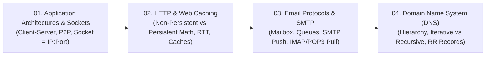

# 🌐 Module 03: Application Layer and Protocols

Welcome to **Module 03: Application Layer and Protocols**. Sitting at the pinnacle of the networking protocol stack, the Application Layer is where human interaction, web browsing, email communication, and name resolution come to life. This module explores architectural patterns (**Client-Server vs. P2P**), the abstraction of **Sockets**, the timing physics of **HTTP 1.0/1.1 and Web Caching**, the push/pull dynamics of **SMTP and IMAP**, and the global distributed hierarchy of the **Domain Name System (DNS)**.

---

## 🗺️ Module Learning Roadmap

---

## 📚 Chapter Breakdown

| Chapter File | Topics Covered | Key Visualizations | Real-World & Math Focus |
|---|---|---|---|
| **[01-application-architectures.md](./01-application-architectures.md)** | Client-Server vs P2P, Always-on servers, Dynamic IP peers, Socket abstraction as a software door, Port numbers | Central server fan-out vs P2P mesh, Socket connection ladder diagram | Socket address tuple `(IP, Port)` mapping, Concurrent connections |
| **[02-http-and-web-caching.md](./02-http-and-web-caching.md)** | HTTP 1.0 vs 1.1, Stateless nature, Cookies, Non-Persistent vs Persistent HTTP, Web Caches / Proxies | HTTP Request-Response ladder, Persistent connection reuse, Proxy cache hit/miss flow | Exact download time math ($2\text{RTT}+\text{FTT}$ vs $\text{RTT}+n(\text{RTT}+\text{FTT})$), Mid 261 Q2(b) |
| **[03-email-protocols-smtp.md](./03-email-protocols-smtp.md)** | Email architecture, User Agents (MUA), Mail Transfer Agents (MTA), Mailboxes & Queues, SMTP (Port 25) vs HTTP/IMAP/POP3 | Full end-to-end 3-stage email delivery pipeline diagram | Push vs Pull protocol comparison, 7-bit ASCII constraints, MIME encoding |
| **[04-dns-domain-name-system.md](./04-dns-domain-name-system.md)** | Distributed Hierarchical Database, Root, TLD (.com, .edu, .bd), Authoritative DNS, Iterative vs Recursive resolution, Resource Records | 8-Step Iterative DNS query ladder, DNS hierarchical tree, Local DNS cache table | Resolving hostnames to IP, CNAME aliases, MX mail routing, Mid 253 Q2 walkthrough |

---

## 🎯 Key Competencies Acquired

By completing this module, you will be able to:
1. Choose between Client-Server and P2P architectures based on scalability and cost tradeoffs.
2. Master the **Socket abstraction** and identify communication endpoints via `(IP, Port)` tuples.
3. Compute precise web page retrieval times under **Non-Persistent HTTP** and **Persistent HTTP** regimes across multiple embedded objects.
4. Explain how web caches and proxy servers dramatically reduce link utilization and response times.
5. Trace an email from the sender's web browser, across intermediate SMTP servers, to the recipient's inbox.
6. Trace both **Iterative** and **Recursive** DNS query flows and construct valid DNS Resource Records (Types A, NS, CNAME, and MX).

