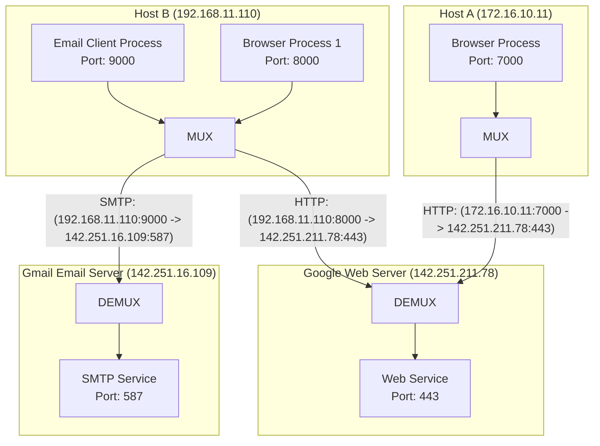

# 🔀 Chapter 01: Transport Layer Multiplexing and Demultiplexing

---

## 1. Overview (Topic Introduction)
The Network Layer delivers datagrams between host computers (**Host-to-Host delivery**). However, on modern computers, dozens of distinct applications run concurrently (web browsers, game clients, email checkers, SSH sessions). The primary responsibility of the Transport Layer is to extend host-to-host delivery to **Process-to-Process delivery** between application processes running on those hosts. This is accomplished via **Multiplexing (MUX)** at the sender and **Demultiplexing (DEMUX)** at the receiver.

---

## 2. Learning Objectives
After studying this chapter, you will be able to:
* Distinguish between **Host-to-Host delivery** (Network Layer) and **Process-to-Process delivery** (Transport Layer).
* Explain the mechanics of **Multiplexing at the sender** and **Demultiplexing at the receiver**.
* Understand how **Connectionless Demultiplexing (UDP)** uses a **2-Tuple** `(Dest IP, Dest Port)`.
* Understand how **Connection-Oriented Demultiplexing (TCP)** uses a **4-Tuple** `(Source IP, Source Port, Dest IP, Dest Port)`.
* Trace concurrent client connections arriving at common service ports (e.g., HTTP Port 80/443, SMTP Port 587).

---

## 3. Core Concepts

### 3.1 Multiplexing & Demultiplexing Defined
* **Multiplexing at Sender (MUX):** The task of gathering data chunks from different application sockets, encapsulating each chunk with transport headers (including source and destination port numbers), and passing the resulting segments to the Network Layer.
* **Demultiplexing at Receiver (DEMUX):** The task of inspecting the header fields of an incoming transport segment delivered by the Network Layer and directing the payload to the correct receiving socket.

```
Sender Host (Multiplexing):                Receiver Host (Demultiplexing):
┌──────────────────────────────┐          ┌──────────────────────────────┐
│ App 1   App 2   App 3 (Chrome)│          │ App 1   App 2   App 3 (Chrome)│
│   │       │       │          │          │   ▲       ▲       ▲          │
│   ▼       ▼       ▼          │          │   │       │       │          │
│ Socket1 Socket2 Socket3      │          │ Socket1 Socket2 Socket3      │
│   └───────┬───────┘          │          │   ▲       ▲       ▲          │
│           ▼                  │          │   └───────┼───────┘          │
│    [ MUX Engine ]            │          │    [ DEMUX Engine ]          │
│           │                  │          │           ▲                  │
│           ▼                  │          │           │                  │
│   Transport Layer (TCP/UDP)  │          │   Transport Layer (TCP/UDP)  │
│           │                  │          │           ▲                  │
│           ▼                  │          │           │                  │
│     Network Layer (IP)       │ ───────> │     Network Layer (IP)       │
└──────────────────────────────┘          └──────────────────────────────┘
```

---

### 3.2 Connectionless vs. Connection-Oriented Demux

#### 1. Connectionless Demultiplexing (UDP):
* A UDP socket is fully identified by a **2-Tuple**:
  $$\mathbf{(\text{Destination IP Address}, \ \text{Destination Port Number})}$$
* If two UDP segments arrive from different source IP addresses or different source port numbers, but have the **same destination IP and destination port**, they will both be directed to the **exact same destination socket**!

#### 2. Connection-Oriented Demultiplexing (TCP):
* A TCP socket is uniquely identified by a **4-Tuple**:
  $$\mathbf{(\text{Source IP}, \ \text{Source Port}, \ \text{Destination IP}, \ \text{Destination Port})}$$
* When a TCP segment arrives from the network, the OS inspects all four values. Two incoming TCP segments with different source IP addresses or different source ports will be directed to **two completely different welcoming sockets**, even if both are targeting destination port 443!

---

## 4. Visual Explanation (Diagrams)

### 4.1 Real-World MUX & DEMUX Pipeline (From CN Class Note 2, Page 2: Mid 261 Q1(b))


---

## 5. Step-by-Step DEMUX Execution at Server
1. **Physical & Data Link Arrival:** Network interface card receives frames, removes MAC headers, passes IP datagrams to Network Layer.
2. **Network Layer Processing:** Network layer checks destination IP address, verifies checksum, strips IP header, extracts the Transport Layer segment.
3. **Transport Layer Port Extraction:** Transport layer parses the segment header to read:
   - Source Port
   - Destination Port
4. **Socket Table Lookup:** The OS kernel searches its active socket table for an entry matching the 4-tuple `(SrcIP, SrcPort, DstIP, DstPort)`.
5. **Buffer Delivery:** The segment payload is placed directly into the matching socket’s receive buffer, waking up the waiting application process (`recv()` returns).

---

## 6. Real-Life Example
* **University Mailroom Analogy:**
  - The postal van delivers 500 letters to the University Administration Building (**Network Layer Host Delivery**).
  - The mailroom clerk reads the department and recipient name on each envelope (**Transport Layer Header**).
  - The clerk places Letter 1 into Professor Alice's pigeonhole (**Port 443**) and Letter 2 into Registrar Bob's pigeonhole (**Port 587**) (**Demultiplexing**).

---

## 7. Practical Implementation (Python 4-Tuple Socket Demux Verification)

```python
import socket

def demonstrate_tcp_demux():
    # Server socket listening on port 8080
    server = socket.socket(socket.AF_INET, socket.SOCK_STREAM)
    server.bind(('127.0.0.1', 8080))
    server.listen(5)
    print("[*] Server welcoming socket listening on 127.0.0.1:8080")

    # The 4-tuple uniquely identifies each connection
    active_connections = {}

    def handle_connection(client_socket, client_address):
        # client_address is (client_ip, client_port)
        tuple_4 = (client_address[0], client_address[1], '127.0.0.1', 8080)
        active_connections[tuple_4] = client_socket
        print(f"[+] New dedicated socket spawned for 4-Tuple: {tuple_4}")

    print("[*] Ready to demultiplex incoming connections based on 4-tuples.")
    server.close()

demonstrate_tcp_demux()
```

---

## 8. Common Mistakes & Pitfalls
> [!WARNING]
> * **Assuming UDP uses 4-tuples for demuxing:** UDP demuxing ignores source IP and source port when choosing the destination socket! All UDP packets targeting the same `(DstIP, DstPort)` land in the same socket.
> * **Believing a Web Server on Port 80 can only talk to one client at a time:** A web server listens on port 80. When a client connects, the OS creates a *new dedicated socket* identified by that unique 4-tuple, freeing the listening socket to welcome other clients concurrently!

---

## 9. Practice Problems & Exam Walkthroughs

### 📝 Problem 1 (From CN Class Note 2, Page 2: Midterm 261 Q1(b))
**Question:** Host A has IP `172.16.10.11` and Host B has IP `192.168.11.110`.
* Host A runs a browser connected from port `7000` to Google Web Server (`142.251.211.78`, port `443`).
* Host B runs a browser connected from port `8000` to Google Web Server (port `443`).
* Host B simultaneously runs an email client connected from port `9000` to Gmail Email Server (`142.251.16.109`, port `587`).
1. Detail the 4-tuples for each of the three active TCP connections.
2. How does Google Web Server distinguish packets arriving from Host A versus Host B on port 443?

**Step-by-Step Solution:**
1. **The Three 4-Tuples:**
   * **Connection 1 (Host A Browser $\to$ Google Web Server):**
     `(172.16.10.11, 7000, 142.251.211.78, 443)`
   * **Connection 2 (Host B Browser $\to$ Google Web Server):**
     `(192.168.11.110, 8000, 142.251.211.78, 443)`
   * **Connection 3 (Host B Email $\to$ Gmail Email Server):**
     `(192.168.11.110, 9000, 142.251.16.109, 587)`
2. **Differentiation at Google Web Server:**
   * Both Connection 1 and Connection 2 arrive with destination IP `142.251.211.78` and destination port `443`.
   * However, the server's TCP demultiplexing engine examines the **Source IP and Source Port**:
     - Segments with `(SrcIP: 172.16.10.11, SrcPort: 7000)` are demultiplexed to Socket A.
     - Segments with `(SrcIP: 192.168.11.110, SrcPort: 8000)` are demultiplexed to Socket B.

---

## 10. Knowledge Check (MCQ & Quizzes)

#### Q1. Which fields compose the 4-tuple used by an operating system to demultiplex incoming TCP segments?
- [ ] A) Source MAC, Destination MAC, Source IP, Destination IP
- [ ] B) Source IP, Destination IP, Protocol, Checksum
- [x] C) Source IP, Source Port, Destination IP, Destination Port
- [ ] D) Sequence Number, Acknowledgement Number, Window, Flags
*Explanation:* TCP connections are uniquely identified across the entire Internet by the 4-tuple of Source and Destination IP addresses and Port numbers.

#### Q2. If two UDP datagrams have different Source IP addresses but the same Destination IP and Destination Port, what happens at the receiver?
- [ ] A) The second datagram is rejected as a collision.
- [ ] B) A new socket is spawned for the second sender.
- [x] C) Both datagrams are delivered to the exact same receiving socket.
- [ ] D) The receiver converts the connection to TCP.
*Explanation:* UDP demultiplexing is connectionless and based solely on the 2-tuple `(Dest IP, Dest Port)`.

---

## 11. Summary & Revision Sheet
* **Multiplexing (Sender):** Gathers data from multiple sockets, adds transport headers, passes to network layer.
* **Demultiplexing (Receiver):** Inspects header ports, delivers segment data to correct socket.
* **UDP Demux:** 2-Tuple `(Dest IP, Dest Port)`.
* **TCP Demux:** 4-Tuple `(Src IP, Src Port, Dest IP, Dest Port)`.

---

---

## 🔗 Related Topics

> Connect your understanding — explore these closely related chapters:

- 📖 [UDP & Checksum](02-udp-and-internet-checksum.md) — Connectionless transport with minimal demultiplexing
- 📖 [TCP Principles](04-tcp-principles-and-handshake.md) — Connection-oriented transport with complex demultiplexing
- 📖 [Application Architectures](../03-application-layer-and-protocols/01-application-architectures.md) — Socket API that multiplexing enables

## 12. References & Further Reading
* Kurose & Ross, Chapter 3.2: *Multiplexing and Demultiplexing*.
* RFC 793: *Transmission Control Protocol*.


---

<div align="center">

| [⬅️ Previous](../03-application-layer-and-protocols/README.md) | [🏠 Module Index](README.md) | [Next ➡️](02-udp-and-internet-checksum.md) |
|:---:|:---:|:---:|

</div>
