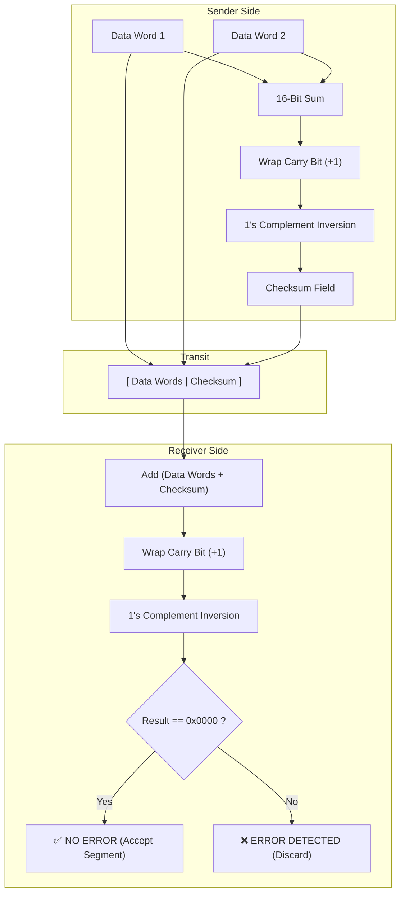

# 🧮 Chapter 02: UDP and the 16-Bit Internet Checksum

---

## 1. Overview (Topic Introduction)
The **User Datagram Protocol (UDP)** provides a lightweight, "no-frills" transport service. Defined in RFC 768, UDP is connectionless, unordered, and provides no congestion or flow control. Its primary additions over bare IP are port numbers (for multiplexing) and an optional error-detection mechanism: the **16-Bit Internet Checksum (RFC 1071)**. Mastering the mathematical mechanics of 1's complement addition, carry bit wrap-around, and hexadecimal conversion is a core requirement for network engineering and university exams.

---

## 2. Learning Objectives
After studying this chapter, you will be able to:
* Describe the structure and overhead of the minimal **8-Byte UDP Header**.
* Explain the trade-offs of UDP: why applications like DNS, VoIP, and video streaming intentionally choose UDP over TCP.
* Master the **RFC 1071 16-Bit Internet Checksum** algorithm.
* Perform 1's complement addition with **wrap-around carry bits** in both **Binary** and **Hexadecimal**.
* Verify checksums at the receiver and prove mathematical error detection when bits flip during transit.

---

## 3. Core Concepts

### 3.1 UDP Header Structure
UDP has a fixed, minimal header of only **8 Bytes (64 bits)**:

```
 0                   1                   2                   3
 0 1 2 3 4 5 6 7 8 9 0 1 2 3 4 5 6 7 8 9 0 1 2 3 4 5 6 7 8 9 0 1
+-+-+-+-+-+-+-+-+-+-+-+-+-+-+-+-+-+-+-+-+-+-+-+-+-+-+-+-+-+-+-+-+
|          Source Port          |       Destination Port        |
+-+-+-+-+-+-+-+-+-+-+-+-+-+-+-+-+-+-+-+-+-+-+-+-+-+-+-+-+-+-+-+-+
|            Length             |           Checksum            |
+-+-+-+-+-+-+-+-+-+-+-+-+-+-+-+-+-+-+-+-+-+-+-+-+-+-+-+-+-+-+-+-+
|                            Payload                            |
|                            (Data)                             |
+-+-+-+-+-+-+-+-+-+-+-+-+-+-+-+-+-+-+-+-+-+-+-+-+-+-+-+-+-+-+-+-+
```
* **Source Port (16 bits):** Port on sending host.
* **Destination Port (16 bits):** Port on receiving host.
* **Length (16 bits):** Total length of UDP segment (Header + Data) in Bytes (Minimum = 8).
* **Checksum (16 bits):** Error detection field over UDP header, data, and IP pseudo-header.

---

### 3.2 The Internet Checksum Algorithm (RFC 1071)
The sender treats all bytes in the segment as a sequence of **16-bit integers**:
1. **Summation:** Add all 16-bit words using binary arithmetic.
2. **Carry Wrap-Around:** Whenever addition produces a carry bit beyond the 16th bit (an overflow into the 17th bit), add that carry bit back into the least significant bit (LSB) of the sum!
3. **1's Complement Inversion:** Take the 1's complement (invert all bits: $0 \to 1$, $1 \to 0$) of the final wrapped sum. This inverted result is the **Checksum**.
4. **Receiver Verification:**
   - The receiver adds all received 16-bit words **plus the received Checksum**.
   - Perform the carry wrap-around.
   - If no errors occurred, the resulting sum must be all 1s (`0xFFFF`).
   - Taking the 1's complement gives all 0s (`0x0000`).
   - If any bit is non-zero, an error has occurred!

---

### 3.3 The Hexadecimal Shortcut Technique
In university exams, converting 16-bit binary numbers is time-consuming and error-prone. Converting binary groups to **Hexadecimal (Base-16)** makes calculations 4x faster!
* Group every 4 bits into 1 Hex digit:
  `1110` = `E`, `0110` = `6`, `1101` = `D`, `0101` = `5`.
* Perform standard column-by-column hex addition. If the total exceeds 16, carry into the next column.
* Any final overflow carry bit is added back to the lowest hex digit.
* Invert by subtracting the sum from `0xFFFF` (`15 - digit` for each position).

---

## 4. Visual Explanation (Diagrams)

### 4.1 Sender and Receiver Checksum Pipeline (From CN Class Note 2, Page 4)


---

## 5. Step-by-Step 4-Bit Concrete Example (From CN Class Note 2, Page 4)

Given two 4-bit data blocks: $A = 1101_2$ ($13_{10}$) and $B = 1111_2$ ($15_{10}$).

### 1. Sender Steps:
1. **Sum:**
   $$\begin{array}{r@{\quad}l}
     & 1101 \\
   + & 1111 \\
   \hline
   (1) & 1100 \quad (\text{Carry bit } 1)
   \end{array}$$
2. **Wrap-around Carry:**
   $$\begin{array}{r@{\quad}l}
     & 1100 \\
   + & 0001 \\
   \hline
     & 1101
   \end{array}$$
3. **1's Complement Inversion:**
   $$\sim(1101) = \mathbf{0010_2} \quad (\text{Checksum})$$
   Sent segment: `[ 1101 | 1111 | 0010 ]`

### 2. Receiver Steps:
Add all data blocks plus the checksum:
$$\begin{array}{r@{\quad}l}
  & 1101 \\
  & 1111 \\
+ & 0010 \\
\hline
(1) & 1110 \quad (\text{Carry bit } 1)
\end{array}$$
Wrap carry:
$$1110 + 1 = 1111_2$$
1's Complement Inversion:
$$\sim(1111_2) = \mathbf{0000_2} \quad \implies \mathbf{NO\ ERROR!}$$

---

## 6. Real-Life Example
* **Grocery Bill Verification:**
  - Cashier sums up item prices: \$5 + \$6 = \$11.
  - Cashier writes down the negative balance: -\$11 (**Checksum**).
  - You verify by adding everything: \$5 + \$6 + (-\$11) = \$0.
  - If the sum is zero, the bill is correct! If any other number appears, a mistake was made.

---

## 7. Practical Implementation (Python RFC 1071 Checksum Engine)

```python
def compute_checksum(words_16bit):
    """
    words_16bit: list of 16-bit integers
    """
    total = sum(words_16bit)

    # Fold 32-bit sum into 16 bits by adding carry bits
    while (total >> 16) > 0:
        carry = total >> 16
        total = (total & 0xFFFF) + carry

    # 1's complement inversion
    checksum = ~total & 0xFFFF
    return checksum

def verify_checksum(words_16bit, received_checksum):
    total = sum(words_16bit) + received_checksum
    while (total >> 16) > 0:
        carry = total >> 16
        total = (total & 0xFFFF) + carry
    inverted = ~total & 0xFFFF
    return inverted == 0

# Test Case from CN Class Note 2, Page 5:
# Word 1: 1110 0110 0110 0110 -> 0xE666
# Word 2: 1101 0101 0101 0101 -> 0xD555
w1 = 0xE666
w2 = 0xD555
cs = compute_checksum([w1, w2])
print(f"Word 1  : 0x{w1:04X}")
print(f"Word 2  : 0x{w2:04X}")
print(f"Checksum: 0x{cs:04X}") # Should be 0x4443
print("Integrity Verified?", verify_checksum([w1, w2], cs))
```

---

## 8. Common Mistakes & Pitfalls
> [!WARNING]
> * **Forgetting Carry Wrap-Around:** Discarding the carry bit instead of adding it back to the LSB invalidates the entire 1's complement mathematical property!
> * **Inverting Before Wrapping:** You must add all carry bits *before* performing the 1's complement inversion.
> * **Assuming Checksum Detects All Errors:** If two bits flip in opposite directions (e.g., bit 3 flips $0 \to 1$ and bit 3 of another word flips $1 \to 0$), their sum remains identical. The checksum will pass even though data is corrupted! (This is why Data Link uses stronger CRC).

---

## 9. Practice Problems & Exam Walkthroughs

### 📝 Problem 1 (From CN Class Note 2, Page 5: 16-Bit Hex Example)
**Question:** Compute the 16-bit Internet Checksum for the two 16-bit words:
* Word 1: `1110 0110 0110 0110`
* Word 2: `1101 0101 0101 0101`
Show full hexadecimal working.

**Step-by-Step Solution:**
1. **Convert Binary to Hexadecimal:**
   - Word 1: `E 6 6 6`
   - Word 2: `D 5 5 5`
2. **Add in Hexadecimal:**
   $$\begin{array}{r@{\quad}l}
     & \text{E666} \\
   + & \text{D555} \\
   \hline
  (1) & \text{BBBB} \quad (\text{Carry bit } 1)
   \end{array}$$
3. **Wrap-around Carry:**
   $$\text{BBBB} + 1 = \mathbf{\text{BBBC}}$$
4. **1's Complement Inversion:**
   $$\text{FFFF} - \text{BBBC} = \mathbf{4443_{16}} \quad (\text{Checksum})$$

---

### 📝 Problem 2 (From CN Class Note 2, Page 9: HW 252 Q1(d))
**Question:** Find the 16-bit Internet Checksum for the following 4-byte stream:
`11101011  10100101  01011010  10010101`
Then verify how the receiver detects an error if the 3rd bit of the 1st byte is corrupted ($1 \to 0$) and the 2nd bit of the 3rd byte is corrupted ($1 \to 0$).

**Step-by-Step Solution:**
1. **Group into two 16-bit words and convert to Hex:**
   - Word 1: `1110 1011 1010 0101` $\to$ $\mathbf{\text{EBA5}}$
   - Word 2: `0101 1010 1001 0101` $\to$ $\mathbf{5\text{A95}}$
2. **Sender Sum:**
   $$\begin{array}{r@{\quad}l}
     & \text{EBA5} \\
   + & 5\text{A95} \\
   \hline
  (1) & 463\text{A} \quad (\text{Carry bit } 1)
   \end{array}$$
   Wrap carry: $463\text{A} + 1 = 463\text{B}$.
3. **Sender Checksum:**
   $$\text{FFFF} - 463\text{B} = \mathbf{\text{B9C4}_{16}}$$

4. **Receiver Error Verification:**
   - Word 1 originally: `1110 1011 1010 0101`. 3rd bit of 1st byte flips from $1 \to 0$:
     New Word 1: `1100 1011 1010 0101` $\to$ $\mathbf{\text{CBA5}}$.
   - Word 2 originally: `0101 1010 1001 0101`. 2nd bit of 3rd byte (which is 1st byte of Word 2) flips from $1 \to 0$:
     New Word 2: `0001 1010 1001 0101` $\to$ $\mathbf{1\text{A95}}$.
   - Sum at Receiver:
     $$\begin{array}{r@{\quad}l}
       & \text{CBA5} \\
       & 1\text{A95} \\
     + & \text{B9C4} \quad (\text{Checksum}) \\
     \hline
    (2) & 00FE
     \end{array}$$
     Wrap carry (+2): $00\text{FE} + 2 = 0100_{16}$.
     1's Complement: $\text{FFFF} - 0100 = \mathbf{\text{FEFF} \neq 0000} \implies \mathbf{ERROR\ DETECTED!}$

---

## 10. Knowledge Check (MCQ & Quizzes)

#### Q1. What is the size of the standard UDP header?
- [ ] A) 20 Bytes
- [ ] B) 40 Bytes
- [x] C) 8 Bytes
- [ ] D) 4 Bytes
*Explanation:* The UDP header has four 16-bit fields (Source Port, Destination Port, Length, Checksum) totaling exactly 8 Bytes (64 bits).

#### Q2. What must the receiver's sum (including checksum) equal before taking the final 1's complement inversion for an error-free segment?
- [ ] A) `0x0000`
- [x] B) `0xFFFF`
- [ ] C) `0x1111`
- [ ] D) `0xAAAA`
*Explanation:* Adding the data words to their inverted 1's complement sum produces all 1s (`0xFFFF`). Inverting `0xFFFF` results in `0x0000`, confirming zero detected errors.

---

## 11. Summary & Revision Sheet
* **UDP Header:** 8 Bytes total (4 fields of 2 Bytes each).
* **Checksum Steps:**
  1. Add 16-bit words.
  2. Add carry overflow back to LSB (+1).
  3. Invert all bits (`FFFF - Sum`).
* **Receiver Check:** `Sum(Data + Checksum) + Wrap == FFFF` $\implies$ Valid!

---

---

## 🔗 Related Topics

> Connect your understanding — explore these closely related chapters:

- 📖 [Transport Multiplexing](01-transport-multiplexing.md) — Port-based demultiplexing used by UDP
- 📖 [Reliable Data Transfer](03-reliable-data-transfer.md) — rdt built on top of unreliable channel like UDP provides
- 📖 [Link Layer Error Detection](../06-data-link-layer-and-lan/01-link-layer-and-error-detection.md) — CRC vs UDP checksum tradeoffs

## 12. References & Further Reading
* RFC 768: *User Datagram Protocol*.
* RFC 1071: *Computing the Internet Checksum*.


---

<div align="center">

| [⬅️ Previous](01-transport-multiplexing.md) | [🏠 Module Index](README.md) | [Next ➡️](03-reliable-data-transfer.md) |
|:---:|:---:|:---:|

</div>
