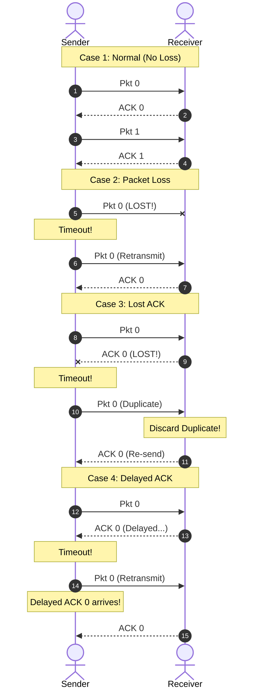

# 🔄 Chapter 03: Reliable Data Transfer (RDT, Go-Back-N, and Selective Repeat)

---

## 1. Overview (Topic Introduction)
The fundamental challenge of the Transport Layer is to create a **Reliable Data Transfer (RDT)** service on top of an underlying Network Layer (IP) that is inherently **unreliable** (packets can be corrupted, lost, duplicated, or delivered out of order). This chapter examines the evolution of reliable protocols from basic **Stop-and-Wait** to high-throughput pipelined protocols: **Go-Back-N (GBN)** and **Selective Repeat (SR)**.

---

## 2. Learning Objectives
After studying this chapter, you will be able to:
* Analyze the four operational failure modes of **Stop-and-Wait**: No Loss, Packet Loss, ACK Loss, and Delayed ACK.
* Understand why pipelining is mathematically necessary to overcome the abysmal link utilization of Stop-and-Wait.
* Trace sliding window operations in **Go-Back-N (GBN)** with **Cumulative Acknowledgements**.
* Trace sliding window operations in **Selective Repeat (SR)** with **Individual Acknowledgements** and **Receiver Buffering**.
* Compare GBN and SR in terms of retransmission bandwidth overhead, sender complexity, and receiver buffer memory requirements.

---

## 3. Core Concepts

### 3.1 Stop-and-Wait: The 4 Operational Cases (From CN Class Note 2, Page 6)
In Stop-and-Wait, the sender transmits one packet (`Pkt 0`) and waits for an acknowledgement (`ACK 0`) before transmitting the next (`Pkt 1`).
1. **Case 1: No Loss (Normal Operation):** Sender sends `Pkt 0` $\to$ Receiver receives $\to$ sends `ACK 0` $\to$ Sender sends `Pkt 1`.
2. **Case 2: Data Packet Loss:** Sender sends `Pkt 0` (lost on wire). Sender's countdown timer expires (**Timeout**) $\to$ Sender retransmits `Pkt 0`.
3. **Case 3: ACK Loss:** Sender sends `Pkt 0` $\to$ Receiver sends `ACK 0` (lost on wire). Sender times out $\to$ retransmits `Pkt 0`. Receiver detects duplicate sequence number $\to$ discards duplicate packet, re-sends `ACK 0`.
4. **Case 4: Premature Timeout / Delayed ACK:** Sender sends `Pkt 0`. The network is slow; timeout occurs before `ACK 0` arrives. Sender retransmits `Pkt 0`. The delayed `ACK 0` arrives at sender; receiver receives duplicate `Pkt 0` and sends another `ACK 0`.

*Limitation:* Extremely poor link utilization ($U_{\text{sender}} \ll 1\%$). To utilize high-bandwidth links, we must use **Pipelining**.

---

### 3.2 Go-Back-N (GBN) vs. Selective Repeat (SR) Comparison

| Feature | Go-Back-N (GBN) | Selective Repeat (SR) |
|---|---|---|
| **Acknowledgement Type** | **Cumulative ACK:** `ACK n` acknowledges all packets up to and including $n$. | **Individual ACK:** `ACK n` acknowledges *only* packet $n$. |
| **Out-of-Order Packets** | **Discarded!** Receiver refuses to buffer out-of-order packets. Re-sends duplicate ACK for highest in-order packet. | **Buffered!** Receiver stores out-of-order packets in memory buffer until missing packet arrives. |
| **Timeout Retransmission** | **Retransmits ALL $N$ packets** in the sliding window starting from the lost packet! | **Retransmits ONLY the single lost packet** whose timer expired. |
| **Receiver Buffer** | Size = 1 (No buffer needed). | Size = $N$ (Requires memory buffer). |
| **Bandwidth Efficiency** | Lower (Wastes bandwidth retransmitting packets receiver already saw). | Maximum (Only lost packets cross the wire). |

---

## 4. Visual Explanation (Diagrams)

### 4.1 Stop-and-Wait Operational Modes (From CN Class Note 2, Page 6)


---

### 4.2 Go-Back-N (GBN) Sliding Window: Packet 2 Lost (From CN Class Note 2, Page 7)
```
Sender Window = 4:  [ 0  1  2  3 ] 4  5  6
Sender sends: Pk0, Pk1, Pk2 (LOST!), Pk3

Pk0 received -> Receiver sends ACK 0 -> Window slides: 0 [ 1  2  3  4 ] 5  6 -> Sends Pk4
Pk1 received -> Receiver sends ACK 1 -> Window slides: 0  1 [ 2  3  4  5 ] 6 -> Sends Pk5
Pk2 LOST! (X)
Pk3 received -> Out of order! Discarded! -> Receiver sends duplicate ACK 1
Pk4 received -> Out of order! Discarded! -> Receiver sends duplicate ACK 1
Pk5 received -> Out of order! Discarded! -> Receiver sends duplicate ACK 1

TIMEOUT at Sender for Pk2!
Sender must RETRANSMIT ENTIRE WINDOW: Pk2, Pk3, Pk4, Pk5!
```

---

### 4.3 Selective Repeat (SR) Sliding Window: Packet 2 Lost (From CN Class Note 2, Page 8)
```
Sender Window = 4:  [ 0  1  2  3 ] 4  5  6
Sender sends: Pk0, Pk1, Pk2 (LOST!), Pk3

Pk0 received -> Delivered to App -> Receiver sends ACK 0
Pk1 received -> Delivered to App -> Receiver sends ACK 1
Pk2 LOST! (X)
Pk3 received -> Out of order! -> BUFFERED in Receiver Memory! -> Sends ACK 3
Pk4 received -> BUFFERED in Receiver Memory! -> Sends ACK 4
Pk5 received -> BUFFERED in Receiver Memory! -> Sends ACK 5

TIMEOUT at Sender for Pk2!
Sender retransmits ONLY Pk2!

Pk2 received -> Receiver delivers Pk2, Pk3, Pk4, Pk5 in-order to App! -> Sends ACK 2
Zero retransmission waste!
```

---

## 5. Step-by-Step GBN vs. SR Decision Rules
* **GBN Receiver Rule:**
  - If packet with `Seq == expected_seq`: Accept, deliver to App, increment `expected_seq`, send `ACK expected_seq`.
  - Else: **Discard packet**, re-send `ACK (expected_seq - 1)`.
* **SR Receiver Rule:**
  - If packet in `[rcv_base, rcv_base + N - 1]`: Send individual `ACK n`. If out of order, **buffer it**. If packet fills gap at `rcv_base`, deliver all consecutive buffered packets to App and advance `rcv_base`.

---

## 6. Real-Life Example
* **Classroom Homework Analogy:**
  - The teacher asks for Assignments 1, 2, 3, 4.
  - Student hands in 1, then forgets 2, but hands in 3 and 4.
  - **Go-Back-N Teacher:** Throws assignments 3 and 4 into the trash! Tells the student: "I am missing assignment 2! Go home and redo 2, 3, AND 4!"
  - **Selective Repeat Teacher:** Keeps 3 and 4 on the desk (**buffered**). Tells the student: "I have 3 and 4 safe, just bring me assignment 2 tomorrow!"

---

## 7. Practical Implementation (Python Pipelining Simulator)

```python
def simulate_loss(protocol="GBN", window_size=4, total_packets=6, lost_packet=2):
    print(f"=== Simulating {protocol} with Window={window_size}, Lost Pkt={lost_packet} ===")
    sent_count = 0

    if protocol == "GBN":
        # Initial window sent: 0, 1, 2, 3
        # Pkt 0, 1 succeed. Pkt 2 lost. Pkts 3, 4, 5 sent but discarded by receiver.
        # Timeout on 2 triggers retransmission of 2, 3, 4, 5.
        transmissions = [0, 1, 2, 3, 4, 5] + [2, 3, 4, 5]
        print(f"GBN Transmissions ({len(transmissions)} packets sent):", transmissions)
    elif protocol == "SR":
        # Initial window sent: 0, 1, 2, 3
        # Pkt 0, 1 succeed. Pkt 2 lost. Pkts 3, 4, 5 buffered by receiver.
        # Timeout on 2 triggers retransmission of ONLY Pkt 2!
        transmissions = [0, 1, 2, 3, 4, 5] + [2]
        print(f"SR  Transmissions ({len(transmissions)} packets sent):", transmissions)

simulate_loss("GBN")
simulate_loss("SR")
```

---

## 8. Common Mistakes & Pitfalls
> [!WARNING]
> * **Assuming GBN Buffers Packets:** GBN receivers *never* buffer out-of-order packets. They immediately discard them!
> * **Window Size Constraint in SR:** In Selective Repeat, the window size $N$ must be less than or equal to half the sequence number space ($N \le 2^{k-1}$) to prevent sequence number ambiguity!

---

## 9. Practice Problems & Exam Walkthroughs

### 📝 Problem 1 (From CN Class Note 2, Page 8: Exam 251 Q1(c))
**Question:** A sender uses a sliding window protocol with window size $N = 4$ and sends packets `0, 1, 2, 3, 4, 5`. Packet 1 is lost during transmission.
1. Trace the sequence of transmitted packets and ACKs for **Go-Back-N**.
2. Trace the sequence of transmitted packets and ACKs for **Selective Repeat**.

**Step-by-Step Solution:**
1. **Go-Back-N (GBN):**
   * Sender transmits: `Pk0, Pk1 (LOST), Pk2, Pk3`.
   * Receiver gets `Pk0` $\to$ sends `ACK 0`.
   * Sender window slides to `[1 2 3 4]`, transmits `Pk4`.
   * Receiver gets `Pk2` (out of order, expecting 1) $\to$ discards `Pk2`, sends duplicate `ACK 0`.
   * Receiver gets `Pk3` $\to$ discards `Pk3`, sends duplicate `ACK 0`.
   * Receiver gets `Pk4` $\to$ discards `Pk4`, sends duplicate `ACK 0`.
   * Timer for `Pk1` times out at sender!
   * Sender retransmits all unacknowledged packets: `Pk1, Pk2, Pk3, Pk4`.
2. **Selective Repeat (SR):**
   * Sender transmits: `Pk0, Pk1 (LOST), Pk2, Pk3`.
   * Receiver gets `Pk0` $\to$ delivers to App, sends `ACK 0`.
   * Receiver gets `Pk2` $\to$ buffers `Pk2`, sends `ACK 2`.
   * Receiver gets `Pk3` $\to$ buffers `Pk3`, sends `ACK 3`.
   * Sender sends `Pk4` $\to$ Receiver buffers `Pk4`, sends `ACK 4`.
   * Timer for `Pk1` times out at sender!
   * Sender retransmits **ONLY `Pk1`**.
   * Receiver receives `Pk1`, combines with buffered `Pk2, Pk3, Pk4`, delivers all to App, and sends `ACK 1`.

---

## 10. Knowledge Check (MCQ & Quizzes)

#### Q1. In Go-Back-N, what does receiving `ACK 4` signify to the sender?
- [ ] A) Only packet 4 was received; packets 0, 1, 2, 3 may still be lost.
- [x] B) All packets 0, 1, 2, 3, and 4 have been successfully received (Cumulative ACK).
- [ ] C) Packet 4 was lost and needs retransmission.
- [ ] D) The sender should close the connection.
*Explanation:* GBN uses cumulative acknowledgements; `ACK n` confirms that all packets up to $n$ have been correctly received in order.

#### Q2. Why does Selective Repeat require memory buffers at the receiver?
- [ ] A) To calculate the IP checksum.
- [ ] B) To store packets when the link speed increases.
- [x] C) To hold correctly received out-of-order packets until missing lower-sequence packets arrive.
- [ ] D) To convert TCP segments into UDP datagrams.
*Explanation:* Because SR does not discard out-of-order packets, it buffers them so they can be delivered to the application layer in-order once the gap is filled.

---

#### Q3. In Go-Back-N (GBN), if the sender window size is N=4, sequence numbers are 0-7, and ACK 2 is received but ACK 3 is lost, what happens when ACK 4 arrives?
- [ ] A) The sender retransmits packets 3 and 4
- [x] B) ACK 4 is a **cumulative ACK** — it implicitly acknowledges all packets up to and including packet 4, so the sender slides the window forward past packet 3 (no retransmission needed)
- [ ] C) ACK 4 is discarded because ACK 3 was not received first
- [ ] D) The sender must restart from packet 0 (reset)
*Explanation:* **GBN uses cumulative acknowledgements**. `ACK n` means "I have correctly received all packets up to and including packet n". So `ACK 4` implicitly acknowledges packet 3 even if `ACK 3` was lost. The sender slides the window forward — no retransmission of packet 3 is needed.

#### Q4. What is the minimum number of sequence numbers required for a Selective Repeat (SR) protocol with window size W?
- [ ] A) W sequence numbers
- [ ] B) W + 1 sequence numbers
- [x] C) 2W sequence numbers (sequence number space must be at least twice the window size)
- [ ] D) W² sequence numbers
*Explanation:* For **Selective Repeat**, the total sequence number space must be $\geq 2W$ to prevent **sequence number ambiguity**. If sequence space were only W, the receiver could not distinguish between a retransmitted old packet and a new packet from the next window cycle. For GBN, the requirement is only $\geq W + 1$.

#### Q5. What is the key difference between the Go-Back-N and Selective Repeat protocols when a packet loss is detected?
- [ ] A) GBN requires the receiver to buffer out-of-order packets; SR does not
- [x] B) GBN retransmits the lost packet AND all subsequent packets in the window; SR only retransmits the specific lost packet while buffering correctly-received later packets
- [ ] C) SR has a larger window size than GBN
- [ ] D) GBN uses cumulative ACKs; SR does not use ACKs at all
*Explanation:* **GBN**: upon detecting a loss (timeout or NAK), the sender goes back and retransmits from the lost packet onwards — simple receiver (no buffering needed), but wastes bandwidth on correctly-delivered packets. **SR**: receiver buffers out-of-order packets; sender only retransmits the specific lost packet — more efficient but requires complex receiver-side buffering.

#### Q6. In Stop-and-Wait protocol, what is the maximum link utilization (efficiency) for a 1 Gbps link, 10 ms RTT, and 8000-bit packets?
- [x] A) Approximately 0.04% — Stop-and-Wait is extremely inefficient on high-bandwidth, long-delay links: $U = \frac{L/R}{RTT + L/R} = \frac{8\ \mu s}{10,008\ \mu s} \approx 0.0008$
- [ ] B) 50% — sender transmits half the time
- [ ] C) 100% — the link is always busy
- [ ] D) 10% — one packet every 10 RTTs
*Explanation:* $L/R = 8000 / 10^9 = 8 \times 10^{-6}\ s = 8\ \mu s$. RTT = 10,000 μs. $U = 8 / (10,000 + 8) \approx 0.0008 = 0.08\%$. Stop-and-Wait is **catastrophically inefficient** on high-bandwidth long-delay paths. This motivates pipelining protocols (GBN, SR, TCP).


## 11. Summary & Revision Sheet
* **Stop-and-Wait:** Send 1, wait for ACK. Poor link utilization.
* **GBN:** Cumulative ACK, receiver discards out-of-order, retransmits entire window on timeout.
* **SR:** Individual ACK, receiver buffers out-of-order, retransmits only lost packet on timeout.

---

---

## 🔗 Related Topics

> Connect your understanding — explore these closely related chapters:

- 📖 [UDP & Checksum](02-udp-and-internet-checksum.md) — The unreliable channel that rdt abstracts over
- 📖 [TCP](04-tcp-principles-and-handshake.md) — rdt3.0 principles directly implemented in TCP
- 📖 [TCP Flow & Congestion Control](05-tcp-flow-and-congestion-control.md) — Advanced mechanisms built on rdt foundations

## 12. References & Further Reading
* Kurose & Ross, Chapter 3.4: *Principles of Reliable Data Transfer*.


---

<div align="center">

| [⬅️ Previous](02-udp-and-internet-checksum.md) | [🏠 Module Index](README.md) | [Next ➡️](04-tcp-principles-and-handshake.md) |
|:---:|:---:|:---:|

</div>
