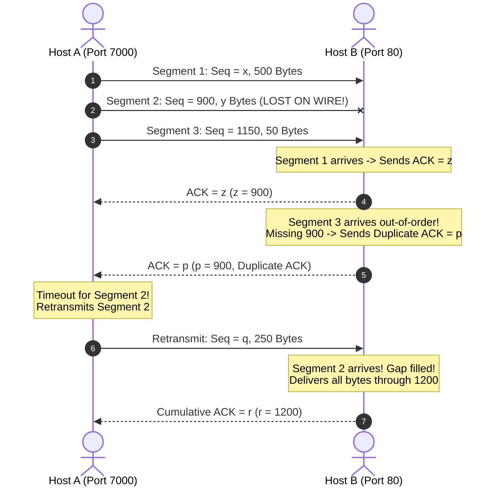

# 🤝 Chapter 04: TCP Mechanics, Sequence/ACK Numbers, and Handshakes

---

## 1. Overview (Topic Introduction)
The **Transmission Control Protocol (TCP)** is the foundational connection-oriented workhorse of the Internet (RFC 793). It transforms an unreliable packet network into a reliable, in-order, full-duplex stream of bytes. To accomplish this, TCP employs byte-stream sequence numbering, cumulative acknowledgements with piggybacking, stateful connection setup (**3-Way Handshake**), and graceful termination (**4-Way Teardown**).

---

## 2. Learning Objectives
After studying this chapter, you will be able to:
* Interpret the fields of the **TCP Segment Header** (20-byte baseline).
* Calculate **Sequence Numbers** (starting byte index) and **Acknowledgement Numbers** (next expected byte).
* Understand why **SYN** and **FIN** control packets consume 1 byte of sequence space even without payload data.
* Trace the **3-Way Handshake** connection setup using flag bit vectors `[SYN | ACK | FIN]`.
* Trace the **4-Way Connection Teardown** sequence.
* Solve complex exam ladder problems with lost segments and compute missing transmission variables ($x, y, z, p, q, r$).

---

## 3. Core Concepts

### 3.1 Sequence and Acknowledgement Numbers
TCP views data not as a sequence of discrete packets, but as an unstructured, ordered **stream of bytes**.
* **Sequence Number:** The byte-stream number of the **first data byte** in the segment's payload.
* **Acknowledgement Number:** The sequence number of the **next byte** the receiver is expecting from the sender:
  $$\text{ACK Number} = \text{Sequence Number Received} + \text{Payload Bytes Received}$$
* **Piggybacking:** An acknowledgement from Host B to Host A can be carried inside the same segment carrying return data from B to A.

---

### 3.2 TCP Control Flags
The TCP header contains a 6-bit flag field:
* **SYN (Synchronize):** Used strictly during connection establishment.
* **ACK (Acknowledgement):** Set to 1 in all segments after the initial SYN packet.
* **FIN (Finish):** Used to gracefully close a connection.
* **RST (Reset):** Abruptly aborts a connection.

> [!IMPORTANT]
> **Byte Consumption of Control Messages:** Both a `SYN` segment and a `FIN` segment consume **1 byte of sequence number space**, ensuring that the receiver must acknowledge them!

---

### 3.3 Connection Lifecycle

#### 1. The 3-Way Handshake (Connection Setup):
```
Client (Initiator)                                Server (Listener)
      │                                                   │
      │ 1. SYN = 1, ACK = 0, Seq = x                      │  [1 0 0]
      ├──────────────────────────────────────────────────▶│
      │                                                   │
      │ 2. SYN = 1, ACK = 1, Seq = y, Ack = x + 1         │  [1 1 0]
      │◀──────────────────────────────────────────────────┤
      │                                                   │
      │ 3. SYN = 0, ACK = 1, Seq = x + 1, Ack = y + 1     │  [0 1 0]
      ├──────────────────────────────────────────────────▶│
      │           (Connection ESTABLISHED!)               │
```

#### 2. The 4-Way Connection Teardown (Connection Close):
Since TCP is full-duplex, each direction of data transfer must be closed independently:
```
Client                                            Server
      │                                                   │
      │ 1. FIN = 1, ACK = 0, Seq = x                      │  [0 0 1]
      ├──────────────────────────────────────────────────▶│
      │ 2. ACK = 1, Ack = x + 1                           │  [0 1 0]
      │◀──────────────────────────────────────────────────┤
      │                                                   │
      │ 3. FIN = 1, ACK = 0, Seq = y                      │  [0 0 1]
      │◀──────────────────────────────────────────────────┤
      │ 4. ACK = 1, Ack = y + 1                           │  [0 1 0]
      ├──────────────────────────────────────────────────▶│
      ▼                                                   ▼
 (Connection CLOSED)                              (Connection CLOSED)
```

---

## 4. Visual Explanation (Diagrams)

### 4.1 Missing Variable TCP Sequence/ACK Ladder (From CN Class Note 2, Page 12)


---

## 5. Step-by-Step Mathematical Derivation of $x, y, z, p, q, r$

From the ladder diagram above:
1. **Find $x$ (Initial Seq):**
   - Segment 1 starts at byte $x$ and contains $500\text{ Bytes}$.
   - The next segment (Segment 2) starts at byte $900$.
   - Therefore:
     $$x + 500 = 900 \implies \mathbf{x = 400}$$
2. **Find $y$ (Segment 2 Payload):**
   - Segment 2 starts at byte $900$ and contains $y\text{ Bytes}$.
   - The next segment (Segment 3) starts at byte $1150$.
   - Therefore:
     $$900 + y = 1150 \implies \mathbf{y = 250\text{ Bytes}}$$
3. **Find $z$ (First ACK):**
   - Host B receives Segment 1 (bytes 400 through 899).
   - Host B expects byte $900$ next:
     $$\mathbf{z = 900}$$
4. **Find $p$ (Duplicate ACK after Segment 2 Loss):**
   - Host B receives Segment 3 (bytes 1150 to 1199), but is still missing byte 900!
   - TCP cumulative acknowledgement rules dictate re-acknowledging the highest in-order byte received:
     $$\mathbf{p = 900} \quad (\text{Duplicate ACK})$$
5. **Find $q$ (Retransmission Sequence Number):**
   - Sender times out for the lost Segment 2 and retransmits it.
   - Retransmission carries the identical starting byte:
     $$\mathbf{q = 900}$$
6. **Find $r$ (Final Cumulative ACK):**
   - Host B now has all bytes from 400 through 1199 without gaps ($900 + 250 + 50 = 1200$).
   - Next expected byte is:
     $$\mathbf{r = 1200}$$

---

## 6. Real-Life Example
* **Telephone Protocol Analogy:**
  - Alice: "Hello Bob, can you hear me?" (**SYN**)
  - Bob: "Yes Alice, I hear you! Can you hear me?" (**SYN-ACK**)
  - Alice: "Yes, loud and clear! Let's talk." (**ACK**)
  - *Data transmission begins.*

---

## 7. Practical Implementation (Python TCP Sequence Tracker)

```python
class TCPSession:
    def __init__(self, client_isn, server_isn):
        self.client_seq = client_isn
        self.server_seq = server_isn

    def handshake(self):
        print(f"1. Client -> Server: SYN=1, Seq={self.client_seq}")
        # SYN consumes 1 byte
        self.server_ack = self.client_seq + 1

        print(f"2. Server -> Client: SYN=1, ACK=1, Seq={self.server_seq}, Ack={self.server_ack}")
        # SYN consumes 1 byte
        self.client_ack = self.server_seq + 1
        self.client_seq += 1

        print(f"3. Client -> Server: ACK=1, Seq={self.client_seq}, Ack={self.client_ack}")
        self.server_seq += 1
        print("[+] 3-Way Handshake Complete! Connection Established.")

    def send_data(self, sender, length_bytes):
        if sender == "client":
            seq = self.client_seq
            self.client_seq += length_bytes
            expected_ack = self.client_seq
            print(f"Client sends {length_bytes}B (Seq={seq}) -> Expects Ack={expected_ack}")
            return expected_ack

session = TCPSession(client_isn=1000, server_isn=5000)
session.handshake()
session.send_data("client", 250)
```

---

## 8. Common Mistakes & Pitfalls
> [!WARNING]
> * **Setting ACK = Seq received:** Remember, ACK is NEVER the sequence number just received; it is the **next byte expected** ($\text{Seq} + \text{Length}$)!
> * **Forgetting SYN/FIN sequence consumption:** In handshake calculations, always add $+1$ for the SYN packet.

---

## 9. Practice Problems & Exam Walkthroughs

### 📝 Problem 1 (From CN Class Note 2, Page 12: Exam 253 Q1(c))
**Question:** In a TCP transmission between Host A (port 7000) and Host B (port 80):
* Segment 1 has `Seq = x`, data = $500\text{ B}$.
* Segment 2 has `Seq = 900`, data = $y\text{ B}$ (lost during transmission).
* Segment 3 has `Seq = 1150`, data = $50\text{ B}$.
Host B sends ACKs $z$ and $p$. After timeout, Host A retransmits `Seq = q` with $250\text{ B}$, and Host B sends ACK $r$.
1. Find the values of $x, y, z, p, q, r$.
2. Specify the Source Port and Destination Port for packets traveling from Host B to Host A.

**Step-by-Step Solution:**
1. **Values Calculated:**
   - $x = 900 - 500 = \mathbf{400}$
   - $y = 1150 - 900 = \mathbf{250\text{ Bytes}}$
   - $z = 400 + 500 = \mathbf{900}$
   - $p = \mathbf{900}$ (Duplicate ACK since segment 2 is missing)
   - $q = \mathbf{900}$ (Retransmission of lost segment 2)
   - $r = 900 + 250 + 50 = \mathbf{1200}$
2. **Ports for Return Traffic (Host B $\to$ Host A):**
   - Source Port: $\mathbf{80}$
   - Destination Port: $\mathbf{7000}$

---

## 10. Knowledge Check (MCQ & Quizzes)

#### Q1. Host A sends Host B a TCP segment with Sequence Number 1500 containing 200 Bytes of data. What ACK Number does Host B return?
- [ ] A) 1500
- [ ] B) 1699
- [x] C) 1700
- [ ] D) 1701
*Explanation:* The payload covers bytes 1500 through 1699. The next byte expected by Host B is $1500 + 200 = 1700$.

#### Q2. Why does closing a TCP connection require a 4-Way handshake instead of a 3-Way handshake?
- [ ] A) The 4th segment is used to recalculate the checksum.
- [x] B) TCP is full-duplex; each direction of data transfer must be closed independently.
- [ ] C) TCP switches to UDP during termination.
- [ ] D) To prevent IP spoofing attacks.
*Explanation:* Because TCP connections are full-duplex, one side closing its transmission channel (`FIN`) does not prevent the other side from continuing to send data until it also sends a `FIN`.

---

## 11. Summary & Revision Sheet
* **Seq Number:** Starting byte index of data in segment.
* **ACK Number:** Next byte expected ($\text{Received Seq} + \text{Bytes}$).
* **3-Way Handshake:** `SYN (x)` $\to$ `SYN-ACK (y, x+1)` $\to$ `ACK (x+1, y+1)`.
* **4-Way Close:** `FIN` $\to$ `ACK` $\to$ `FIN` $\to$ `ACK`.
* **SYN & FIN:** Each consume **1 Byte** of sequence space!

---

---

## 🔗 Related Topics

> Connect your understanding — explore these closely related chapters:

- 📖 [Reliable Data Transfer](03-reliable-data-transfer.md) — rdt principles that TCP implements
- 📖 [TCP Flow & Congestion Control](05-tcp-flow-and-congestion-control.md) — rwnd and cwnd mechanisms
- 📖 [Cryptography](../02-network-security-fundamentals/01-cia-triad-and-cryptography.md) — TLS handshake extends the TCP 3-way handshake

## 12. References & Further Reading
* RFC 793: *Transmission Control Protocol*.
* Kurose & Ross, Chapter 3.5: *Connection-Oriented Transport: TCP*.


---

<div align="center">

| [⬅️ Previous](03-reliable-data-transfer.md) | [🏠 Module Index](README.md) | [Next ➡️](05-tcp-flow-and-congestion-control.md) |
|:---:|:---:|:---:|

</div>
