# 📈 Chapter 05: TCP Flow Control and Congestion Control

---

## 1. Overview (Topic Introduction)
TCP must prevent two distinct types of failure in data delivery:
1. **Overwhelming the Receiver:** The sender transmits data faster than the receiving application process can read from its socket buffer (**Flow Control**).
2. **Overwhelming the Network Core:** Too many sources attempt to send data faster than intermediate router queues and links can handle (**Congestion Control**).

This chapter analyzes how TCP elegantly solves both challenges through the advertised receiver window ($rwnd$), the dynamic congestion window ($cwnd$), **Slow Start**, **AIMD (Additive Increase, Multiplicative Decrease)**, and loss recovery mechanisms.

---

## 2. Learning Objectives
After studying this chapter, you will be able to:
* Distinguish clearly between **Flow Control** (End-to-End buffer protection) and **Congestion Control** (Network core protection).
* Explain how the **Receive Window ($rwnd$)** throttles transmission speed based on buffer availability.
* Trace the exponential growth of the **Congestion Window ($cwnd$)** during **Slow Start**.
* Analyze the linear growth and sawtooth pattern of **Additive Increase, Multiplicative Decrease (AIMD)**.
* Differentiate between how TCP reacts to **Triple Duplicate ACKs** (mild congestion $\to$ Fast Recovery) versus a **Timeout** (severe congestion $\to$ reset to $1\text{ MSS}$).
* Solve university exam problems tracing $cwnd$ and $ssthresh$ evolution across multiple RTT rounds.

---

## 3. Core Concepts

### 3.1 Flow Control vs. Congestion Control

```
Flow Control:                               Congestion Control:
Sender Host ════════════════════> Receiver  Sender Hosts ════> [ Router ] ════> Destination
                                  Buffer                       [ Bottleneck ]
                                  (rwnd)                       [ Buffer     ]
Protects: The Receiver's Buffer             Protects: Intermediate Network Routers
Signaled by: Explicit 'rwnd' in TCP header  Inferred by: Packet loss (Timeouts / 3-Dup ACKs)
```

#### Flow Control Mechanics:
* Receiver allocates a receive buffer of size `RcvBuffer`.
* The application reads data from the buffer at rate $R_{\text{read}}$.
* Receiver advertises its spare buffer space in the **`rwnd`** field of every outgoing TCP header:
  $$rwnd = \text{RcvBuffer} - (\text{LastByteRcvd} - \text{LastByteRead})$$
* **Sender Rule:** Ensure unacknowledged in-flight data does not exceed $rwnd$:
  $$\text{LastByteSent} - \text{LastByteAcked} \le rwnd$$

---

### 3.2 TCP Congestion Control: The 3 Phases
The sender limits its transmission rate to $\min(cwnd, rwnd)$. In practice, assuming $rwnd$ is large, the rate is governed by $cwnd$:

#### 1. Slow Start (SS):
* *Initial State:* Starts with $cwnd = 1\text{ MSS}$ (Maximum Segment Size).
* *Growth Rule:* For **every ACK received**, $cwnd$ increases by $1\text{ MSS}$.
* *Result:* $cwnd$ **doubles every RTT** ($1 \to 2 \to 4 \to 8 \to 16 \dots$)!
* *Exit Condition:* When $cwnd$ reaches the **Slow Start Threshold ($ssthresh$)**, TCP switches to Congestion Avoidance.

#### 2. Congestion Avoidance (AIMD - Additive Increase):
* *Growth Rule:* Increases $cwnd$ by **$1\text{ MSS}$ per RTT** (linear growth: $33 \to 34 \to 35 \dots$).
* Probes for extra available bandwidth cautiously.

#### 3. Loss Event Recovery (Multiplicative Decrease):
When packet loss occurs, TCP reacts based on how the loss was detected:

| Loss Event | Severity | Action Taken by TCP Reno |
|---|---|---|
| **3 Duplicate ACKs** | **Mild Congestion:** Routers still forwarded subsequent packets to trigger ACKs! | 1. $ssthresh = \lfloor cwnd / 2 \rfloor$<br/>2. $cwnd = ssthresh$<br/>3. Continues in **Congestion Avoidance (Additive Increase)** via Fast Recovery! |
| **Timeout** | **Severe Congestion:** Network pipeline is completely clogged; no packets moving! | 1. $ssthresh = \lfloor cwnd / 2 \rfloor$<br/>2. **$cwnd = 1\text{ MSS}$** (Crashes to bottom!)<br/>3. Restarts in **Slow Start**! |

---

## 4. Visual Explanation (Diagrams)

### 4.1 Congestion Window Sawtooth Curve (From CN Class Note 2, Page 15 & 16)

```mermaid
graph LR
    subgraph Slow_Start["Slow Start (Exponential)"]
        S1["RTT 1: cwnd = 1"] --> S2["RTT 2: cwnd = 2"]
        S2 --> S3["RTT 3: cwnd = 4"]
        S3 --> S4["RTT 4: cwnd = 8"]
        S4 --> S5["RTT 5: cwnd = 16"]
        S5 --> S6["RTT 6: cwnd = 32 (ssthresh)"]
    end

    subgraph Congestion_Avoidance["Congestion Avoidance (Linear +1/RTT)"]
        S6 --> C1["RTT 7: 33"] --> C2["..."] --> C3["RTT 14: 40"]
    end

    subgraph Loss_Event_1["3 Duplicate ACKs at cwnd=40"]
        C3 --> L1["ssthresh = 20\ncwnd = 20\n(Continues Linear +1)"]
    end

    subgraph Congestion_Avoidance_2["Linear Growth"]
        L1 --> C4["RTT 15: 21"] --> C5["..."] --> C6["RTT 21: 26"]
    end

    subgraph Loss_Event_2["Timeout at cwnd=26"]
        C6 --> T1["ssthresh = 13\ncwnd = 1 MSS!\n(Restarts Slow Start!)"]
    end
```


---

## 5. Step-by-Step Congestion Tracing Algorithm
1. **Initialize:** Set $cwnd = 1\text{ MSS}$, set $ssthresh = \text{initial value}$ (e.g., 32).
2. **If $cwnd < ssthresh$:** In **Slow Start** $\to$ double $cwnd$ each RTT.
3. **If $cwnd \ge ssthresh$:** In **Congestion Avoidance** $\to$ increment $cwnd$ by 1 each RTT.
4. **On 3 Duplicate ACKs:**
   - Cut $ssthresh = cwnd / 2$.
   - Set $cwnd = ssthresh$.
   - Stay in linear growth.
5. **On Timeout:**
   - Cut $ssthresh = cwnd / 2$.
   - Reset $cwnd = 1$.
   - Enter Slow Start until new $ssthresh$.

---

## 6. Real-Life Example
* **Automobile Highway Analogy:**
  - When merging onto an empty highway, you accelerate rapidly (**Slow Start**).
  - Approaching the speed limit, you ease up on the pedal, clicking up 1 mph at a time (**Congestion Avoidance**).
  - If you see brake lights tap ahead (**3 Duplicate ACKs**), you tap your brakes, drop to half speed, and continue moving (**Fast Recovery**).
  - If the entire highway comes to a dead standstill crash (**Timeout**), you slam to zero mph, shift to 1st gear, and restart moving from 1 mph (**Slow Start from $cwnd = 1$**).

---

## 7. Practical Implementation (Python cwnd Tracing Simulator)

```python
def trace_tcp_congestion(initial_ssthresh=32, rounds=25, loss_events={}):
    """
    loss_events: dict mapping RTT round -> '3dup' or 'timeout'
    """
    cwnd = 1
    ssthresh = initial_ssthresh
    history = []

    for rtt in range(1, rounds + 1):
        event = loss_events.get(rtt, None)

        if event == '3dup':
            ssthresh = max(1, cwnd // 2)
            cwnd = ssthresh
            state = f"3-DUP ACK! (ssthresh={ssthresh}, cwnd={cwnd})"
        elif event == 'timeout':
            ssthresh = max(1, cwnd // 2)
            cwnd = 1
            state = f"TIMEOUT! (ssthresh={ssthresh}, cwnd={cwnd})"
        else:
            if cwnd < ssthresh:
                state = f"Slow Start (cwnd={cwnd})"
                cwnd *= 2
                if cwnd > ssthresh:
                    cwnd = ssthresh
            else:
                state = f"Congestion Avoidance (cwnd={cwnd})"
                cwnd += 1

        history.append((rtt, state))

    return history

# Trace matching CN Class Note 2, Page 16:
# Round 14 has 3 Duplicate ACKs, Round 22 has a Timeout
events = {14: '3dup', 22: 'timeout'}
trace = trace_tcp_congestion(initial_ssthresh=32, rounds=24, loss_events=events)
for rtt, st in trace[10:24]:
    print(f"RTT {rtt:02d}: {st}")
```

---

## 8. Common Mistakes & Pitfalls
> [!WARNING]
> * **Resetting $cwnd$ to 1 on 3 Duplicate ACKs:** In TCP Reno, 3 Duplicate ACKs drops $cwnd$ to **half** ($cwnd / 2$), NOT to 1! Only a **Timeout** drops $cwnd$ to $1\text{ MSS}$.
> * **Confusing $rwnd$ with $cwnd$:** $rwnd$ is set by the **destination host** based on its physical RAM buffer; $cwnd$ is set dynamically by the **sender host** based on network loss.

---

## 9. Practice Problems & Exam Walkthroughs

### 📝 Problem 1 (From CN Class Note 2, Page 16: Master Tracing Problem)
**Question:** A TCP connection begins with $ssthresh = 32\text{ MSS}$.
1. Tracing RTT rounds 0 to 6, what is the value of $cwnd$ at round 6?
2. During rounds 7 to 14, what phase is active and what is $cwnd$ at round 14?
3. At round 14, **3 Duplicate ACKs** are received. What are the new values of $ssthresh$ and $cwnd$?
4. The connection continues through round 21. At round 22, a **Timeout** occurs when $cwnd = 26\text{ MSS}$. What are the new values of $ssthresh$ and $cwnd$, and what phase begins next?

**Step-by-Step Solution:**
1. **Rounds 0 to 6 (Slow Start):**
   - $cwnd$ doubles every RTT:
     $$\text{RTT 0: } 1 \to \text{RTT 1: } 2 \to \text{RTT 2: } 4 \to \text{RTT 3: } 8 \to \text{RTT 4: } 16 \to \text{RTT 5: } 32$$
   - At round 5/6, $cwnd$ hits $ssthresh = \mathbf{32\text{ MSS}}$.
2. **Rounds 7 to 14 (Congestion Avoidance):**
   - In Congestion Avoidance, $cwnd$ increases linearly by $+1\text{ MSS}$ per RTT:
     $$33 \to 34 \to 35 \to 36 \to 37 \to 38 \to 39 \to \mathbf{40\text{ MSS}}$$
   - At round 14, $cwnd = \mathbf{40\text{ MSS}}$.
3. **Loss Event at Round 14 (3 Duplicate ACKs):**
   - Mild congestion detected.
   - New $ssthresh = \frac{cwnd}{2} = \frac{40}{2} = \mathbf{20\text{ MSS}}$.
   - New $cwnd = ssthresh = \mathbf{20\text{ MSS}}$.
   - Phase continues in Congestion Avoidance (linear growth).
4. **Rounds 15 to 21:**
   - Grows linearly from $20$:
     $$20 \to 21 \to 22 \to 23 \to 24 \to 25 \to 26\text{ MSS}$$
5. **Loss Event at Round 22 (Timeout at $cwnd = 26$):**
   - Severe congestion detected.
   - New $ssthresh = \frac{cwnd}{2} = \frac{26}{2} = \mathbf{13\text{ MSS}}$.
   - New $cwnd = \mathbf{1\text{ MSS}}$.
   - Phase switches back to **Slow Start** until $cwnd$ reaches $13\text{ MSS}$!

---

## 10. Knowledge Check (MCQ & Quizzes)

#### Q1. When a TCP sender receives three duplicate acknowledgements, why does it NOT reset its congestion window to 1 MSS?
- [ ] A) The receiver requested a pause in transmission.
- [x] B) The arrival of duplicate ACKs proves that subsequent packets are still successfully traversing the network core.
- [ ] C) TCP switches to UDP mode.
- [ ] D) The sender assumes the receiver buffer is full.
*Explanation:* Duplicate ACKs can only be generated if later packets reached the receiver, proving the network core is not completely dead; hence Fast Recovery drops $cwnd$ only by half.

#### Q2. If $ssthresh = 16$ and current $cwnd = 8$, how many RTTs will it take for $cwnd$ to reach 16 assuming no packet loss?
- [ ] A) 8 RTTs
- [x] B) 1 RTT
- [ ] C) 2 RTTs
- [ ] D) 4 RTTs
*Explanation:* Since $cwnd < ssthresh$, the connection is in Slow Start. In Slow Start, $cwnd$ doubles every RTT. From $8$, one RTT doubles it to $16$.

---

#### Q3. TCP's receive window (rwnd) is set to 0 by the receiver. What mechanism prevents the sender from stopping permanently?
- [ ] A) The sender immediately closes the connection and reopens it
- [x] B) The sender continues sending **1-byte probe segments** ("persist timer" mechanism) to keep the connection alive and trigger updated window size advertisements from the receiver
- [ ] C) The sender waits for an ACK from the receiver before stopping
- [ ] D) The receiver automatically increases rwnd to 1 MSS after 30 seconds
*Explanation:* When rwnd = 0, if the sender just stops, a classic **deadlock** can occur: receiver buffers free up and sends `rwnd > 0` update, but that update is lost — both sides wait forever. The **persist timer** prevents this: when rwnd = 0, the sender periodically transmits **1-byte probe segments**, forcing the receiver to reply with its current rwnd even if the window update was lost.

#### Q4. What is the TCP **Fast Retransmit** mechanism and why is it preferred over waiting for a timeout?
- [ ] A) Fast Retransmit uses a shorter timeout value (50ms instead of default RTO)
- [x] B) When the sender receives 3 duplicate ACKs for the same sequence number, it immediately retransmits the missing segment WITHOUT waiting for the full RTO timeout — because 3 dup-ACKs indicate a specific packet was lost but subsequent ones arrived
- [ ] C) Fast Retransmit permanently halves the retransmission timeout (RTO) value
- [ ] D) Fast Retransmit only works in combination with SACK (Selective ACK) options
*Explanation:* 3 duplicate ACKs are a strong signal that a **specific segment is missing** but the following segments ARE being received. This is a mild loss event (network is still working). Waiting for the full **RTO** (which could be hundreds of milliseconds) wastes time unnecessarily. **Fast Retransmit** responds immediately, then enters **Fast Recovery** (CA mode, not Slow Start) — TCP Reno's key improvement.

#### Q5. After a TCP timeout event, the new ssthresh and cwnd values are set to what?
- [ ] A) ssthresh = cwnd / 2; cwnd = cwnd / 2 (halved, same as 3 dup-ACKs)
- [x] B) ssthresh = cwnd / 2; cwnd = 1 MSS — sender restarts from Slow Start, treating timeout as severe congestion
- [ ] C) ssthresh = 1; cwnd = 1 MSS — both reset to minimum
- [ ] D) ssthresh unchanged; cwnd = ssthresh
*Explanation:* A **timeout** is treated as severe congestion (much worse than 3 dup-ACKs). TCP Reno response: 1) `ssthresh = ⌊cwnd / 2⌋`. 2) `cwnd = 1 MSS`. 3) Enter **Slow Start** phase. The sender must rebuild cwnd from scratch, dramatically reducing throughput. Compare: 3 dup-ACKs only sets `cwnd = cwnd/2` and enters Congestion Avoidance (Fast Recovery).

#### Q6. TCP's AIMD (Additive Increase, Multiplicative Decrease) behavior produces a sawtooth cwnd pattern. What is the rationale for linear increase but multiplicative decrease?
- [x] A) Additive increase is conservative and fair — it probes for available bandwidth slowly. Multiplicative decrease reacts aggressively to congestion — quickly backing off to relieve the congested network element
- [ ] B) Additive increase is faster than multiplicative decrease in absolute bit terms
- [ ] C) AIMD is chosen for mathematical simplicity, not network efficiency
- [ ] D) The decrease should be additive too — AIMD is a legacy design that modern TCP replaces
*Explanation:* **Additive Increase** (add 1 MSS per RTT during CA): cautiously probes for unused bandwidth. **Multiplicative Decrease** (halve cwnd on loss): rapidly reduces load on the congested router to clear the queue. The asymmetry is intentional — slow to consume, fast to give back. Mathematically, AIMD converges to both **efficiency** (fully utilizing link capacity) and **fairness** (equal share among competing TCP flows) — proven by Chiu and Jain (1989).


## 11. Summary & Revision Sheet
* **Flow Control:** Controlled by receiver's advertised buffer: $rwnd$.
* **Congestion Control:** Controlled by sender's network estimate: $cwnd$.
* **Slow Start:** $cwnd < ssthresh \implies$ Doubles every RTT ($cwnd = cwnd \times 2$).
* **Congestion Avoidance:** $cwnd \ge ssthresh \implies$ Grows linearly ($+1\text{ MSS}$ per RTT).
* **3-Duplicate ACKs:** Mild loss $\to ssthresh = cwnd / 2$, $cwnd = ssthresh$, linear growth.
* **Timeout:** Severe loss $\to ssthresh = cwnd / 2$, **$cwnd = 1$**, Slow Start restart.

---

---

## 🔗 Related Topics

> Connect your understanding — explore these closely related chapters:

- 📖 [TCP Principles & Handshake](04-tcp-principles-and-handshake.md) — TCP header fields used in flow control
- 📖 [Delay & Throughput](../01-network-basics-and-architecture/02-delay-loss-and-throughput.md) — Congestion is what causes queuing delay and packet loss
- 📖 [Network Layer Overview](../05-network-layer-and-routing/01-network-layer-overview.md) — Routers that cause congestion TCP tries to avoid

## 12. References & Further Reading
* RFC 5681: *TCP Congestion Control*.
* Jacobson, V. (1988). *Congestion Avoidance and Control*. ACM SIGCOMM.


---

<div align="center">

| [⬅️ Previous](04-tcp-principles-and-handshake.md) | [🏠 Module Index](README.md) | [Next ➡️](../05-network-layer-and-routing/README.md) |
|:---:|:---:|:---:|

</div>
