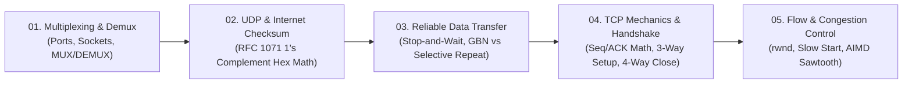

# ⚡ Module 04: Transport Layer and Reliability

Welcome to **Module 04: Transport Layer and Reliability**. The Transport Layer bridges the gap between network-layer host-to-host packet delivery and application-layer process-to-process communication. This module covers **Multiplexing/Demultiplexing**, lightweight **UDP and the 16-bit Internet Checksum**, the theory of **Reliable Data Transfer (RDT, Go-Back-N, Selective Repeat)**, the state-machine mechanics of **TCP Connection Establishment & Termination**, and the algorithms powering **TCP Flow and Congestion Control (AIMD, Slow Start)**.

---

## 🗺️ Module Learning Roadmap

---

## 📚 Chapter Breakdown

| Chapter File | Topics Covered | Key Visualizations | Real-World & Math Focus |
|---|---|---|---|
| **[01-transport-multiplexing.md](./01-transport-multiplexing.md)** | Process-to-process delivery, Sender MUX, Receiver DEMUX, Connectionless (UDP) vs Connection-Oriented (TCP) Demux | Multi-process socket fan-in / fan-out, Google Web Server (443) & Gmail (587) demux | 4-tuple socket mapping `(SrcIP, SrcPort, DstIP, DstPort)`, Mid 261 Q1(b) |
| **[02-udp-and-internet-checksum.md](./02-udp-and-internet-checksum.md)** | UDP Segment format, RFC 1071 16-bit Internet Checksum, 1's complement addition, Carry wrap-around | Checksum pipeline diagram, Bit-level summation tables | Binary and Hexadecimal checksum derivation, Error detection verification, HW 252 1(d) |
| **[03-reliable-data-transfer.md](./03-reliable-data-transfer.md)** | RDT 1.0 - 3.0, Stop-and-Wait (No loss, packet loss, ACK loss, delayed ACK), Go-Back-N (GBN) vs Selective Repeat (SR) | 4 Stop-and-Wait timing ladders, GBN discarded packets vs SR receiver buffer | Cumulative ACK vs Individual ACK, Sliding window movements, Retransmission cost |
| **[04-tcp-principles-and-handshake.md](./04-tcp-principles-and-handshake.md)** | TCP Segment header, Sequence & ACK numbers, Piggybacking, 3-Way Handshake (`SYN`, `SYN-ACK`, `ACK`), 4-Way Close (`FIN`) | 3-Way & 4-Way flag bit vectors `[S|A|F]`, TCP Seq/ACK ladder with dropped packets | Calculating missing variables ($x, y, z, p, q, r$), Duplicate ACK handling, Mid 253 Q1(c) |
| **[05-tcp-flow-and-congestion-control.md](./05-tcp-flow-and-congestion-control.md)** | Flow Control (Receiver Window $rwnd$), Congestion Control, Slow Start (exponential), AIMD (sawtooth curve), Fast Retransmit | Buffer occupancy diagram, cwnd vs RTT timeline graphs | Tracing cwnd transitions across RTTs [0-22], 3-Duplicate ACK vs Timeout recovery |

---

## 🎯 Key Competencies Acquired

By completing this module, you will be able to:
1. Explain how operating systems route incoming segments to correct sockets using 4-tuple addressing.
2. Compute 16-bit Internet Checksums by hand using binary and hexadecimal addition with wrap-around carry.
3. Compare the packet overhead and buffer complexity of Go-Back-N versus Selective Repeat during packet loss.
4. Solve complex TCP sequence and acknowledgement ladder problems with lost segments and timeouts.
5. Trace TCP congestion window (`cwnd`) and slow start threshold (`ssthresh`) evolution across network events.

