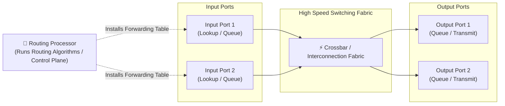

# 🧭 Chapter 01: Network Layer Overview — Data Plane vs. Control Plane

---

## 1. Overview (Topic Introduction)
The Network Layer is responsible for transporting packets from a sending host to a receiving host across intermediate networks. Modern network architecture bifurcates this layer into two distinct functional planes:
* **The Data Plane:** Local, per-router functions that determine how a packet arriving on one of a router's input links is forwarded to one of that router's output links (**Forwarding**).
* **The Control Plane:** Network-wide logic that determines how a packet is routed along an end-to-end path from source to destination (**Routing**).

---

## 2. Learning Objectives
After studying this chapter, you will be able to:
* Distinguish clearly between **Forwarding** (Data Plane) and **Routing** (Control Plane).
* Understand the internal architecture of a high-performance router (Input Ports, Switching Fabric, Output Ports, Routing Processor).
* Compare traditional **Per-Router Control Planes** (distributed routing algorithms like OSPF and BGP) with **Software-Defined Networking (SDN)** (centralized remote controller).
* Implement and trace **Longest Prefix Matching** during forwarding table lookups.

---

## 3. Core Concepts

### 3.1 Routing vs. Forwarding

| Dimension | Forwarding (Data Plane) | Routing (Control Plane) |
|---|---|---|
| **Definition** | The local, per-router action of transferring a packet from an incoming interface to an outgoing interface. | The network-wide process of determining the end-to-end path packets take from source to destination. |
| **Scope** | **Local:** Operates entirely within a single router's hardware. | **Global:** Involves coordination across all routers in the network. |
| **Time Scale** | Nanoseconds (implemented in dedicated hardware/ASICs). | Milliseconds to seconds (implemented in software). |
| **Analogy** | **Taking an exit ramp:** Navigating through a specific single interchange. | **Planning a road trip:** Using a map or GPS to choose the sequence of highways from Dhaka to Sylhet. |

---

### 3.2 Control Plane Approaches

```
Traditional Approach (Per-Router Control):        SDN Approach (Logically Centralized Control):
┌──────────────┐      ┌──────────────┐                   ┌──────────────────────────────┐
│ Routing Algo │      │ Routing Algo │                   │   Remote Centralized SDN     │
│ (e.g., OSPF) │      │ (e.g., OSPF) │                   │         Controller           │
├──────────────┤      ├──────────────┤                   └──────────────┬───────────────┘
│ Forwarding   │      │ Forwarding   │                                  │ Control Agent
│   Table      │      │   Table      │                                  │ (OpenFlow)
└──────────────┘      └──────────────┘                                  ▼
   Router 1              Router 2                               ┌──────────────┐
  (Autonomous distributed computation)                          │ Forwarding   │
                                                                │    Table     │
                                                                └──────────────┘
                                                                    Data Switch
```

1. **Per-Router Control (Traditional):** A routing algorithm (e.g., OSPF, RIP, BGP) runs inside each individual router. Routers communicate with one another to exchange routing state and independently compute their own forwarding tables.
2. **Logically Centralized Control (SDN):** A centralized controller computes forwarding tables globally and installs them directly into dumb data-plane switches via protocols like OpenFlow.

---

### 3.3 Router Architecture: Inside a Router
A high-performance router consists of four primary components:
1. **Input Ports:** Terminates physical links, performs data link decapsulation, and performs table lookups to determine the outbound port.
2. **Switching Fabric:** The high-speed internal bus or crossbar network that physically moves packets from input buffers to output buffers.
3. **Output Ports:** Buffers packets arriving from the switching fabric and transmits them onto the physical outbound link.
4. **Routing Processor:** Executes traditional routing algorithms and updates the hardware forwarding tables.

---

## 4. Visual Explanation (Diagrams)

### 4.1 Internal Router Architecture


---

## 5. Step-by-Step Packet Forwarding (Longest Prefix Match)
When a router receives a packet with destination IP `200.23.16.5`:
1. It extracts the destination IP address.
2. It compares the IP address against its hardware Forwarding Table.
3. Multiple table entries may match! The router strictly selects the entry with the **Longest Matching Prefix** (most specific subnet mask).
4. The switching fabric immediately transfers the packet to the output port associated with that longest matching prefix.

---

## 6. Real-Life Example
* **Airport Navigation:**
  - **Routing (Control Plane):** The air traffic control system and flight dispatchers plan the entire flight route from Dhaka (DAC) to London (LHR) via Dubai (DXB).
  - **Forwarding (Data Plane):** The pilot reaches Dubai airport and airport ground controllers guide the aircraft from Runway 12L to Terminal 3 Gate B14.

---

## 7. Practical Implementation (Python Longest Prefix Matching Simulator)

```python
import ipaddress

class ForwardingTable:
    def __init__(self):
        self.routes = []

    def add_route(self, prefix_str, outbound_interface):
        network = ipaddress.ip_network(prefix_str)
        self.routes.append((network, outbound_interface))
        # Sort routes by prefix length descending (longest prefix first!)
        self.routes.sort(key=lambda x: x[0].prefixlen, reverse=True)

    def lookup(self, ip_str):
        ip = ipaddress.ip_address(ip_str)
        for network, interface in self.routes:
            if ip in network:
                return interface, str(network)
        return "Default Gateway (Interface 0)", "0.0.0.0/0"

# Setup router forwarding table
rt = ForwardingTable()
rt.add_route("200.23.16.0/20", "Interface 1")
rt.add_route("200.23.16.0/24", "Interface 2 (More Specific)")
rt.add_route("200.23.24.0/24", "Interface 3")

# Query packet destination
test_ip = "200.23.16.5"
interface, matched_net = rt.lookup(test_ip)
print(f"Packet to {test_ip} matches {matched_net} -> Forwarded to: {interface}")
```

---

## 8. Common Mistakes & Pitfalls
> [!WARNING]
> * **Confusing Routing with Forwarding:** Remember that *forwarding* is a micro-level hardware operation taking nanoseconds at a single router, while *routing* is a macro-level software algorithm coordinating the entire network.
> * **Assuming the first match wins:** In routing tables, the **longest prefix match** always takes precedence over shorter, less specific prefixes!

---

## 9. Practice Problems & Exam Walkthroughs

### 📝 Problem 1 (From Fall 2025 Final 253 Q2(a))
**Question:** Compare Routing and Forwarding in terms of functional definition, scope of operation, execution hardware/software, and operational timescale. [2 Marks]

**Step-by-Step Solution:**
* **Routing:**
  - *Definition:* The network-wide process of planning the complete end-to-end path from source host to destination host.
  - *Scope:* Global (involves all routers along the path).
  - *Execution:* Implemented in software in the **Control Plane** (Routing Processor).
  - *Timescale:* Milliseconds to seconds.
* **Forwarding:**
  - *Definition:* The local router action of moving a packet from an incoming link interface to the correct outgoing link interface.
  - *Scope:* Local (confined strictly within a single router).
  - *Execution:* Implemented in dedicated hardware ASICs in the **Data Plane**.
  - *Timescale:* Nanoseconds.

---

## 10. Knowledge Check (MCQ & Quizzes)

#### Q1. Which plane of the network layer is directly responsible for transferring packets across a router's internal switching fabric?
- [x] A) Data Plane
- [ ] B) Control Plane
- [ ] C) Management Plane
- [ ] D) Application Plane
*Explanation:* The data plane handles the actual per-packet forwarding and switching fabric transit.

#### Q2. What rule does a router follow when an IP address matches multiple entries in its forwarding table?
- [ ] A) Shortest Prefix Match
- [x] B) Longest Prefix Match
- [ ] C) Lowest Interface Number
- [ ] D) First Entry in Memory
*Explanation:* The longest prefix match selects the most specific routing entry with the greatest number of matching leading bits.

---

## 11. Summary & Revision Sheet
* **Data Plane:** Local forwarding (hardware, nanoseconds).
* **Control Plane:** Global routing (software, milliseconds).
* **Router Parts:** Input ports, Switching fabric, Output ports, Routing processor.
* **Forwarding Decision:** Driven by **Longest Prefix Match**.

---

---

## 🔗 Related Topics

> Connect your understanding — explore these closely related chapters:

- 📖 [IPv4 & Fragmentation](02-ipv4-and-fragmentation.md) — Detailed IP header and datagram structure
- 📖 [Routing Algorithms](05-routing-algorithms-dijkstra.md) — Control plane algorithms that build forwarding tables
- 📖 [TCP](../04-transport-layer-and-reliability/04-tcp-principles-and-handshake.md) — Transport layer service user of the network layer

## 12. References & Further Reading
* RFC 1812: *Requirements for IP Version 4 Routers*.
* Kurose & Ross, Chapter 4.1 & 4.2: *Overview of Network Layer & What's Inside a Router*.


---

<div align="center">

| [⬅️ Previous](../04-transport-layer-and-reliability/README.md) | [🏠 Module Index](README.md) | [Next ➡️](02-ipv4-and-fragmentation.md) |
|:---:|:---:|:---:|

</div>
