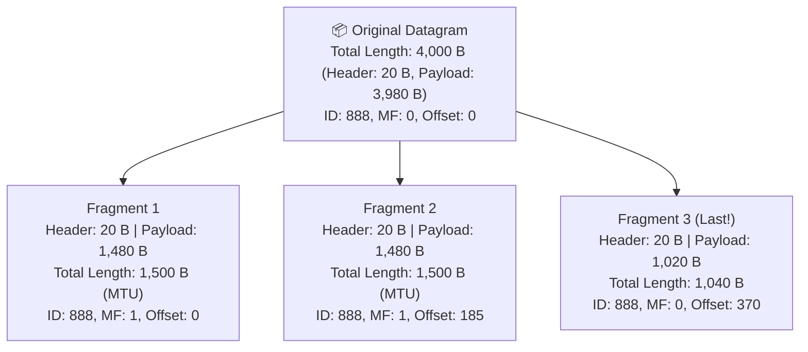

# ✂️ Chapter 02: IPv4 Datagram Format and IP Fragmentation

---

## 1. Overview (Topic Introduction)
Not all physical network links can carry packets of the same size. Different link-layer technologies enforce different **Maximum Transmission Units (MTUs)**—the maximum amount of data that a link-layer frame can encapsulate. For example, standard Ethernet has an MTU of $1,500\text{ Bytes}$, whereas some WAN links have smaller MTUs. When an arriving IP datagram is larger than the outbound link's MTU, the router must slice the IP payload into smaller pieces called **Fragments**. 

Understanding how fragments are identified, flagged, and assigned **8-byte boundary offsets** is a classic university exam topic and vital for network engineering.

---

## 2. Learning Objectives
After studying this chapter, you will be able to:
* Identify the key fields of the **IPv4 Datagram Header** related to fragmentation: **Identification (ID)**, **Flags ($DF, MF$)**, and **Fragment Offset**.
* Apply the **8-Byte Boundary Divisibility Rule** to determine the maximum allowable payload per fragment.
* Calculate fragment counts using ceiling functions ($\lceil \text{Total Payload} / \text{Max Fragment Payload} \rceil$).
* Construct complete **IP Fragmentation Tables** showing Fragment Size, Total Length, ID, MF Flag, and Fragment Offset.
* Solve complex exam problems with custom IP header sizes (e.g., 30-byte IP headers).

---

## 3. Core Concepts

### 3.1 The Fragmentation Fields in IPv4 Header
A standard IPv4 header is **20 Bytes** (can be up to 60 Bytes with options):

```
 0                   1                   2                   3
 0 1 2 3 4 5 6 7 8 9 0 1 2 3 4 5 6 7 8 9 0 1 2 3 4 5 6 7 8 9 0 1
+-+-+-+-+-+-+-+-+-+-+-+-+-+-+-+-+-+-+-+-+-+-+-+-+-+-+-+-+-+-+-+-+
|Version|  IHL  |Type of Service|          Total Length         |
+-+-+-+-+-+-+-+-+-+-+-+-+-+-+-+-+-+-+-+-+-+-+-+-+-+-+-+-+-+-+-+-+
|         Identification        |Flags|      Fragment Offset    |
+-+-+-+-+-+-+-+-+-+-+-+-+-+-+-+-+-+-+-+-+-+-+-+-+-+-+-+-+-+-+-+-+
|  Time to Live |    Protocol   |         Header Checksum       |
+-+-+-+-+-+-+-+-+-+-+-+-+-+-+-+-+-+-+-+-+-+-+-+-+-+-+-+-+-+-+-+-+
|                       Source IP Address                       |
+-+-+-+-+-+-+-+-+-+-+-+-+-+-+-+-+-+-+-+-+-+-+-+-+-+-+-+-+-+-+-+-+
|                    Destination IP Address                     |
+-+-+-+-+-+-+-+-+-+-+-+-+-+-+-+-+-+-+-+-+-+-+-+-+-+-+-+-+-+-+-+-+
```

1. **Identification (16 bits):** A unique number assigned by the sending host. **All fragments of the same original datagram share the identical Identification number** so the receiver can group them together!
2. **Flags (3 bits):**
   - Bit 0: Reserved (must be 0).
   - Bit 1: **DF (Don't Fragment):** If set to 1, routers are forbidden from fragmenting. If a packet exceeds MTU and $DF = 1$, the router drops it and sends back an ICMP "Fragmentation Needed" error.
   - Bit 2: **MF (More Fragments):**
     - $MF = 1 \implies$ "More fragments follow behind me" (not the last piece).
     - $MF = 0 \implies$ "I am the **very last fragment**" (or the packet was never fragmented).
3. **Fragment Offset (13 bits):**
   - Specifies the starting position of this fragment's data relative to the beginning of the original unfragmented datagram payload.
   - **Crucial Rule:** Because the offset field is only 13 bits (cannot address $2^{16} = 65,535$ bytes individually), **the offset is measured in units of 8-Byte (64-bit) blocks**!
   $$\text{Offset Value in Header} = \frac{\text{Cumulative Preceding Payload Bytes}}{8}$$

---

### 3.2 The Golden 8-Byte Divisibility Rule
The data payload carried in any fragment (except possibly the final fragment) **MUST be a multiple of 8 Bytes**!
1. Calculate candidate payload:
   $$\text{Candidate Payload} = \text{MTU} - \text{Header Size}$$
2. Check divisibility by 8:
   $$\text{Remainder} = \text{Candidate Payload} \pmod 8$$
3. If divisible ($\text{Remainder} = 0$): Use candidate payload directly.
4. If NOT divisible: You **must round DOWN (floor)** to the nearest multiple of 8:
   $$\text{Max Allowed Payload} = \left\lfloor \frac{\text{Candidate Payload}}{8} \right\rfloor \times 8$$

> [!NOTE]
> *Example 1:* $\text{MTU} = 1500\text{ B}$, $\text{Header} = 20\text{ B}$.
> Candidate payload $= 1500 - 20 = 1480\text{ B}$.
> $1480 / 8 = 185$ (Exact integer! $\implies$ Valid payload = $1480\text{ B}$).
>
> *Example 2:* $\text{MTU} = 1500\text{ B}$, $\text{Header} = 30\text{ B}$ (From Exam 261 Q2(c)!).
> Candidate payload $= 1500 - 30 = 1470\text{ B}$.
> $1470 / 8 = 183.75$ (Fractional!).
> Round down: $\lfloor 183.75 \rfloor \times 8 = 183 \times 8 = \mathbf{1464\text{ Bytes}}$!

---

### 3.3 Where does Reassembly happen?
Fragments are **NOT reassembled at intermediate routers**. They are reassembled **strictly at the final destination host**. If routers reassembled fragments, it would create immense buffering overhead and fail if fragments took different parallel routes!

---

## 4. Visual Explanation (Diagrams)

### 4.1 Datagram Splitting Tree (From CN Class Note 2, Page 19)


---

## 5. Step-by-Step 4-Stage Fragmentation Algorithm
Given an incoming datagram with Total Length $L_{\text{total}}$, IP Header $H$, and outbound link MTU:
1. **Compute Total Payload:**
   $$\text{Total Payload} = L_{\text{total}} - H$$
2. **Compute Max Payload per Fragment ($P_{\max}$):**
   $$P_{\max} = \left\lfloor \frac{\text{MTU} - H}{8} \right\rfloor \times 8$$
3. **Compute Number of Fragments ($K$):**
   $$K = \left\lceil \frac{\text{Total Payload}}{P_{\max}} \right\rceil$$
4. **Construct Table:**
   - For fragment $i = 1$ to $K - 1$:
     - $\text{Payload} = P_{\max}$
     - $\text{Total Length} = P_{\max} + H$
     - $MF = 1$
     - $\text{Offset} = \frac{(i - 1) \times P_{\max}}{8}$
   - For final fragment $i = K$:
     - $\text{Payload} = \text{Total Payload} - (K - 1) \times P_{\max}$
     - $\text{Total Length} = \text{Payload} + H$
     - $MF = 0$ (Last piece!)
     - $\text{Offset} = \frac{(K - 1) \times P_{\max}}{8}$

---

## 6. Real-Life Example
* **Courier Weight Limit Analogy:**
  - You want to ship a giant 4,000 kg machine.
  - The delivery plane has a strict cargo door container limit of 1,500 kg (**MTU**).
  - The metal crate container weighs 20 kg (**Header**), so each crate holds up to 1,480 kg of machine parts (**Payload**).
  - You disassemble the machine into 3 crates, label them all with tracking code `#888` (**ID**), mark "Box 1 of 3" and "Box 2 of 3" with a red continue sticker (**$MF = 1$**), and mark "Box 3 of 3" with final green sticker (**$MF = 0$**).
  - The recipient puts the machine back together at their factory (**Destination Host Reassembly**).

---

## 7. Practical Implementation (Python IP Fragmentation Solver)

```python
import math

def calculate_ip_fragments(total_datagram_bytes, header_bytes, mtu_bytes, datagram_id=888):
    total_payload = total_datagram_bytes - header_bytes
    candidate_payload = mtu_bytes - header_bytes

    # Enforce 8-byte boundary rule:
    max_payload = (candidate_payload // 8) * 8
    num_fragments = math.ceil(total_payload / max_payload)

    print(f"=== IP Fragmentation Analysis ===")
    print(f"Total Datagram: {total_datagram_bytes} B | Header: {header_bytes} B | MTU: {mtu_bytes} B")
    print(f"Total Payload : {total_payload} B")
    print(f"Max Payload/Frag (8-byte divisible): {max_payload} B")
    print(f"Number of Fragments: {num_fragments}\n")

    fragments = []
    cumulative_bytes = 0

    for i in range(1, num_fragments + 1):
        is_last = (i == num_fragments)
        if is_last:
            payload = total_payload - cumulative_bytes
            mf_flag = 0
        else:
            payload = max_payload
            mf_flag = 1

        offset = cumulative_bytes // 8
        total_len = payload + header_bytes

        frag_info = {
            'Fragment': f"Frag {i}",
            'Total Length': total_len,
            'Payload Bytes': payload,
            'ID': datagram_id,
            'MF Flag': mf_flag,
            'Offset': offset
        }
        fragments.append(frag_info)
        cumulative_bytes += payload

    return fragments

# Test Case from Final 261 Q2(c) (Class Note 2, Page 20):
# 4500 B datagram, 30 B Header, 1500 B MTU
frags = calculate_ip_fragments(4500, 30, 1500, datagram_id=888)
print(f"{'Fragment':<10} | {'Total Len':<10} | {'Payload':<10} | {'ID':<6} | {'MF':<4} | {'Offset':<8}")
print("-" * 65)
for f in frags:
    print(f"{f['Fragment']:<10} | {f['Total Length']:<10} | {f['Payload Bytes']:<10} | {f['ID']:<6} | {f['MF Flag']:<4} | {f['Offset']:<8}")
```

---

## 8. Common Mistakes & Pitfalls
> [!WARNING]
> * **Forgetting to subtract the Header from MTU:** When finding max payload, calculate $\text{MTU} - \text{Header}$, NOT just $\text{MTU} / 8$!
> * **Forgetting the Floor Rounding on Fractions:** If $(\text{MTU} - \text{Header}) / 8 = 183.75$, you CANNOT use $1470\text{ Bytes}$! You must multiply $183 \times 8 = 1464\text{ Bytes}$. Using 1470 produces fractional offsets, which cannot be represented in the IP header!
> * **Offset Units:** Remember that the number written in the IP header offset field is **bytes divided by 8**, NOT raw bytes!

---

## 9. Practice Problems & Exam Walkthroughs

### 📝 Problem 1 (From Fall 2026 Final 261 Q2(c) & CN Class Note 2, Page 20)
**Question:** A datagram of $4,500\text{ Bytes}$ arrives at a router that must forward it to an outbound link with an $\text{MTU} = 1,500\text{ Bytes}$. The IP header size is specified as $30\text{ Bytes}$.
1. Determine the maximum payload per fragment.
2. Calculate the total number of fragments generated.
3. Construct the complete fragmentation table specifying Fragment Number, Total Length, ID, MF Flag, and Fragment Offset.

**Step-by-Step Solution:**
1. **Calculate Maximum Payload per Fragment:**
   * Total IP payload $= 4500 - 30 = \mathbf{4470\text{ Bytes}}$.
   * Candidate payload $= 1500 - 30 = 1470\text{ Bytes}$.
   * Check divisibility: $\frac{1470}{8} = 183.75$ (fraction!).
   * Apply 8-byte floor rule:
     $$\text{Max Payload} = \lfloor 183.75 \rfloor \times 8 = 183 \times 8 = \mathbf{1464\text{ Bytes}}$$
2. **Calculate Number of Fragments:**
   $$\text{Fragments} = \left\lceil \frac{4470}{1464} \right\rceil = \lceil 3.053 \rceil = \mathbf{4\text{ fragments}}$$
3. **Calculate Final Fragment Data Size:**
   $$\text{Final Payload} = 4470 - (3 \times 1464) = 4470 - 4392 = \mathbf{78\text{ Bytes}}$$
4. **Complete Fragmentation Table:**

| Fragment | Total Length (Bytes) | Data Payload (Bytes) | ID | More Fragments (MF) Flag | Fragment Offset |
|---|---|---|---|---|---|
| **Original (Before)** | 4,500 | 4,470 | 888 | 0 | 0 |
| **Fragment 1** | 1,494 ($1464 + 30$) | 1,464 | 888 | **1** | $0 / 8 = \mathbf{0}$ |
| **Fragment 2** | 1,494 ($1464 + 30$) | 1,464 | 888 | **1** | $1464 / 8 = \mathbf{183}$ |
| **Fragment 3** | 1,494 ($1464 + 30$) | 1,464 | 888 | **1** | $(1464 \times 2) / 8 = 2928 / 8 = \mathbf{366}$ |
| **Fragment 4 (Last)** | 108 ($78 + 30$) | 78 | 888 | **0** | $(1464 \times 3) / 8 = 4392 / 8 = \mathbf{549}$ |

---

## 10. Knowledge Check (MCQ & Quizzes)

#### Q1. If a fragment has a Fragment Offset field equal to 200, what is the starting byte position of its payload in the original datagram?
- [ ] A) Byte 200
- [ ] B) Byte 25
- [x] C) Byte 1,600
- [ ] D) Byte 3,200
*Explanation:* Offset is measured in 8-byte blocks: $200 \times 8 = 1,600\text{ Bytes}$.

#### Q2. Where are IP fragments reassembled back into the original datagram?
- [ ] A) At the very next router hop.
- [ ] B) At the boundary router of the destination Autonomous System.
- [x] C) Exclusively at the final destination host.
- [ ] D) In the switching fabric.
*Explanation:* To keep routers fast and stateless, reassembly occurs strictly at the ultimate destination host.

---

#### Q3. A datagram of 4000 bytes (including 20-byte IP header) is fragmented over a link with MTU = 1500 bytes. How many fragments are created and what is the offset of the last fragment?
- [ ] A) 2 fragments; last offset = 185
- [x] B) 3 fragments; last offset = 370 — Payload: 3980 bytes, max per fragment = 1480 bytes (8-byte aligned). Frag 1: 0-1479 (offset=0), Frag 2: 1480-2959 (offset=185), Frag 3: 2960-3979 (offset=370)
- [ ] C) 3 fragments; last offset = 1480
- [ ] D) 4 fragments; last offset = 500
*Explanation:* Original payload = 4000 − 20 = **3980 bytes**. Max payload per fragment = 1500 − 20 = 1480 bytes (already 8-byte aligned since 1480 / 8 = 185). Fragment 1: bytes 0−1479, offset = 0/8 = **0**; MF=1. Fragment 2: bytes 1480−2959, offset = 1480/8 = **185**; MF=1. Fragment 3: bytes 2960−3979 (1020 bytes), offset = 2960/8 = **370**; MF=0.

#### Q4. Which entity performs IP datagram reassembly in the Internet architecture?
- [ ] A) Each intermediate router along the path
- [ ] B) The sending host before fragmentation occurs
- [x] C) Only the final destination host — intermediate routers forward fragments independently without reassembly
- [ ] D) The first router after the fragmenting router
*Explanation:* In the Internet design, **reassembly is performed only at the destination host**. Intermediate routers simply forward each fragment independently based on its destination IP. This design choice keeps routers simple (they don't need memory to hold fragments waiting for others) and allows different fragments to take different paths through the network.

#### Q5. What does the **DF (Don't Fragment)** bit in the IPv4 header signify, and what happens if a router needs to fragment a packet with DF=1?
- [ ] A) DF=1 means the packet is already fragmented and this is the last fragment
- [x] B) DF=1 tells routers they must NOT fragment this packet; if the packet exceeds the link's MTU, the router drops it and sends an ICMP "Fragmentation Needed" message back to the sender
- [ ] C) DF=1 means the packet header is encrypted
- [ ] D) DF=1 is only valid for UDP packets, not TCP
*Explanation:* **Path MTU Discovery (PMTUD)** uses the DF bit. A sender sets DF=1 on probes to discover the minimum MTU along the entire path. If a router cannot forward the packet without fragmenting, it **drops the packet** and sends **ICMP Type 3, Code 4 (Fragmentation Needed)** back to the sender, which reduces its path MTU estimate and retransmits with smaller packets.


## 11. Summary & Revision Sheet
* **Header Fields:** ID (same for all pieces), MF flag ($1 = \text{more follow}, 0 = \text{last}$), Offset ($\text{bytes} / 8$).
* **8-Byte Rule:** $\text{Payload} = \lfloor (\text{MTU} - \text{Header}) / 8 \rfloor \times 8$.
* **Final Fragment Payload:** $\text{Total Payload} - ((K - 1) \times \text{Payload}_{\max})$.
* **Reassembly:** Strictly at destination host.

---

---

## 🔗 Related Topics

> Connect your understanding — explore these closely related chapters:

- 📖 [DHCP](03-dhcp-dynamic-addressing.md) — How hosts get their IPv4 addresses dynamically
- 📖 [NAT](04-nat-network-address-translation.md) — Why private IPv4 addresses are translated at network boundaries
- 📖 [Network Layer Overview](01-network-layer-overview.md) — Forwarding and routing that IPv4 enables

## 12. References & Further Reading
* RFC 791: *Internet Protocol — Fragmentation and Reassembly*.
* Kurose & Ross, Chapter 4.3: *The Internet Protocol (IP)*.


---

<div align="center">

| [⬅️ Previous](01-network-layer-overview.md) | [🏠 Module Index](README.md) | [Next ➡️](03-dhcp-dynamic-addressing.md) |
|:---:|:---:|:---:|

</div>
