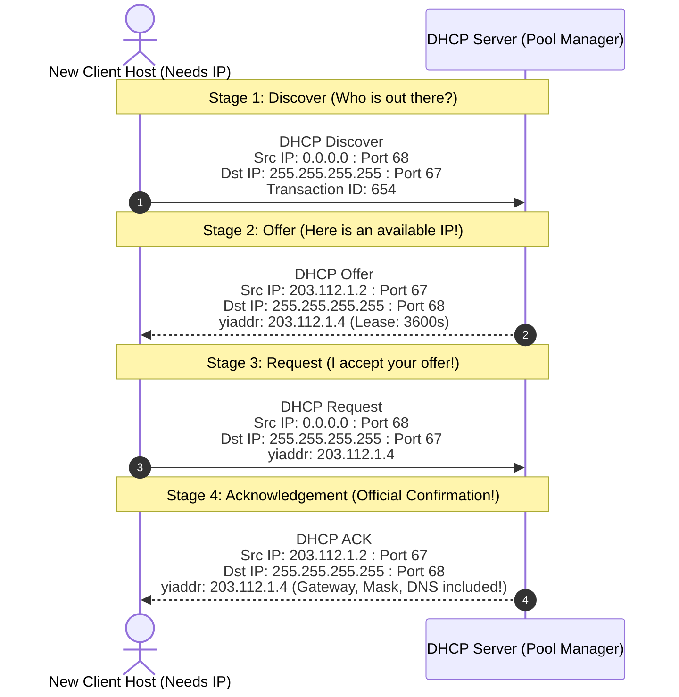

# 🔌 Chapter 03: Dynamic Addressing and the DHCP DORA Process

---

## 1. Overview (Topic Introduction)
Before a device can communicate on the Internet, it must possess a network-layer identity: an **IP Address**, a **Subnet Mask**, the IP address of its **First-Hop Default Gateway Router**, and the IP address of its **Local DNS Server**. Manually configuring these parameters on every laptop, phone, and IoT gadget is impossible at scale. 

The **Dynamic Host Configuration Protocol (DHCP)** automates this entirely, acting as a "plug-and-play" network protocol. Operating over **UDP (Client Port 68, Server Port 67)**, DHCP leases IP addresses to arriving hosts using the famous 4-step **DORA** exchange.

---

## 2. Learning Objectives
After studying this chapter, you will be able to:
* Explain the role of DHCP in enterprise, residential, and mobile networks.
* Master the 4 stages of the **DORA** protocol: **Discover**, **Offer**, **Request**, and **Acknowledgement**.
* Explain how a client communicates over the network *before* it has been assigned an IP address using **Broadcast Addresses** (`0.0.0.0` and `255.255.255.255`).
* Identify the exact transport socket combinations: **Client Port 68** and **Server Port 67**.
* Understand address lease times, renewal requests, and address pool reclamation.

---

## 3. Core Concepts

### 3.1 Static vs. Dynamic IP Allocation
* **Static Allocation:** Network administrators manually type fixed IP settings into a host's operating system. Useful for servers, printers, and core router interfaces.
* **Dynamic Allocation (DHCP):** Hosts request an IP address on-demand when joining a network. The address is granted as a temporary **lease**. When the host disconnects, the address returns to the server's pool for reuse.

---

### 3.2 The 4 Pieces of Information Delivered by DHCP
When DHCP finishes, the client has learned four critical parameters:
1. **Assigned Client IP Address (`yiaddr` - "Your IP Address")**
2. **Subnet Mask:** Defines network vs host bits (e.g., `255.255.255.0`).
3. **Default Gateway Router IP:** Where to send packets destined for outside subnets.
4. **Local DNS Server IP:** Where to send domain resolution queries.

---

### 3.3 The DORA Protocol Mechanics
Because the client does not yet have an IP address, and does not know where the DHCP server is located on the subnet, it communicates using **Layer 3 Link-Layer Broadcasts**:
* **Client IP:** `0.0.0.0` (indicates "I have no address").
* **Destination IP:** `255.255.255.255` (broadcast to every node on the local subnet).
* **Transport Ports:** Client uses **UDP Port 68**; Server listens on **UDP Port 67**.

```
  DHCP Client (New Host)                             DHCP Server
      │                                                   │
      │ 1. DHCP Discover (Broadcast)                      │
      ├──────────────────────────────────────────────────▶│
      │    Src: 0.0.0.0:68  Dst: 255.255.255.255:67       │
      │                                                   │
      │ 2. DHCP Offer (Broadcast)                         │
      │◀──────────────────────────────────────────────────┤
      │    Src: Server_IP:67 Dst: 255.255.255.255:68      │
      │    yiaddr: Offered_IP, Lease Time                 │
      │                                                   │
      │ 3. DHCP Request (Broadcast)                       │
      ├──────────────────────────────────────────────────▶│
      │    Src: 0.0.0.0:68  Dst: 255.255.255.255:67       │
      │    yiaddr: Offered_IP (Echoing selection)         │
      │                                                   │
      │ 4. DHCP ACK (Broadcast)                           │
      │◀──────────────────────────────────────────────────┤
      │    Src: Server_IP:67 Dst: 255.255.255.255:68      │
      │    Confirms lease, Subnet Mask, Gateway, DNS      │
```

---

## 4. Visual Explanation (Diagrams)

### 4.1 Detailed DORA Packet Header Ladder (From CN Class Note 2, Page 18)


---

## 5. Step-by-Step DORA Execution Details
1. **DHCP Discover:** Client broadcasts a packet asking if any DHCP server is present on the physical network.
2. **DHCP Offer:** A DHCP server (or multiple servers) inspects its IP address pool, reserves an available IP (e.g., `203.112.1.4`), and broadcasts an offer packet containing the proposed `yiaddr` and lease duration.
3. **DHCP Request:** The client chooses one server's offer (if multiple responded) and broadcasts a DHCP Request echoing back the chosen IP.
   - *Why broadcast?* To inform other competing DHCP servers that their offers were rejected, allowing them to release their reserved IPs back into their pools!
4. **DHCP ACK:** The chosen server confirms the configuration parameters with a final DHCP ACK. The client now configures its interface with `203.112.1.4`.

---

## 6. Real-Life Example
* **Hotel Room Check-in Analogy:**
  - You arrive in a new city without a hotel room (**New Host joining network**).
  - You step out of the station and call out: "Any hotels with open rooms?" (**DHCP Discover**).
  - Hotel Manager A calls back: "I have Room 402 available for \$50/night!" (**DHCP Offer**).
  - You shout back: "I accept Room 402 at Hotel A!" (**DHCP Request**).
  - Hotel Manager A gives you the keycard and WiFi password (**DHCP ACK with Gateway & DNS**).

---

## 7. Practical Implementation (Python DHCP Packet Simulator)

```python
class DHCPMessage:
    def __init__(self, msg_type, src_ip, dst_ip, src_port, dst_port, yiaddr="0.0.0.0", xid=101):
        self.msg_type = msg_type
        self.src_ip = src_ip
        self.dst_ip = dst_ip
        self.src_port = src_port
        self.dst_port = dst_port
        self.yiaddr = yiaddr
        self.xid = xid

    def display(self):
        print(f"[{self.msg_type}]")
        print(f"  IP Header  : Src={self.src_ip} -> Dst={self.dst_ip}")
        print(f"  UDP Header : SrcPort={self.src_port} -> DstPort={self.dst_port}")
        print(f"  DHCP Payload: yiaddr (Your IP)={self.yiaddr} | XID={self.xid}\n")

# Simulate complete DORA exchange (Matching Class Note 2, Page 18)
server_ip = "203.112.1.2"
assigned_ip = "203.112.1.4"

m1 = DHCPMessage("1. DHCP DISCOVER", "0.0.0.0", "255.255.255.255", 68, 67, yiaddr="0.0.0.0")
m2 = DHCPMessage("2. DHCP OFFER",    server_ip, "255.255.255.255", 67, 68, yiaddr=assigned_ip)
m3 = DHCPMessage("3. DHCP REQUEST",  "0.0.0.0", "255.255.255.255", 68, 67, yiaddr=assigned_ip)
m4 = DHCPMessage("4. DHCP ACK",      server_ip, "255.255.255.255", 67, 68, yiaddr=assigned_ip)

for m in [m1, m2, m3, m4]:
    m.display()
```

---

## 8. Common Mistakes & Pitfalls
> [!WARNING]
> * **Confusing Client Port (68) and Server Port (67):** The server listens on port **67**; the client listens on port **68**.
> * **Assuming the Client Can Unicast its DHCP Request:** Even though the client received an offer, it still cannot legally use the offered IP until the DHCP ACK is returned. Hence, its Source IP in the DHCP Request MUST remain `0.0.0.0`, and the Destination IP MUST be `255.255.255.255` broadcast!

---

## 9. Practice Problems & Exam Walkthroughs

### 📝 Problem 1 (From CN Class Note 2, Page 18: DHCP Exam Problem)
**Question:** A new client host connects to a local subnet where a DHCP server operates at IP `203.112.1.2`. The server offers the client the IP address `203.112.1.4`.
1. Detail the Source IP, Destination IP, Source Port, Destination Port, and `yiaddr` for all four steps of the DORA process.
2. Why does the client broadcast its DHCP Request message instead of sending it unicast directly to the server?

**Step-by-Step Solution:**
1. **4-Step Packet Headers:**
   * **Step 1: DHCP Discover:**
     - Source IP: `0.0.0.0`
     - Destination IP: `255.255.255.255`
     - Source Port: `68`, Destination Port: `67`
     - `yiaddr`: `0.0.0.0`
   * **Step 2: DHCP Offer:**
     - Source IP: `203.112.1.2`
     - Destination IP: `255.255.255.255`
     - Source Port: `67`, Destination Port: `68`
     - `yiaddr`: `203.112.1.4`
   * **Step 3: DHCP Request:**
     - Source IP: `0.0.0.0`
     - Destination IP: `255.255.255.255`
     - Source Port: `68`, Destination Port: `67`
     - `yiaddr`: `203.112.1.4`
   * **Step 4: DHCP ACK:**
     - Source IP: `203.112.1.2`
     - Destination IP: `255.255.255.255`
     - Source Port: `67`, Destination Port: `68`
     - `yiaddr`: `203.112.1.4`
2. **Why Broadcast the Request:**
   - Multiple DHCP servers on the subnet may have sent competing offers. By broadcasting its selection, the client notifies the chosen server that its offer was accepted and simultaneously notifies the other servers to release their reserved addresses.

---

## 10. Knowledge Check (MCQ & Quizzes)

#### Q1. Which transport protocol and port numbers are utilized by DHCP?
- [ ] A) TCP, Client 80, Server 8080
- [x] B) UDP, Client 68, Server 67
- [ ] C) UDP, Client 53, Server 53
- [ ] D) ICMP, Port 0
*Explanation:* DHCP runs over UDP with server listening on port 67 and client listening on port 68.

#### Q2. What does the IP address `0.0.0.0` represent when used as the Source IP in a DHCP Discover packet?
- [ ] A) The default gateway router.
- [ ] B) The global broadcast address.
- [x] C) An unconfigured host indicating that it currently possesses no valid IP address.
- [ ] D) A corrupted packet header.
*Explanation:* `0.0.0.0` signifies that the sending host does not yet have an assigned IP address.

---

## 11. Summary & Revision Sheet
* **Acronym:** **D**iscover $\to$ **O**ffer $\to$ **R**equest $\to$ **A**CK.
* **Ports:** Client = UDP 68, Server = UDP 67.
* **Addresses:** Client uses `0.0.0.0` as source until ACK is verified; Destination is `255.255.255.255` broadcast.
* **Payload:** `yiaddr` holds the leased IP.

---

---

## 🔗 Related Topics

> Connect your understanding — explore these closely related chapters:

- 📖 [IPv4 & Fragmentation](02-ipv4-and-fragmentation.md) — The IPv4 addressing model DHCP assigns from
- 📖 [NAT](04-nat-network-address-translation.md) — DHCP assigns private IPs; NAT translates them to public
- 📖 [MAC & ARP](../06-data-link-layer-and-lan/03-mac-addressing-and-arp.md) — DHCP uses broadcast at Layer 2 before IP is assigned

## 12. References & Further Reading
* RFC 2131: *Dynamic Host Configuration Protocol*.
* Kurose & Ross, Chapter 4.3.3: *DHCP*.


---

<div align="center">

| [⬅️ Previous](02-ipv4-and-fragmentation.md) | [🏠 Module Index](README.md) | [Next ➡️](04-nat-network-address-translation.md) |
|:---:|:---:|:---:|

</div>
