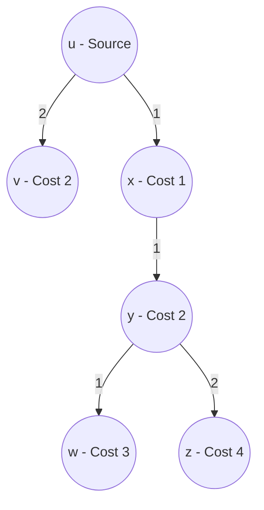

# 🗺️ Chapter 05: Routing Algorithms — Link-State and Dijkstra's Shortest Path

---

## 1. Overview (Topic Introduction)
The core duty of the network Control Plane is **Routing**: finding the optimal, least-cost path from a source host through a mesh of routers to a destination host. Routing algorithms are classified into two broad categories: **Link-State (Global)** and **Distance-Vector (Decentralized)**. 

In Link-State routing (the foundation of protocols like **OSPF**), every router acquires a complete, identical map of the entire network topology. Each router then independently executes **Dijkstra's Algorithm** to compute the **Least Cost Path Tree** and construct its local **Forwarding Table**.

---

## 2. Learning Objectives
After studying this chapter, you will be able to:
* Contrast **Link-State (LS)** routing with **Distance-Vector (DV)** routing across message dissemination, convergence, and algorithm type.
* Avoid the classic exam pitfall: **LS sends to ALL nodes, DV sends ONLY to immediate neighbors**!
* Execute **Dijkstra's Shortest Path Algorithm** step-by-step using iteration tables.
* Construct the **Least Cost Path Tree** from the algorithm's predecessor pointers.
* Generate the router's **Forwarding Table** by extracting the **First Hop Link** for each destination.
* Solve 6-node and 9-node network routing problems from past university final exams.

---

## 3. Core Concepts

### 3.1 Link-State (LS) vs. Distance-Vector (DV) Comparison (From Class Note 2, Page 24 & 28)

| Feature | Link-State (LS) | Distance-Vector (DV) |
|---|---|---|
| **Information Shared** | **Link state of directly attached links** (its neighbors and cost). | **Its entire estimate (vector) of costs** to all destinations. |
| **To Whom Shared?** | **To ALL nodes in the entire network** (via Link-State Broadcast / Flooding). | **ONLY to its immediate direct neighbors**! |
| **When Shared?** | Periodically and whenever a link state changes. | Periodically and when local cost changes. |
| **Knowledge Base** | **Complete global topology map** known by every node. | **Local view only** (knows next hop neighbor and estimated cost). |
| **Algorithm Used** | **Dijkstra's Algorithm** ($O(N^2)$ or $O(N \log N)$). | **Bellman-Ford Algorithm** ($D_x(y) = \min_v \{c(x,v) + D_v(y)\}$). |
| **Real Protocols** | **OSPF** (Open Shortest Path First), IS-IS. | **RIP** (Routing Information Protocol), BGP. |

> [!CAUTION]
> **Common Exam Trap (Class Note 2, Page 28):**
> * **Link-State:** Sends to **ALL nodes**, but shares info about **ONLY neighbors**!
> * **Distance-Vector:** Sends to **ONLY neighbors**, but shares info about **ALL nodes**!

---

### 3.2 Dijkstra's Algorithm Definitions & Notation
* $c(x, y)$: Cost of link from node $x$ to $y$ (if not direct neighbors, $c(x, y) = \infty$).
* $D(v)$: Current least cost of path from source node $u$ to destination node $v$.
* $p(v)$: Predecessor node along the current least cost path to $v$.
* $N'$: Subset of nodes whose least cost path is definitively known.

#### Algorithm Pseudo-code:
1. **Initialization:**
   - $N' = \{u\}$ (Source node).
   - For all nodes $v$:
     - If $v$ is neighbor of $u$: $D(v) = c(u, v), p(v) = u$.
     - Else: $D(v) = \infty$.
2. **Loop:**
   - Find node $w$ not in $N'$ with minimum $D(w)$.
   - Add $w$ to $N'$ ($N' = N' \cup \{w\}$).
   - Update $D(v)$ for all adjacent neighbors $v$ not in $N'$:
     $$D(v) = \min(D(v), \ D(w) + c(w, v))$$
     If updated, set $p(v) = w$.
3. **Termination:** Repeat until all nodes are in $N'$.

---

## 4. Visual Explanation (Diagrams)

### 4.1 6-Node Graph Topology (From CN Class Note 2, Page 25)
```
          (2)
      ┌─────────── [ v ] ──────────┐ (3)
      │             │              │
      │             │ (2)          │
     [ u ]         │              │
(Src) │  \          │              ▼
      │   \ (1)     │            [ w ] ────────── (5) ──────────┐
      │    \        │              ▲ \                          │
  (5) │     ▼       ▼              │  \ (1)                     │
      │    [ x ] ──────────────────┤   ▼                        ▼
      │     │         (3)          │  [ y ] ─────── (2) ───────▶[ z ]
      │     └───────── (1) ────────┘
      └─────────────────────────────────┘
```
**Link Costs:**
- $(u, v) = 2$, $(u, x) = 1$, $(u, w) = 5$
- $(v, x) = 2$, $(v, w) = 3$
- $(x, w) = 3$, $(x, y) = 1$
- $(w, y) = 1$, $(w, z) = 5$
- $(y, z) = 2$

---

## 5. Step-by-Step Dijkstra Iteration Table Execution (Source Node: $u$)

| Step | $N'$ | $D(v), p(v)$ | $D(w), p(w)$ | $D(x), p(x)$ | $D(y), p(y)$ | $D(z), p(z)$ | Selection |
|:---:|:---|:---:|:---:|:---:|:---:|:---:|:---:|
| **Init** | $\{u\}$ | **$2, u$** | $5, u$ | $\mathbf{1, u}$ | $\infty$ | $\infty$ | Min is $x$ ($1$) $\to$ Add $x$ |
| **1** | $\{u, x\}$ | $\mathbf{2, u}$ | $\min(5, 1+3) = \mathbf{4, x}$ | **---** | $\min(\infty, 1+1) = \mathbf{2, x}$ | $\infty$ | Min is $v$ ($2$) $\to$ Add $v$ |
| **2** | $\{u, x, v\}$ | **---** | $\min(4, 2+3) = \mathbf{4, x}$ | **---** | $\mathbf{2, x}$ | $\infty$ | Min is $y$ ($2$) $\to$ Add $y$ |
| **3** | $\{u, x, v, y\}$ | **---** | $\min(4, 2+1) = \mathbf{3, y}$ | **---** | **---** | $\min(\infty, 2+2) = \mathbf{4, y}$ | Min is $w$ ($3$) $\to$ Add $w$ |
| **4** | $\{u, x, v, y, w\}$ | **---** | **---** | **---** | **---** | $\min(4, 3+5) = \mathbf{4, y}$ | Min is $z$ ($4$) $\to$ Add $z$ |
| **5** | $\{u, x, v, y, w, z\}$ | **---** | **---** | **---** | **---** | **---** | **Complete!** |

---

### 5.1 Step 2: Constructing the Least Cost Path Tree (From CN Class Note 2, Page 25)
Following the predecessor pointers $p(\cdot)$ backwards:
* To $x$: $p(x) = u \implies \mathbf{u \to x}$ (cost 1)
* To $v$: $p(v) = u \implies \mathbf{u \to v}$ (cost 2)
* To $y$: $p(y) = x \implies \mathbf{u \to x \to y}$ (cost 2)
* To $w$: $p(w) = y \implies \mathbf{u \to x \to y \to w}$ (cost 3)
* To $z$: $p(z) = y \implies \mathbf{u \to x \to y \to z}$ (cost 4)



---

### 5.2 Step 3: Forwarding Table for Source Node $u$ (From CN Class Note 2, Page 26)
> [!IMPORTANT]
> **The First-Hop Rule:** In a router's forwarding table, the interface link is NOT the whole path; it is strictly the **very first link interface** leaving source $u$!

| Destination Node | Path in Tree | Immediate Next Hop Link (First Hop) |
|:---:|:---:|:---:|
| **$v$** | $u \to v$ | **$(u, v)$** |
| **$x$** | $u \to x$ | **$(u, x)$** |
| **$y$** | $u \to x \to y$ | **$(u, x)$** |
| **$w$** | $u \to x \to y \to w$ | **$(u, x)$** |
| **$z$** | $u \to x \to y \to z$ | **$(u, x)$** |

---

## 6. Real-Life Example
* **GPS Navigation App (Google Maps):**
  - All roads, speed limits, and traffic delays are known in a centralized graph database (**Link-State Map**).
  - Your phone runs Dijkstra's algorithm to calculate the absolute shortest time to your destination.
  - The turn-by-turn guidance at the very next intersection ("Turn left onto Airport Road") is your router's **Forwarding Table first-hop action**!

---

## 7. Practical Implementation (Python Dijkstra Routing Engine)

```python
import heapq

def dijkstra_routing(graph, source):
    # graph: dict of dicts {u: {v: cost}}
    distances = {node: float('inf') for node in graph}
    predecessors = {node: None for node in graph}
    distances[source] = 0

    # Priority queue storing (cost, node)
    pq = [(0, source)]
    visited = set()

    while pq:
        curr_dist, curr_node = heapq.heappop(pq)
        if curr_node in visited:
            continue
        visited.add(curr_node)

        for neighbor, weight in graph[curr_node].items():
            dist = curr_dist + weight
            if dist < distances[neighbor]:
                distances[neighbor] = dist
                predecessors[neighbor] = curr_node
                heapq.heappush(pq, (dist, neighbor))

    # Construct Forwarding Table (First hop from source)
    forwarding_table = {}
    for node in graph:
        if node == source:
            continue
        curr = node
        while predecessors[curr] != source and predecessors[curr] is not None:
            curr = predecessors[curr]
        forwarding_table[node] = (source, curr)

    return distances, predecessors, forwarding_table

# 6-Node Graph from CN Class Note 2, Page 25:
g = {
    'u': {'v': 2, 'x': 1, 'w': 5},
    'v': {'u': 2, 'x': 2, 'w': 3},
    'x': {'u': 1, 'v': 2, 'w': 3, 'y': 1},
    'w': {'u': 5, 'v': 3, 'x': 3, 'y': 1, 'z': 5},
    'y': {'x': 1, 'w': 1, 'z': 2},
    'z': {'w': 5, 'y': 2}
}

dists, preds, fwd = dijkstra_routing(g, 'u')
print("Least Costs from u:", dists)
print("Forwarding Table for u (First Hop Link):")
for dst, link in fwd.items():
    print(f"  To {dst} -> via {link}")
```

---

## 8. Common Mistakes & Pitfalls
> [!WARNING]
> * **Listing Entire Paths in Forwarding Tables:** A forwarding table does NOT store `$u \to x \to y \to z$`. It stores strictly the immediate outbound interface link `(u, x)`!
> * **Forgetting to Update Multiple Neighbors:** After adding node $w$ to $N'$, you must evaluate all of $w$'s neighbors. If $D(w) + c(w, v) < D(v)$, you must update $D(v)$ and change $p(v) = w$.

---

## 9. Practice Problems & Exam Walkthroughs

### 📝 Problem 1 (From Fall 2025 Final 253 Q2(b) & CN Class Note 2, Page 33)
**Question:** Given a network graph with Source node $B$, find the least-cost path to all nodes using Dijkstra's algorithm, construct the Least Cost Path Tree, and derive the Forwarding Table for Node $B$.

**Step-by-Step Solution:**
1. **Initialize:** Source node is $B$.
2. **Execute Dijkstra:** Trace iterations step-by-step selecting the minimum unvisited cost at each row until all nodes are marked.
3. **Trace Predecessors:** Build the tree by linking each node to its parent pointer.
4. **Construct Forwarding Table for $B$:** For each destination, find which neighbor of $B$ initiates the journey. Every destination whose path branches through neighbor $C$ has first hop `(B, C)`. Every destination branching through neighbor $A$ has first hop `(B, A)`.

---

## 10. Knowledge Check (MCQ & Quizzes)

#### Q1. In Link-State routing, what information does an individual router flood to all other routers?
- [ ] A) Its complete forwarding table.
- [x] B) The state and cost of its directly attached links.
- [ ] C) Its routing processor clock speed.
- [ ] D) The entire shortest path tree.
*Explanation:* Link-State packets contain the identities of the router's immediate neighbors and the costs of those direct links.

#### Q2. What is the time complexity of Dijkstra's algorithm implemented with a basic linear search over $n$ nodes?
- [ ] A) $O(n)$
- [x] B) $O(n^2)$
- [ ] C) $O(n^3)$
- [ ] D) $O(\log n)$
*Explanation:* Searching for the minimum across $n$ nodes across $n$ iterations gives $O(n^2)$ complexity. (Can be reduced to $O(n \log n)$ using a binary min-heap).

---

#### Q3. In Dijkstra's Link-State algorithm, what is the computational complexity for a network with N nodes?
- [ ] A) O(N) — linear time
- [ ] B) O(N log N) — with priority queue optimization
- [x] C) O(N²) for basic implementation; O((N + E) log N) with binary heap priority queue where E = edges
- [ ] D) O(2^N) — exponential due to path enumeration
*Explanation:* **Basic Dijkstra** (without priority queue): Each iteration scans all unvisited nodes to find minimum → O(N) per iteration × N iterations = **O(N²)**. With a **binary heap priority queue**, each extract-min costs O(log N) and each decrease-key costs O(log N): **O((N + E) log N)** total. For sparse networks (E ≈ N), this is O(N log N).

#### Q4. In Distance-Vector routing, what is the "count-to-infinity" problem and how does the split-horizon technique address it?
- [ ] A) Count-to-infinity occurs when TTL values wrap around from 255 to 0; split-horizon prevents TTL reset
- [x] B) Count-to-infinity: when a link fails, two adjacent routers exchange incorrect distance estimates in a loop, incrementing each other's cost infinitely. Split-horizon prevents this by not advertising a route back to the neighbor it was learned from
- [ ] C) Count-to-infinity is a flooding problem in Link-State routing
- [ ] D) Split-horizon doubles routing table size to prevent count-to-infinity
*Explanation:* **Count-to-infinity**: Router A learns about destination D from Router B (cost 2). Link B-D fails. B now has no route to D — it asks A, who still advertises cost 3 (2+1). B updates to cost 4, A to cost 5... they increment ("count to infinity") until some maximum (16 in RIP). **Split-horizon**: B never advertises to A a route that B learned FROM A — breaking the routing loop.

#### Q5. What is the fundamental philosophical difference between Link-State (LS) and Distance-Vector (DV) routing?
- [ ] A) LS uses TCP; DV uses UDP for routing updates
- [x] B) LS: each router learns the COMPLETE network topology via flooding, then computes optimal paths independently (Dijkstra). DV: each router knows only its neighbors' costs, iteratively converges via Bellman-Ford by exchanging distance estimates
- [ ] C) LS is used in inter-AS routing; DV is used in intra-AS routing only
- [ ] D) LS requires more bandwidth than DV in all cases
*Explanation:* **Link-State (OSPF)**: Each router floods its link-state information to ALL routers in the network. Every router gets a full topology map and runs Dijkstra independently. **Distance-Vector (RIP)**: Each router only tells its direct neighbors its current estimated distances to all destinations. No global topology knowledge — convergence happens iteratively through neighbor exchanges via Bellman-Ford.


## 11. Summary & Revision Sheet
* **Link State:** Global map, Dijkstra algorithm, flood direct links to ALL.
* **Distance Vector:** Local map, Bellman-Ford, send all estimates to NEIGHBORS only.
* **Dijkstra Relaxation:** $D(v) = \min(D(v), D(w) + c(w, v))$.
* **Forwarding Table:** Maps Destination Node $\to$ First Hop Outbound Link.

---

---

## 🔗 Related Topics

> Connect your understanding — explore these closely related chapters:

- 📖 [Network Layer Overview](01-network-layer-overview.md) — Control plane vs data plane separation
- 📖 [Multiple Access Protocols](../06-data-link-layer-and-lan/02-multiple-access-protocols.md) — Link-level concerns before routing is relevant
- 📖 [Master Cheat Sheet](../07-master-cheat-sheets-and-formulas/master-formula-cheat-sheet.md) — Dijkstra relaxation formula and routing algorithm summary

## 12. References & Further Reading
* Dijkstra, E. W. (1959). *A note on two problems in connexion with graphs*. Numerische Mathematik.
* RFC 2328: *OSPF Version 2*.


---

<div align="center">

| [⬅️ Previous](04-nat-network-address-translation.md) | [🏠 Module Index](README.md) | [Next ➡️](../06-data-link-layer-and-lan/README.md) |
|:---:|:---:|:---:|

</div>
