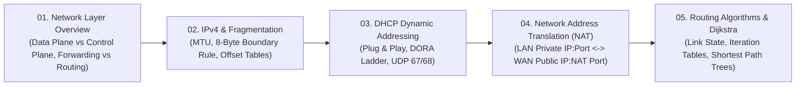

# 🧭 Module 05: Network Layer and Routing

Welcome to **Module 05: Network Layer and Routing**. The Network Layer is the central nexus of the Internet, responsible for host-to-host packet delivery across heterogeneous subnets. This module covers the separation between the **Data Plane** and **Control Plane**, the mechanics of **IPv4 Datagram Fragmentation** under strict 8-byte boundary rules, dynamic host configuration via **DHCP (DORA)**, address virtualization via **NAT (Network Address Translation)**, and shortest-path routing computation via **Dijkstra's Link-State Algorithm**.

---

## 🗺️ Module Learning Roadmap

---

## 📚 Chapter Breakdown

| Chapter File | Topics Covered | Key Visualizations | Real-World & Math Focus |
|---|---|---|---|
| **[01-network-layer-overview.md](./01-network-layer-overview.md)** | Data Plane (local per-router forwarding) vs Control Plane (network-wide routing), Router architecture, Routing Table lookup | Router switching fabric, Per-router forwarding vs SDN centralized controller | Prefix matching, Input port queuing, HOL blocking |
| **[02-ipv4-and-fragmentation.md](./02-ipv4-and-fragmentation.md)** | IPv4 Header fields, MTU limitations, 8-Byte divisibility constraint, Fragment Offset, More Fragments ($M$) flag | Datagram splitting tree, Fragment reassembly at destination host | Mathematical offset calculation tables, Non-divisible MTU rounding floor logic, Final 261 Q2(c) |
| **[03-dhcp-dynamic-addressing.md](./03-dhcp-dynamic-addressing.md)** | Dynamic Host Configuration Protocol, IP address leases, Broadcast communication without IP | DORA 4-step sequence ladder (Discover, Offer, Request, ACK) | UDP ports 67/68, Broadcast addresses `255.255.255.255` and `0.0.0.0`, yiaddr allocation |
| **[04-nat-network-address-translation.md](./04-nat-network-address-translation.md)** | RFC 1918 Private IP spaces, Router NAT translation tables, 4-step packet header modification | Dual-sided router partition (LAN vs WAN), Packet header rewrite sequence | Step-by-step IP/Port transformation table (what changes vs what stays constant), Final 251 Q3(a) & Final 252 Q3(c) |
| **[05-routing-algorithms-dijkstra.md](./05-routing-algorithms-dijkstra.md)** | Link-State (LS) vs Distance-Vector (DV), Dijkstra's Algorithm, Iteration Tables, Shortest Path Trees, Forwarding Tables | 6-Node and 9-Node mesh network graph topologies, Least Cost Path Tree | Step-by-step iteration tables, Tie-breaking rules, First-hop forwarding table generation, Final 253 Q2 |

---

## 🎯 Key Competencies Acquired

By completing this module, you will be able to:
1. Differentiate between forwarding (Data plane) and routing (Control plane).
2. Calculate exact fragment sizes, flags, and 8-byte boundary offsets for arbitrary MTUs and custom header sizes.
3. Trace the complete DHCP DORA handshake including source and destination sockets.
4. Construct and manipulate Router NAT Translation Tables for multiple concurrent internal LAN hosts.
5. Solve Dijkstra's algorithm by hand on complex network graphs, construct the Least Cost Path Tree, and output the router's Forwarding Table.

