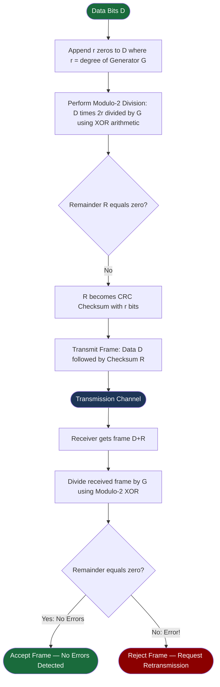

# 🛡️ Chapter 01: Link Layer Services and Error Detection (Parity and CRC)

---

## 1. Overview (Topic Introduction)
While higher-layer protocols treat links as black-box pipes, physical communication channels are subjected to electromagnetic noise, attenuation, and wireless interference that occasionally flip transmitted bits ($0 \to 1$ or $1 \to 0$). The **Data Link Layer** is responsible for transferring datagrams across an individual communication link from one node to an adjacent node. To ensure integrity at the link level, hardware network adapters employ high-speed error detection codes: **Parity Checks** and **Cyclic Redundancy Checks (CRC)**.

---

## 2. Learning Objectives
After studying this chapter, you will be able to:
* Enumerate the core responsibilities of the Data Link Layer: **Framing**, **Link Access**, **Flow Control**, and **Error Control**.
* Implement **Single Parity** and **Two-Dimensional (2D) Parity** to detect and correct single-bit errors.
* Master the mathematics of **Cyclic Redundancy Check (CRC)** using **Modulo-2 Polynomial Division (XOR Arithmetic)**.
* Compute the $r$-bit CRC remainder $R$ to append to data $D$.
* Verify error-free reception at the receiver by demonstrating that the received codeword divided by generator $G$ yields a zero remainder.

---

## 3. Core Concepts

### 3.1 Data Link Layer Services
* **Framing:** Encapsulates the Network Layer IP datagram into a link-layer **Frame**, adding a Link Header (Source/Dest MAC) and Trailer (CRC).
* **Link Access / MAC Protocol:** Coordinates which node can transmit on a shared broadcast channel at any instant.
* **Error Detection:** Hardware checks that detect corrupted bits caused by signal attenuation.
* **Error Correction:** Advanced codes (e.g., Forward Error Correction - FEC) that not only detect but mathematically reconstruct flipped bits without retransmission.

---

### 3.2 Parity Checks

#### 1. Single Parity Bit:
* Append a single bit to ensure the total number of 1s in the frame is **Even** (Even Parity) or **Odd** (Odd Parity).
* *Limitation:* Detects all single-bit errors, but **fails completely** if an even number of bits flip (e.g., 2 bits flip)!

#### 2. Two-Dimensional (2D) Parity (Error Correction!):
* Arrange data bits into an $i \times j$ matrix.
* Compute a parity bit for each **row** and each **column**.
* *Advantage:* If a single bit flips anywhere in the payload, its row parity error and column parity error intersect at that exact bit! The receiver simply flips the bit back, achieving **Error Correction** without retransmission!

---

### 3.3 Cyclic Redundancy Check (CRC)
CRC is a mathematically rigorous error-detection technique implemented directly in network adapter hardware (NICs).
* **Data Payload ($D$):** A $d$-bit binary string.
* **Generator Pattern ($G$):** A predetermined $(r + 1)$-bit pattern agreed upon by sender and receiver.
* **CRC Code ($R$):** An $r$-bit sequence appended to $D$ such that the resulting $(d + r)$-bit pattern is exactly divisible by $G$ under modulo-2 arithmetic.

#### Modulo-2 Arithmetic Rules:
* Modulo-2 binary arithmetic uses **bitwise XOR ($\oplus$)**:
  - $0 \oplus 0 = 0$
  - $1 \oplus 1 = 0$
  - $0 \oplus 1 = 1$
  - $1 \oplus 0 = 1$
* **No Carries and No Borrows!** Addition and Subtraction are completely identical to XOR!

---

## 4. Visual Explanation (Diagrams)

### 4.1 2D Parity Matrix Single-Bit Correction
```
Row Parity
          Bit 1  Bit 2  Bit 3  Bit 4   Parity
Row 1:      1      0      1      1   │   1
Row 2:      0      1    [ 0 ]    0   │   1  <── Row Parity Error!
Row 3:      1      1      0      0   │   0
          ───────────────────────────┼──────
Col Parity: 0      0      1      1   │   0
                          ▲
                          └── Column Parity Error!
Intersection at (Row 2, Col 3): Bit is corrupted! Flip 0 -> 1 to correct!
```

### 4.2 CRC Frame Structure
```
┌───────────────────────────────────────┬───────────────────────┐
│           Data Payload (D)            │     CRC Remainder (R) │
│               d bits                  │            r bits     │
└───────────────────────────────────────┴───────────────────────┘
<────────────────────── Transmitted Frame: (d + r) bits ─────────>
```


### 4.3 CRC Encoding & Decoding Pipeline — Flowchart



---

## 5. Step-by-Step CRC Calculation Algorithm
Given Data $D = 101110_2$ and Generator $G = 1001_2$ ($r + 1 = 4 \implies r = 3\text{ bits}$):

1. **Step 1: Append $r$ zeros to $D$:**
   Since $G$ is 4 bits, $r = 3$.
   Append three zeros: $D \cdot 2^r = \mathbf{101110000_2}$.
2. **Step 2: Perform Modulo-2 Division of $D \cdot 2^r$ by $G$:**
   $$\begin{array}{l@{\quad}l}
   \phantom{1001)} & \mathbf{101011} \quad (\text{Quotient - ignored}) \\
   1001) & 101110000 \\
         & \underline{1001} \\
         & \phantom{1}0101 \quad (\text{XOR result}) \\
         & \phantom{10}0000 \quad (\text{Leading 0, divide by 0}) \\
         & \phantom{10}\overline{1010} \\
         & \phantom{10}\underline{1001} \\
         & \phantom{100}0110 \\
         & \phantom{1000}0000 \\
         & \phantom{1000}\overline{1100} \\
         & \phantom{1000}\underline{1001} \\
         & \phantom{10000}\mathbf{101} \quad (\text{Remainder } R = 3\text{ bits!})
   \end{array}$$
3. **Step 3: Construct Transmitted Frame:**
   Append $R = 101$ to $D$:
   $$\text{Transmitted Frame} = \mathbf{101110101_2}$$
4. **Step 4: Receiver Verification:**
   Receiver divides $101110101$ by $G = 1001$.
   The remainder is **$000$** $\implies$ **No Error Detected!**

---

## 6. Real-Life Example
* **ISBN Book Code Verification:**
  - Every published book has a 13-digit ISBN.
  - The final digit is a mathematical check digit calculated from the preceding 12 digits using modular arithmetic.
  - If a cashier mistypes one digit at checkout, the system immediately flags an invalid ISBN without querying the central database.

---

## 7. Practical Implementation (Python CRC Engine)

```python
def xor(a, b):
    # Perform bitwise XOR of two strings
    result = []
    for i in range(1, len(b)):
        if a[i] == b[i]:
            result.append('0')
        else:
            result.append('1')
    return ''.join(result)

def mod2div(dividend, divisor):
    # Modulo-2 division
    pick = len(divisor)
    tmp = dividend[0:pick]

    while pick < len(dividend):
        if tmp[0] == '1':
            tmp = xor(divisor, tmp) + dividend[pick]
        else:
            tmp = xor('0'*pick, tmp) + dividend[pick]
        pick += 1

    if tmp[0] == '1':
        tmp = xor(divisor, tmp)
    else:
        tmp = xor('0'*pick, tmp)

    return tmp

def generate_crc(data_str, generator_str):
    r = len(generator_str) - 1
    appended_data = data_str + '0'*r
    remainder = mod2div(appended_data, generator_str)
    return remainder

# Test Case: Data = 101110, Generator = 1001
d = "101110"
g = "1001"
rem = generate_crc(d, g)
codeword = d + rem
print(f"Data: {d} | Generator: {g}")
print(f"Calculated CRC Remainder (R): {rem}") # Should be 101
print(f"Transmitted Codeword: {codeword}")

# Verify error-free reception:
check = mod2div(codeword, g)
print(f"Receiver Remainder Check: {check} (Valid? {check == '0'*(len(g)-1)})")
```

---

## 8. Common Mistakes & Pitfalls
> [!WARNING]
> * **Borrowing during Subtraction:** Modulo-2 subtraction NEVER borrows from adjacent bits! $0 - 1 = 1$, because it is pure bitwise XOR ($0 \oplus 1 = 1$).
> * **Number of Zeros to Append:** If the generator $G$ is 4 bits long, its polynomial degree is $r = 3$. You must append exactly **3 zeros** ($r$ zeros), NOT 4 zeros!

---

## 9. Practice Problems & Exam Walkthroughs

### 📝 Problem 1 (Standard University Exam CRC Problem)
**Question:** Given data string $D = 1101011011$ and generator polynomial $G(x) = x^4 + x + 1$.
1. Convert the generator polynomial into a binary bit string.
2. How many zeros must be appended to the data string?
3. Calculate the CRC bits ($R$).

**Step-by-Step Solution:**
1. **Convert $G(x)$ to Binary:**
   - $G(x) = 1 \cdot x^4 + 0 \cdot x^3 + 0 \cdot x^2 + 1 \cdot x^1 + 1 \cdot x^0$
   - Binary string $G = \mathbf{10011_2}$ (length 5 bits).
2. **Number of Zeros Appended:**
   - Degree of polynomial is $r = 4$.
   - Append **4 zeros** to $D$: $11010110110000$.
3. **Execute Modulo-2 Division:**
   - Dividing $11010110110000$ by $10011$ using XOR arithmetic yields remainder $R = \mathbf{1110_2}$.
   - Transmitted frame: $1101011011\mathbf{1110}$.

---

## 10. Knowledge Check (MCQ & Quizzes)

#### Q1. What is the result of the Modulo-2 subtraction: $1010_2 - 1100_2$?
- [ ] A) $-0010_2$
- [x] B) $0110_2$
- [ ] C) $1110_2$
- [ ] D) $0010_2$
*Explanation:* In modulo-2 arithmetic, subtraction is identical to XOR: $1 \oplus 1 = 0$, $0 \oplus 1 = 1$, $1 \oplus 0 = 1$, $0 \oplus 0 = 0 \implies 0110_2$.

#### Q2. Why is 2D parity capable of error correction while single parity can only detect errors?
- [ ] A) 2D parity uses a 32-bit checksum.
- [x] B) The intersection of the erroneous row parity and erroneous column parity uniquely pinpoints the single flipped bit.
- [ ] C) 2D parity requests automatic retransmission.
- [ ] D) 2D parity operates at the application layer.
*Explanation:* By identifying both the row and the column where parity failed, the receiver identifies the exact coordinate of the corrupted bit and flips it.

---

## 11. Summary & Revision Sheet
* **Single Parity:** Detects single-bit errors; fails on 2-bit flips.
* **2D Parity:** Detects and corrects single-bit errors via row/column coordinates.
* **CRC Modulo-2 Division:**
  1. Generator $G$ of length $r+1 \implies$ append $r$ zeros.
  2. XOR divide $D \cdot 2^r$ by $G$.
  3. Remainder $R$ is appended to $D$.
* **Arithmetic Rule:** Addition and subtraction are both pure **XOR**.

---

---

## 🔗 Related Topics

> Connect your understanding — explore these closely related chapters:

- 📖 [Multiple Access Protocols](02-multiple-access-protocols.md) — Protocols built on top of error-detected frames
- 📖 [MAC & ARP](03-mac-addressing-and-arp.md) — Ethernet frames that carry CRC error detection
- 📖 [UDP Checksum](../04-transport-layer-and-reliability/02-udp-and-internet-checksum.md) — End-to-end checksum vs per-link CRC comparison

## 12. References & Further Reading
* Peterson, W. W., & Brown, D. T. (1961). *Cyclic Codes for Error Detection*. Proceedings of the IRE.
* Kurose & Ross, Chapter 6.2: *Error-Detection and -Correction Techniques*.


---

<div align="center">

| [⬅️ Previous](../05-network-layer-and-routing/README.md) | [🏠 Module Index](README.md) | [Next ➡️](02-multiple-access-protocols.md) |
|:---:|:---:|:---:|

</div>
