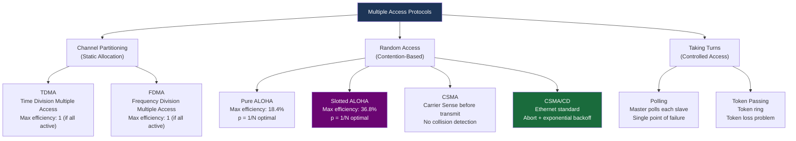
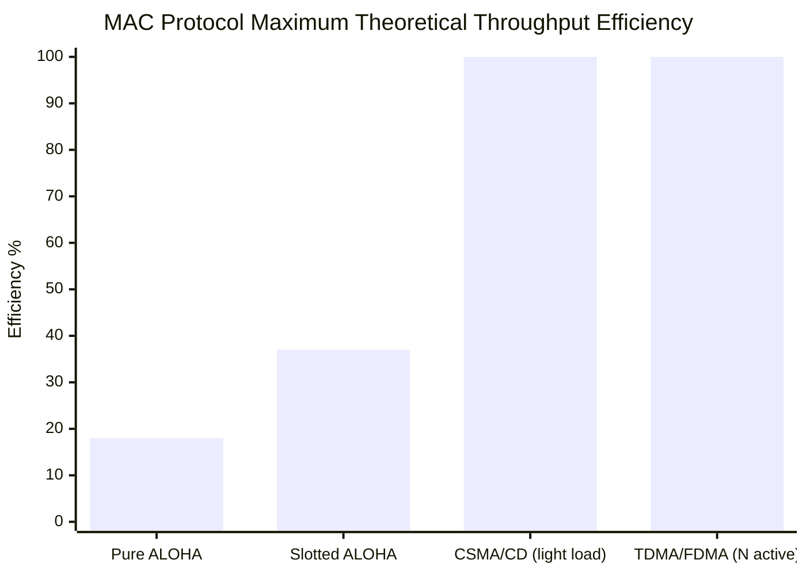

# 📢 Chapter 02: Multiple Access Protocols and Broadcast Channels

---

## 1. Overview (Topic Introduction)
In computer networking, communication links fall into two broad categories: **Point-to-Point Links** (e.g., dedicated fiber connecting two routers) and **Broadcast Channels** (e.g., traditional coaxial Ethernet, wireless WiFi, satellite links). When multiple active nodes share a single broadcast channel, their signals interfere if transmitted simultaneously, causing a **Collision**. 

The **Multiple Access Protocol (MAC)** coordinates channel access so that active nodes can transmit without causing crippling collisions. This chapter examines the three major families of multiple access protocols: **Channel Partitioning**, **Random Access (ALOHA, CSMA, CSMA/CD)**, and **Taking-Turns**.

---

## 2. Learning Objectives
After studying this chapter, you will be able to:
* Define the **Multiple Access Problem** and explain the physical cause of packet collisions.
* Classify protocols into **Channel Partitioning**, **Random Access**, and **Taking-Turns**.
* Compare **Pure ALOHA** ($18\%$ max efficiency) and **Slotted ALOHA** ($37\%$ max efficiency).
* Master **CSMA (Carrier Sense Multiple Access)**: "Listen before speaking".
* Understand **CSMA/CD (Collision Detection)** in Ethernet and the **Binary Exponential Backoff** algorithm.
* Contrast the trade-offs of contention-based random access with taking-turns protocols (Polling and Token Ring).

---

## 3. Core Concepts

### 3.1 Taxonomy of Multiple Access Protocols

```
                          ┌─────────────────────────────────────────┐
                          │       Multiple Access Protocols (MAC)   │
                          └────────────────────┬────────────────────┘
                                               │
         ┌─────────────────────────────────────┼─────────────────────────────────────┐
         ▼                                     ▼                                     ▼
┌──────────────────┐                 ┌──────────────────┐                  ┌──────────────────┐
│ Channel          │                 │ Random Access    │                  │ Taking-Turns     │
│ Partitioning     │                 │ (Contention)     │                  │ (Coordinated)    │
├──────────────────┤                 ├──────────────────┤                  ├──────────────────┤
│ • TDMA (Time)    │                 │ • Pure ALOHA     │                  │ • Polling        │
│ • FDMA (Freq)    │                 │ • Slotted ALOHA  │                  │ • Token Ring     │
│ • CDMA (Code)    │                 │ • CSMA / CSMA/CD │                  │                  │
└──────────────────┘                 └──────────────────┘                  └──────────────────┘
```

---

### 3.2 Channel Partitioning (Static Allocation)
* **TDMA (Time Division Multiple Access):** Time is divided into frames, and each frame is subdivided into $N$ slots. Each node gets a dedicated time slot.
  - *Advantage:* Zero collisions, guaranteed throughput.
  - *Disadvantage:* Bandwidth wasted if a node has nothing to send ($1/N$ link capacity even if only one user is active!).
* **FDMA (Frequency Division Multiple Access):** Bandwidth spectrum is split into $N$ frequency bands.
* **CDMA (Code Division Multiple Access):** Assigns a unique orthogonal code to each node; nodes transmit simultaneously on the same frequency without interference.

---

### 3.3 Random Access Protocols (Contention-Based)
When a node has a packet to send, it transmits at the **full channel rate $R$**. If two or more nodes transmit simultaneously, a collision occurs.

#### 1. Pure ALOHA:
* Unslotted, uncoordinated: Whenever a node has a packet, it transmits immediately!
* Vulnerable collision window is $2 \times t_{\text{frame}}$ (any packet starting within 1 frame time before or after will collide).
* **Maximum Theoretical Channel Efficiency:**
  $$S_{\text{Pure ALOHA}} = \frac{1}{2e} \approx \mathbf{0.184 \ (18.4\%)}$$

#### 2. Slotted ALOHA:
* Time is partitioned into synchronized slots of length $t_{\text{frame}}$. Nodes can only begin transmission at the start of a slot.
* Vulnerable collision window is halved to $1 \times t_{\text{frame}}$.
* **Maximum Theoretical Channel Efficiency:**
  $$S_{\text{Slotted ALOHA}} = \frac{1}{e} \approx \mathbf{0.368 \ (36.8\%)}$$

#### 3. CSMA (Carrier Sense Multiple Access):
* **Core Philosophy:** "Listen before transmit."
* If channel is sensed busy: Defer transmission.
* If channel is sensed idle: Transmit packet.
* *Why collisions still occur:* **Propagation Delay!** If Node A transmits, its signal takes time $d_{\text{prop}}$ to travel down the cable. If Node B listens before A's signal arrives, B senses the link as "idle" and begins transmitting, causing a collision!

#### 4. CSMA/CD (Carrier Sense Multiple Access with Collision Detection):
* **Core Philosophy:** "Listen while transmitting. If collision detected, abort immediately!"
* Aborting immediately upon collision avoids wasting channel time transmitting the remainder of a corrupted packet.
* **Binary Exponential Backoff:**
  - After collision $m$ (up to 10), the node chooses a random integer $K$ from $\{0, 1, 2, \dots, 2^m - 1\}$.
  - The node waits $K \times 512\text{ bit times}$ before re-sensing the link.
  - If repeated collisions occur, the random interval doubles exponentially, quickly resolving contention!

---

### 3.4 Taking-Turns Protocols
1. **Polling:** A master node polls each slave node in round-robin fashion ("Do you have data to send?").
   - *Downsides:* Polling overhead latency, single point of failure at master node.
2. **Token Passing:** A small control frame (the **Token**) circulates sequentially from node to node in a logical ring. A node can transmit only while holding the token.
   - *Downsides:* Token overhead, token recovery complexity if a node crashes while holding the token.

---

## 4. Visual Explanation (Diagrams)

### 4.1 CSMA/CD Propagation Delay & Collision Detection Timeline
```
Time
 │  Host A                                                         Host B
 │     │                                                             │
0│     ├── Transmits Bit 1 ────────┐                                 │
 │     │                           │ Signal propagates               │
 │     │                           ▼                                 │
t│     │               Link sensed IDLE by Host B!                   │
 │     │                           │                                 ├── Transmits Bit 1
 │     │                           │                                 │
 │     │                           ▼                                 ▼
t'     │                           💥 COLLISION OCCURS IN TRANSIT! 💥
 │     │                                   │                 │
 │     │◀── Jam Signal Arrives ────────────┘                 └───────┤
 │     │ (Aborts Transmission!)                                      │ (Aborts Transmission!)
 ▼     ▼                                                             ▼
```


### 4.2 MAC Protocol Taxonomy — Classification Diagram



### 4.3 ALOHA Throughput Efficiency Comparison



---

## 5. Step-by-Step CSMA/CD Execution Workflow (Ethernet)
1. **Prepare:** Network adapter receives datagram from Network Layer and constructs Ethernet frame.
2. **Carrier Sense:** Adapter senses the physical medium:
   - If busy: Wait until channel becomes idle, then wait an Inter-Frame Gap (96 bit times).
   - If idle: Begin transmitting the frame.
3. **Collision Detection:** While transmitting, the adapter constantly monitors electrical energy on the cable:
   - If transmission finishes with **no collision detected**: Frame successfully delivered!
   - If **collision detected**: **Abort transmission immediately**!
4. **Jam Signal:** Broadcast a 48-bit **Jam Signal** to ensure all other transmitting nodes detect the collision.
5. **Exponential Backoff:** Increment collision counter $m$. Choose random $K \in [0, 2^m - 1]$. Wait $K \times 512\text{ bit times}$, then return to Step 2. (After 16 consecutive collisions, abort and report error to OS).

---

## 6. Real-Life Example
* **Dinner Party Conversation Etiquette:**
  - **TDMA:** A timer gives each guest 30 seconds to speak in turn. Even if Uncle Bob has nothing to say, everyone sits in dead silence for 30 seconds.
  - **Pure ALOHA:** Everyone shouts out loud whenever a thought enters their head. Nobody understands anything.
  - **CSMA:** You wait until the room is quiet before speaking. But if you and Sarah start speaking at the exact same fraction of a second, your voices overlap.
  - **CSMA/CD:** When you and Sarah start speaking at the same time and hear the clash, you both immediately stop mid-sentence, pause for a random split-second, and whoever starts first finishes their story.

---

## 7. Practical Implementation (Python CSMA/CD Backoff Simulator)

```python
import random

def simulate_exponential_backoff(max_collisions=5):
    print("=== Simulating CSMA/CD Binary Exponential Backoff ===")
    for collision_count in range(1, max_collisions + 1):
        # Window size is 2^m - 1 (capped at 10)
        m = min(collision_count, 10)
        max_k = (2 ** m) - 1

        chosen_k = random.randint(0, max_k)
        wait_time_slots = chosen_k * 512 # 512 bit times

        print(f"Collision #{collision_count}:")
        print(f"  Range [0, 2^{m} - 1] -> [0, {max_k}]")
        print(f"  Random slot chosen (K): {chosen_k}")
        print(f"  Wait duration: {wait_time_slots} bit times\n")

simulate_exponential_backoff(4)
```

---

## 8. Common Mistakes & Pitfalls
> [!WARNING]
> * **Assuming WiFi uses CSMA/CD:** Wireless WiFi (IEEE 802.11) uses **CSMA/CA (Collision Avoidance)**, NOT Collision Detection! Wireless radios cannot transmit and listen on the same frequency at the same time because outbound radio power drowns out incoming signals.
> * **Minimum Frame Size in Ethernet:** To ensure a sender detects a collision before it finishes transmitting, Ethernet enforces a **Minimum Frame Size of 64 Bytes (512 bits)**!

---

## 9. Practice Problems & Exam Walkthroughs

### 📝 Problem 1 (Standard MAC Protocol Comparison)
**Question:** Compare Slotted ALOHA and CSMA/CD in terms of channel efficiency, vulnerability period, and collision handling.

**Step-by-Step Solution:**
1. **Slotted ALOHA:**
   - *Vulnerability Period:* 1 slot time ($t_{\text{frame}}$).
   - *Collision Handling:* Packets transmit blindly to completion; collision detected only when ACK fails to return.
   - *Maximum Channel Efficiency:* $1/e \approx \mathbf{36.8\%}$.
2. **CSMA/CD:**
   - *Vulnerability Period:* Propagation delay ($d_{\text{prop}}$) to reach the other node.
   - *Collision Handling:* Listens while transmitting; aborts transmission immediately upon detecting energy collision, minimizing wasted airtime.
   - *Maximum Channel Efficiency:* Approaches $\approx \mathbf{100\%}$ when propagation delay is short relative to frame transmission time!

---

## 10. Knowledge Check (MCQ & Quizzes)

#### Q1. Why does CSMA/CD abort transmission immediately upon detecting a collision rather than finishing the frame?
- [ ] A) To recalculate the IP checksum.
- [x] B) To avoid wasting channel bandwidth transmitting the remainder of an already corrupted frame.
- [ ] C) To switch the link to full-duplex mode.
- [ ] D) To send an ARP request.
*Explanation:* Aborting immediately clears the shared channel quickly, allowing nodes to back off and re-sense the link.

#### Q2. What is the maximum theoretical throughput efficiency of Pure ALOHA?
- [ ] A) $100\%$
- [ ] B) $50\%$
- [ ] C) $36.8\%$ ($1/e$)
- [x] D) $18.4\%$ ($1/(2e)$)
*Explanation:* Because Pure ALOHA has a vulnerability window of $2 \times t_{\text{frame}}$, its mathematical maximum throughput is $S = G e^{-2G} \implies 1/(2e) \approx 0.184$.

---

## 11. Summary & Revision Sheet
* **Channel Partitioning (TDMA/FDMA):** Zero collisions, poor utilization under bursty loads ($1/N$).
* **Random Access:** Contention-based, full link rate $R$ when active, collisions possible.
  - Pure ALOHA: $18.4\%$ efficiency.
  - Slotted ALOHA: $36.8\%$ efficiency.
  - CSMA/CD: Sense before transmit, abort on collision, binary exponential backoff.
* **Taking-Turns:** Polling and Token Ring (eliminated collisions, but introduced token latency and failure risks).

---

---

## 🔗 Related Topics

> Connect your understanding — explore these closely related chapters:

- 📖 [Link Layer & Error Detection](01-link-layer-and-error-detection.md) — CRC error detection used in CSMA/CD frames
- 📖 [MAC & ARP](03-mac-addressing-and-arp.md) — MAC addresses are what multiple access protocols arbitrate over
- 📖 [Internet & Network Core](../01-network-basics-and-architecture/01-internet-and-network-core.md) — Multiple access is the first-mile access link problem

## 12. References & Further Reading
* Metcalfe, R. M., & Boggs, D. R. (1976). *Ethernet: Distributed Packet Switching for Local Computer Networks*. Communications of the ACM.
* Kurose & Ross, Chapter 6.3: *Multiple Access Links and Protocols*.


---

<div align="center">

| [⬅️ Previous](01-link-layer-and-error-detection.md) | [🏠 Module Index](README.md) | [Next ➡️](03-mac-addressing-and-arp.md) |
|:---:|:---:|:---:|

</div>
