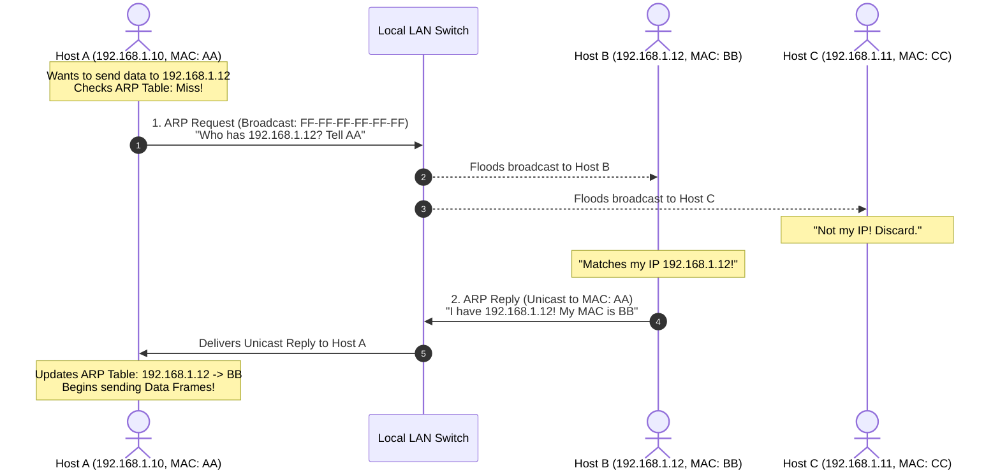
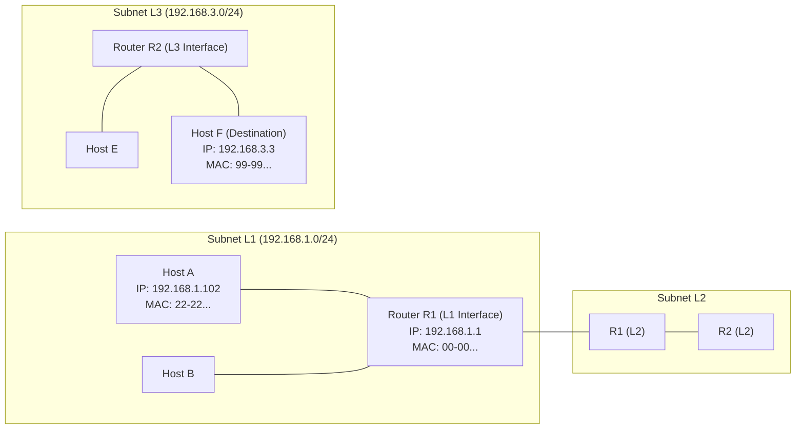

# 🔍 Chapter 03: MAC Addressing and the Address Resolution Protocol (ARP)

---

## 1. Overview (Topic Introduction)
While IP addresses govern end-to-end host identity across the global Internet, data cannot physically travel across an Ethernet wire or Wi-Fi radio using IP addresses alone. Physical hardware adapters (NICs) communicate strictly using **Media Access Control (MAC) Addresses**. 

The **Address Resolution Protocol (ARP)** is the vital translation mechanism operating at the boundary of Layer 2 and Layer 3 that maps a known 32-bit IP address to its corresponding 48-bit physical MAC address. Understanding how ARP broadcasts discover local physical addresses—and how packets traverse **multiple subnets through default gateway routers**—is essential for networking mastery.

---

## 2. Learning Objectives
After studying this chapter, you will be able to:
* Contrast the structure and purpose of **48-bit MAC Addresses** with **32-bit IP Addresses**.
* Explain why ARP is needed: **"IP is known, but MAC is unknown!"**
* Trace the **ARP Request (Broadcast `FF:FF:FF:FF:FF:FF`)** and **ARP Reply (Unicast)** sequence.
* Analyze how hosts maintain an **ARP Cache Table** with Time-to-Live (TTL) expiration.
* Master the mechanics of **Cross-Subnet Packet Forwarding**: explain why a sender targeting a remote IP addresses its frame to the **Default Gateway Router's MAC address**.
* Solve university final exam problems tracing frame encapsulations across multi-router LAN topologies.

---

## 3. Core Concepts

### 3.1 MAC Address vs. IP Address

| Feature | MAC Address (Layer 2) | IP Address (Layer 3) |
|---|---|---|
| **Length & Format** | **48 bits (6 Bytes)**, written as 12 Hex digits:<br/>`1A:2B:3C:4D:5E:6F` or `1A-2B-3C-4D-5E-6F` | **32 bits (4 Bytes)** (IPv4), written in dotted-decimal:<br/>`192.168.1.10` |
| **Scope** | **Local Hop-by-Hop:** Valid strictly within a single local broadcast subnet. | **Global End-to-End:** Valid across the entire global Internet. |
| **Permanence** | **Permanent (Burned-in):** Hardcoded into the ROM/EEPROM of the network adapter by the manufacturer (IEEE assigns vendor prefixes). | **Dynamic / Hierarchical:** Configured by DHCP or admin based on topological location. |
| **Analogy** | **National Identification Number (NID / SSN):** Stays with you for life wherever you move. | **Postal Street Address:** Changes whenever you move to a new apartment or city! |

---

### 3.2 The Address Resolution Protocol (ARP) (From CN Class Note 2, Page 27)
* *The Problem:* Host A wants to send an IP datagram to Host B on the same local network. Host A knows Host B’s IP address (`192.168.1.12`), but Host A’s network card cannot construct an Ethernet frame without Host B’s destination MAC address!
* *The Solution:* **ARP Protocol**:
  1. **ARP Query / Request:** Host A constructs an ARP query packet: *"Who has IP 192.168.1.12? Tell 192.168.1.10"*.
     - Because Host A does not know the destination MAC, it encapsulates the query in a frame addressed to the **Broadcast MAC Address**:
       $$\mathbf{FF:FF:FF:FF:FF:FF}$$
     - Every device on the local switch receives and inspects the ARP query.
  2. **ARP Response / Reply:** Host B inspects the packet, sees its own IP, and replies directly to Host A:
     - Sent as a **Unicast Frame** addressed specifically to Host A's MAC address!
  3. **ARP Cache Update:** Host A records the mapping in its local **ARP Cache Table** with a typical TTL of 20 minutes:
     ```
     IP Address       MAC Address           TTL
     192.168.1.12     BB:BB:BB:BB:BB:BB     20 min
     ```

---

### 3.3 Routing to Another Subnet (Cross-Subnet Delivery)
> [!IMPORTANT]
> **The Golden Cross-Subnet Rule:** If the destination IP address is **outside the sender's local subnet**, Host A CANNOT send an ARP request for the remote host's MAC! (Routers do not forward Layer 2 broadcast frames).
>
> Instead, Host A sends the packet to its **Default Gateway Router interface** on the local subnet:
> * **Destination IP:** Remains the **Remote Host’s IP** (`192.168.3.3`).
> * **Destination MAC:** Is the **Local Gateway Router Interface MAC** (`22:22:22:22:22:22`)!

---

## 4. Visual Explanation (Diagrams)

### 4.1 Intra-Subnet ARP Resolution (From CN Class Note 2, Page 28)


---

### 4.2 Cross-Subnet Packet Forwarding Across Routers (From CN Class Note 2, Page 29)


---

## 5. Step-by-Step Frame Traversal Across Subnets (L1 $\to$ L3)
1. **Host A (Subnet L1):**
   - Application sends data to Destination IP `192.168.3.3`.
   - Host A calculates subnet: `192.168.3.3` is NOT on local subnet `192.168.1.0/24`!
   - Host A must deliver packet to its **Default Gateway Router R1** (IP `192.168.1.1`).
   - Host A resolves R1's MAC via ARP $\implies$ MAC: `00-00-00-00-00-00`.
   - **Constructs Frame 1:**
     $$\text{Frame 1} = [ \text{DMAC: 00-00...} \mid \text{SMAC: 22-22...} \mid \text{SIP: 192.168.1.102} \mid \text{DIP: 192.168.3.3} \mid \text{Data} ]$$
2. **At Router R1:**
   - R1 strips Frame 1 MAC header.
   - Inspects Destination IP `192.168.3.3`, consults routing table $\to$ Next hop is Router R2 across Subnet L2.
   - Encapsulates into a brand-new Frame 2 with R1's L2 MAC as source and R2's L2 MAC as destination.
3. **At Router R2 (Subnet L3 Interface):**
   - R2 inspects Destination IP `192.168.3.3` $\to$ attached directly to Subnet L3!
   - Resolves Host F's MAC via ARP on Subnet L3 $\implies$ MAC: `99-99-99-99-99-99`.
   - **Constructs Frame 3:**
     $$\text{Frame 3} = [ \text{DMAC: 99-99...} \mid \text{SMAC: R2-L3-MAC} \mid \text{SIP: 192.168.1.102} \mid \text{DIP: 192.168.3.3} \mid \text{Data} ]$$
4. **At Host F:**
   - Host F matches `DMAC: 99-99...`, strips frame header, matches `DIP: 192.168.3.3`, delivers payload to transport layer!

---

## 6. Real-Life Example
* **Office Mail Delivery Across Cities:**
  - You want to send a memo to Sarah in the London office.
  - You do not walk down the corridor looking for Sarah's desk in Dhaka (**You do not ARP for Sarah's MAC**).
  - You hand the envelope to your building’s mail courier desk (**Default Gateway Router's MAC**), marked with Sarah's name and London office address (**Destination IP**).
  - The courier trucks the mail to the London facility, where the London office mail clerk walks to Sarah’s physical desk (**Local ARP resolution in destination subnet**) and places it in her hands.

---

## 7. Practical Implementation (Python ARP Table & Frame Generator)

```python
class ARPCache:
    def __init__(self):
        self.table = {}

    def update(self, ip, mac, ttl=1200):
        self.table[ip] = {'mac': mac, 'ttl': ttl}

    def resolve(self, ip):
        if ip in self.table:
            return self.table[ip]['mac']
        return None

def construct_frame(src_mac, dst_mac, src_ip, dst_ip, payload="Data"):
    return {
        'L2_Header': {'Src_MAC': src_mac, 'Dst_MAC': dst_mac},
        'L3_Header': {'Src_IP': src_ip, 'Dst_IP': dst_ip},
        'Payload': payload
    }

# Simulation matching Class Note 2, Page 29 (Exam 251 Q4(b)):
# Host A (192.168.1.102, MAC: 22-22) sends to Host F (192.168.3.3) via Router R1 (192.168.1.1, MAC: 00-00)
arp = ARPCache()
arp.update("192.168.1.1", "00-00-00-00-00-00")

gateway_ip = "192.168.1.1"
dest_ip = "192.168.3.3"
gateway_mac = arp.resolve(gateway_ip)

frame = construct_frame(
    src_mac="22-22-22-22-22-22",
    dst_mac=gateway_mac, # Crucial: Gateway MAC, NOT Host F's MAC!
    src_ip="192.168.1.102",
    dst_ip=dest_ip
)

print("Frame constructed by Host A for transmission across router:")
print("  Layer 2 Frame Header:", frame['L2_Header'])
print("  Layer 3 IP Header   :", frame['L3_Header'])
```

---

## 8. Common Mistakes & Pitfalls
> [!WARNING]
> * **Attempting to ARP for a remote IP:** An ARP request is a Layer 2 broadcast (`FF:FF:FF:FF:FF:FF`). Routers DO NOT forward broadcast packets across subnets! Attempting to ARP for an off-subnet IP will fail silently. Always ARP for your Default Gateway's IP!
> * **Broadcasting the ARP Reply:** An ARP Request is broadcast because the sender does not know who holds the IP. However, the ARP Reply is strictly **Unicast** directly back to the requester's MAC address!

---

## 9. Practice Problems & Exam Walkthroughs

### 📝 Problem 1 (From Fall 2025 Final 251 Q4(b) & CN Class Note 2, Page 29)
**Question:** Consider three subnets $L_1$, $L_2$, $L_3$ interconnected by routers $R_1$ and $R_2$.
* Subnet $L_1$ contains Host A (`192.168.1.102`, MAC: `22-22-22-22-22-22`), Host B, and Router $R_1$'s interface (`192.168.1.1`, MAC: `00-00-00-00-00-00`).
* Subnet $L_3$ contains Host E, Host F (`192.168.3.3`, MAC: `99-99-99-99-99-99`), and Router $R_2$'s interface.
Host A wants to send an IP datagram to Host F. Host A's ARP table is initially empty.
1. What destination MAC address is placed in the ARP request generated by Host A?
2. Which devices on Subnet $L_1$ receive this ARP request?
3. Which device responds to Host A's ARP request, and what MAC address does it supply?
4. Write out the structure of the link-layer frame leaving Host A on Subnet $L_1$.

**Step-by-Step Solution:**
1. **Destination MAC in ARP Request:**
   - Host A broadcasts the request onto the local link:
     $$\mathbf{FF:FF:FF:FF:FF:FF} \quad (\text{Broadcast MAC})$$
2. **Devices Receiving the ARP Request:**
   - Every physical interface on the $L_1$ broadcast domain receives the frame: **Host B and Router $R_1$**.
3. **Device Responding to the ARP Request:**
   - Host A recognizes that `192.168.3.3` is outside its subnet, so its ARP query targets its default gateway `192.168.1.1`.
   - **Router $R_1$ responds** with its own interface MAC: **`00-00-00-00-00-00`**.
4. **Frame Structure Leaving Host A:**
   $$\left[ \ \text{DMAC: 00-00-00-00-00-00} \ \mid \ \text{SMAC: 22-22-22-22-22-22} \ \mid \ \text{SIP: 192.168.1.102} \ \mid \ \text{DIP: 192.168.3.3} \ \mid \ \text{Data} \ \right]$$

---

## 10. Knowledge Check (MCQ & Quizzes)

#### Q1. What address is placed in the destination MAC field of a frame when a host sends a packet to a web server in another country?
- [ ] A) The web server's MAC address
- [ ] B) `FF:FF:FF:FF:FF:FF` broadcast
- [x] C) The Default Gateway Router interface MAC address
- [ ] D) The Local DNS server MAC address
*Explanation:* Packets leaving the local subnet must be physically transported to the first-hop router; hence the destination MAC is the gateway router's MAC.

#### Q2. Why is an ARP Reply sent as a unicast frame rather than a broadcast frame?
- [ ] A) The reply contains encrypted passwords.
- [x] B) The responder already learned the requester's MAC address from the incoming ARP Request header.
- [ ] C) Broadcast frames cannot carry MAC addresses.
- [ ] D) The router blocks unicast frames.
*Explanation:* The original ARP Request included the sender's MAC address, allowing the responder to reply directly via unicast without disturbing other hosts.

---

#### Q3. Host A (IP: 192.168.1.10) wants to send a packet to Host B (IP: 192.168.1.20) on the same Ethernet LAN. Neither has an ARP cache entry for the other. Describe the complete sequence of MAC-level operations.
- [ ] A) Host A sends the IP packet directly to the network with no MAC header required
- [x] B) Host A broadcasts an ARP Request to FF:FF:FF:FF:FF:FF asking "Who has 192.168.1.20?". Host B unicasts an ARP Reply with its MAC. Host A caches the mapping, then sends the Ethernet frame with Host B's MAC as destination
- [ ] C) Host A contacts the DNS server to resolve 192.168.1.20 to a MAC address
- [ ] D) Host A sends the packet to its default gateway which uses ARP on its behalf
*Explanation:* Same-subnet ARP sequence: 1) **ARP Request** broadcast (Dst MAC: `FF:FF:FF:FF:FF:FF`): "Who has 192.168.1.20? Tell 192.168.1.10". 2) All devices receive it; only 192.168.1.20 responds. 3) **ARP Reply** unicast from B to A: "192.168.1.20 is at AA:BB:CC:DD:EE:FF". 4) Host A **caches** the mapping (TTL ≈ 20 min). 5) Host A sends the IP datagram inside an **Ethernet frame** with Dst MAC = `AA:BB:CC:DD:EE:FF`.

#### Q4. Host A wants to send a packet to Host B on a DIFFERENT subnet. Host A's default gateway is Router R (MAC: `11:22:33:44:55:66`). What MAC address does Host A place in the Ethernet frame's Destination field?
- [ ] A) Host B's MAC address (resolved via ARP)
- [ ] B) The broadcast address `FF:FF:FF:FF:FF:FF`
- [x] C) Router R's MAC address (`11:22:33:44:55:66`) — the default gateway's interface MAC on Host A's subnet
- [ ] D) `00:00:00:00:00:00` (null MAC for routing)
*Explanation:* When the destination IP is on a **different subnet**, Host A cannot ARP for Host B directly (ARP broadcasts don't cross routers). Host A uses its **default gateway** (Router R) as the next hop. Host A ARPs for Router R's MAC, then encapsulates the IP packet with **Dst MAC = Router R's MAC**. The IP header still has **Dst IP = Host B's IP**. Each router along the path rewrites MAC addresses while preserving IP addresses.

#### Q5. What is the difference between a switch and a hub in terms of which OSI layer they operate at and how they handle collisions?
- [ ] A) Both operate at Layer 2 and both use CSMA/CD
- [x] B) A hub operates at Layer 1 (physical) and forwards bits to ALL ports (creating a single collision domain); a switch operates at Layer 2 (data link) with per-port MAC learning and forwards frames only to the correct port (each port is its own collision domain)
- [ ] C) A switch operates at Layer 3 and performs IP routing
- [ ] D) Hubs are switches without memory — they function identically except for speed
*Explanation:* **Hub** (Layer 1): repeats electrical signals to ALL ports — all devices share one collision domain and compete using CSMA/CD. **Switch** (Layer 2): learns MAC-to-port mappings via source address examination, forwards frames only to the correct destination port — each port has its **own independent collision domain** (or is full-duplex with no collisions). Switches dramatically increase network efficiency.

#### Q6. How does an Ethernet switch build its MAC address table, and what happens when it receives a frame with an unknown destination MAC?
- [ ] A) The table is manually configured by the network administrator
- [x] B) Self-learning: when a frame arrives on port P with source MAC M, the switch adds M→P to its table. For unknown destination MACs, the switch floods the frame to ALL ports except the incoming port
- [ ] C) The switch contacts the ARP server to resolve unknown MACs
- [ ] D) Unknown MACs are silently dropped
*Explanation:* Ethernet switch **self-learning algorithm**: 1) Frame arrives with Src MAC = `AA:BB:CC` on port 3 → add `AA:BB:CC → Port 3` to table. 2) Look up Dst MAC in table: **Hit** → forward only to that port. **Miss** → **flood** (send to all ports except incoming). 3) Table entries expire (TTL ≈ 300s) so the switch adapts to topology changes automatically.


## 11. Summary & Revision Sheet
* **MAC Address (48-bit):** Permanent hardware identifier for hop-by-hop local link delivery.
* **IP Address (32-bit):** Hierarchical address for global end-to-end routing.
* **ARP Query:** Broadcast (`FF-FF-FF-FF-FF-FF`), "Who has IP X? Tell Y".
* **ARP Reply:** Unicast directly to requester, "I have IP X, my MAC is Z".
* **Cross-Subnet Rule:** If destination is remote $\to$ Deliver to **Default Gateway MAC**!

---

---

## 🔗 Related Topics

> Connect your understanding — explore these closely related chapters:

- 📖 [Link Layer](01-link-layer-and-error-detection.md) — Error detection in Ethernet frames that carry ARP
- 📖 [Multiple Access Protocols](02-multiple-access-protocols.md) — How MAC addresses enable CSMA/CD arbitration
- 📖 [DHCP](../05-network-layer-and-routing/03-dhcp-dynamic-addressing.md) — DHCP relies on Layer 2 broadcast (ARP) before IP is configured

## 12. References & Further Reading
* RFC 826: *An Ethernet Address Resolution Protocol (ARP)*.
* Kurose & Ross, Chapter 6.4: *Link-Layer Addressing and ARP*.


---

<div align="center">

| [⬅️ Previous](02-multiple-access-protocols.md) | [🏠 Module Index](README.md) | [Next ➡️](../07-master-cheat-sheets-and-formulas/master-formula-cheat-sheet.md) |
|:---:|:---:|:---:|

</div>
