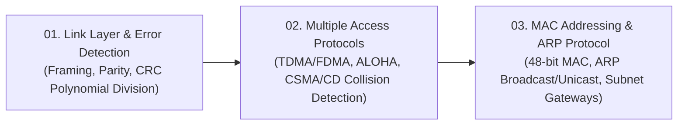

# 🔗 Module 06: Data Link Layer and Local Area Networks

Welcome to **Module 06: Data Link Layer and Local Area Networks (LANs)**. While the Network Layer coordinates end-to-end paths across the globe, the Data Link Layer manages communication across a **single physical link or local network segment**. This module covers link-layer **Framing and Error Detection (Parity & CRC)**, **Multiple Access Protocols (CSMA/CD, ALOHA)** for shared media, and the mechanics of **MAC Addressing and the Address Resolution Protocol (ARP)**.

---

## 🗺️ Module Learning Roadmap

---

## 📚 Chapter Breakdown

| Chapter File | Topics Covered | Key Visualizations | Real-World & Math Focus |
|---|---|---|---|
| **[01-link-layer-and-error-detection.md](./01-link-layer-and-error-detection.md)** | Link layer services, Framing, Flow & Error control, 2D Parity error correction, Cyclic Redundancy Check (CRC) Polynomial Division | Frame layout, 2D Parity matrix, XOR modulo-2 division pipeline | CRC remainder calculation ($R$), Generator polynomial $G$, Bit error detection proofs |
| **[02-multiple-access-protocols.md](./02-multiple-access-protocols.md)** | Broadcast link collisions, Channel Partitioning (TDMA, FDMA, CDMA), Random Access (Slotted ALOHA, Pure ALOHA, CSMA, CSMA/CD), Taking-Turns | CSMA/CD timeline with collision listening window, Backoff exponential wait | Maximum throughput derivations ($1/e \approx 37\%$ for Slotted ALOHA, $1/(2e) \approx 18\%$ for Pure ALOHA) |
| **[03-mac-addressing-and-arp.md](./03-mac-addressing-and-arp.md)** | 48-bit IEEE 802 MAC addresses, ARP mechanics, Broadcast query (`FF:FF:FF:FF:FF:FF`), Unicast reply, ARP cache tables | LAN cloud with switch and hosts, Cross-subnet router gateway MAC rewrite flow | Intrasubnet ARP resolution vs Cross-subnet delivery through Default Gateway, Final 251 Q4(b) |

---

## 🎯 Key Competencies Acquired

By completing this module, you will be able to:
1. Compute Cyclic Redundancy Check (CRC) bits using modulo-2 binary polynomial arithmetic.
2. Differentiate between Channel Partitioning, Random Access, and Taking-Turns multiple access schemes.
3. Understand CSMA/CD (Carrier Sense Multiple Access with Collision Detection) and binary exponential backoff.
4. Explain how ARP resolves Layer 3 IP addresses to Layer 2 physical MAC addresses.
5. Trace cross-subnet packet delivery across intermediate routers, demonstrating why the destination MAC address must be the router interface MAC.

