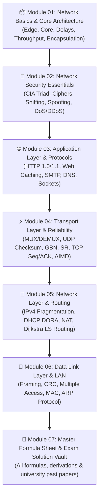

# 🌐 Computer Networks: Modern Course Knowledge Repository & Interactive Learning Guide

[](https://github.com/ASHIQ2KHAN/Computer-Networks-Knowledge)
[](https://github.com/ASHIQ2KHAN/Computer-Networks-Knowledge)
[](https://github.com/ASHIQ2KHAN/Computer-Networks-Knowledge)
[](https://github.com/ASHIQ2KHAN/Computer-Networks-Knowledge)

> **An open-source, beautifully structured, visual, and mathematically rigorous educational repository for mastering Computer Networking from A to Z.**  
> Designed to feel like a modern interactive documentation platform and full-fledged university/industry curriculum.

[](LICENSE)
[](CONTRIBUTING.md)
[](#-master-curriculum--chapter-roadmap)
[](#-master-curriculum--chapter-roadmap)
[](https://ashiq2khan.github.io/Computer-Networks-Knowledge/)
[](#)

---

## 🧭 The A → Z Learning Experience

This repository is built following a battle-tested educational philosophy designed to take a learner from foundational intuition to mathematical mastery and real-world networking engineering.

```
┌────────────────────────────────────────────────────────────────────────────────────────┐
│                               A → Z Learning Experience                                │
│               An open-source, structured, visual and practical learning resource        │
└───────────────────────────────────┬────────────────────────────────────────────────────┘
                                    │
    ┌───────────────────────────────┼───────────────────────────────┐
    │                               │                               │
    ▼                               ▼                               ▼
📖 Complete Theory              📊 Visual Diagrams             💻 Practical Examples
   Every concept explained         Learn by visualization,         Hands-on calculations,
   with deep technical rigor       Mermaid & packet timing         Python scripts & tests
    │                               │                               │
    ▼                               ▼                               ▼
🧠 Knowledge Testing            📁 Organized Resources          👥 Community Ready
   Quizzes, MCQs & UIU             Folder-wise modular layout,     Clean Markdown,
   past exam step-by-step          A-Z chapter index               open for contributions
```

---

## 📑 4. Standard Learning Template

Every chapter and topic guide in this repository strictly adheres to a uniform 12-section pedagogical blueprint (Standard 12-Section Template):

| # | Section | Description & Scope |
|---|---|---|
| **01** | **Overview** | Topic Introduction, Context, and Architectural Motivation |
| **02** | **Learning Objectives** | Clear, actionable competency goals and key learning outcomes |
| **03** | **Core Concepts** | In-depth rigorous theoretical mechanisms and formal definitions |
| **04** | **Visual Explanation** | High-definition ASCII architectural schematics and Mermaid sequence flows |
| **05** | **Step-by-Step Mechanism** | Algorithmic state-transition walkthroughs and step-by-step traces |
| **06** | **Real-Life Example** | Concrete real-world analogies and operational production use-cases |
| **07** | **Practical Implementation** | Python packet analysis scripts, simulation code, or calculation models |
| **08** | **Common Mistakes** | Frequently tested pitfalls, subtle edge cases, and conceptual traps |
| **09** | **Practice Problems** | Authentic university final/midterm exam problems with rigorous step-by-step solutions |
| **10** | **Knowledge Check** | Conceptual multiple-choice questions with comprehensive diagnostic answer keys |
| **11** | **Summary & Revision Sheet** | Quick-reference revision summary tables and key mental models |
| **12** | **References** | Official IETF RFC citations, authoritative textbook chapters, and documentation |

---

## 🗺️ Master Curriculum & Chapter Roadmap



---

## 📂 Detailed Course Directory Breakdown

### 📁 [Module 01: Network Basics and Architecture](./01-network-basics-and-architecture/README.md)
* **[01-internet-and-network-core.md](./01-network-basics-and-architecture/01-internet-and-network-core.md)**: Network Edge, Core mesh, Circuit Switching (FDM vs TDM, slot calculation) vs Packet Switching (Statistical Multiplexing, Binomial probability).
* **[02-delay-loss-and-throughput.md](./01-network-basics-and-architecture/02-delay-loss-and-throughput.md)**: The 4 Nodal Delays ($d_{proc}, d_{que}, d_{trans}, d_{prop}$), Caravan Analogy, Multi-hop delay calculations, Bottleneck Link Throughput.
* **[03-layering-and-encapsulation.md](./01-network-basics-and-architecture/03-layering-and-encapsulation.md)**: OSI 7-Layer vs TCP/IP 5-Layer model, Postal Analogy, Hop-by-hop traversal across Hubs (L1), Switches (L2), and Routers (L3), Protocol Headers & Addressing changes.

### 📁 [Module 02: Network Security Fundamentals](./02-network-security-fundamentals/README.md)
* **[01-cia-triad-and-cryptography.md](./02-network-security-fundamentals/01-cia-triad-and-cryptography.md)**: CIA Triad (Confidentiality, Integrity, Availability), Symmetric/Asymmetric Ciphers, Digital Signatures, Hash functions.
* **[02-network-attacks-and-defense.md](./02-network-security-fundamentals/02-network-attacks-and-defense.md)**: Packet Sniffing (Wireshark/Promiscuous mode), IP Spoofing, Denial of Service (DoS) & Distributed DoS (Botnets/SYN flood), Firewalls & Packet Filters.

### 📁 [Module 03: Application Layer and Protocols](./03-application-layer-and-protocols/README.md)
* **[01-application-architectures.md](./03-application-layer-and-protocols/01-application-architectures.md)**: Client-Server vs Peer-to-Peer (P2P), Sockets as application doors, Port numbers vs IP addresses.
* **[02-http-and-web-caching.md](./03-application-layer-and-protocols/02-http-and-web-caching.md)**: HTTP 1.0 vs 1.1, Non-Persistent vs Persistent HTTP Timing ($2\text{RTT} + \text{FTT}$ vs $\text{RTT} + n(\text{RTT} + \text{FTT})$), Web Caching & Proxy Servers, Cookies.
* **[03-email-protocols-smtp.md](./03-application-layer-and-protocols/03-email-protocols-smtp.md)**: Email architecture (User Agents, Mail Transfer Agents, Mailboxes, Outgoing Queues), SMTP (Push, Port 25) vs HTTP/POP3/IMAP (Pull).
* **[04-dns-domain-name-system.md](./03-application-layer-and-protocols/04-dns-domain-name-system.md)**: Hierarchical DNS Architecture (Root, TLD, Authoritative, Local DNS), Iterative vs Recursive Queries, Resource Records (A, NS, CNAME, MX), Local Caching.

### 📁 [Module 04: Transport Layer and Reliability](./04-transport-layer-and-reliability/README.md)
* **[01-transport-multiplexing.md](./04-transport-layer-and-reliability/01-transport-multiplexing.md)**: Port-based Multiplexing (MUX at sender) and Demultiplexing (DEMUX at receiver), Connectionless vs Connection-Oriented demux.
* **[02-udp-and-internet-checksum.md](./04-transport-layer-and-reliability/02-udp-and-internet-checksum.md)**: UDP Datagram format, 16-bit Internet Checksum calculation with 1's complement wrap-around addition in Binary and Hexadecimal.
* **[03-reliable-data-transfer.md](./04-transport-layer-and-reliability/03-reliable-data-transfer.md)**: RDT 1.0 through 3.0, Stop-and-Wait (No Loss, Data Loss, ACK Loss, Delayed ACK), Pipelining principles, Go-Back-N (GBN) vs Selective Repeat (SR).
* **[04-tcp-principles-and-handshake.md](./04-transport-layer-and-reliability/04-tcp-principles-and-handshake.md)**: TCP Segment anatomy, Sequence numbers (starting byte) and ACK numbers (next expected byte), 3-Way Handshake (`SYN`, `SYN-ACK`, `ACK`), 4-Way Connection Close (`FIN`, `ACK`).
* **[05-tcp-flow-and-congestion-control.md](./04-transport-layer-and-reliability/05-tcp-flow-and-congestion-control.md)**: Flow Control (Receiver Window $rwnd$), Congestion Control principles, Slow Start (exponential growth), AIMD (Additive Increase, Multiplicative Decrease sawtooth), Triple Duplicate ACKs vs Timeout recovery.

### 📁 [Module 05: Network Layer and Routing](./05-network-layer-and-routing/README.md)
* **[01-network-layer-overview.md](./05-network-layer-and-routing/01-network-layer-overview.md)**: Data Plane vs Control Plane, Forwarding (local per-router action) vs Routing (network-wide path computation).
* **[02-ipv4-and-fragmentation.md](./05-network-layer-and-routing/02-ipv4-and-fragmentation.md)**: IPv4 Header structure, MTU limitations, 8-Byte Boundary division rule, More Fragment Flag ($M$), Fragmentation offset calculation tables.
* **[03-dhcp-dynamic-addressing.md](./05-network-layer-and-routing/03-dhcp-dynamic-addressing.md)**: Plug-and-Play dynamic IP configuration, The 4-step DORA exchange (Discover, Offer, Request, ACK) over UDP ports 67 and 68.
* **[04-nat-network-address-translation.md](./05-network-layer-and-routing/04-nat-network-address-translation.md)**: Private IPv4 addressing (RFC 1918), NAT Translation Table mechanics, 4-step packet header transformation (LAN Private IP:Port $\leftrightarrow$ WAN Public IP:NAT Port).
* **[05-routing-algorithms-dijkstra.md](./05-network-layer-and-routing/05-routing-algorithms-dijkstra.md)**: Link State Routing, Dijkstra's Shortest Path Algorithm step-by-step iteration table, Least Cost Path Tree construction, Router Forwarding Table generation.

### 📁 [Module 06: Data Link Layer and Local Area Networks](./06-data-link-layer-and-lan/README.md)
* **[01-link-layer-and-error-detection.md](./06-data-link-layer-and-lan/01-link-layer-and-error-detection.md)**: Link layer services, Framing, Parity checks, Two-dimensional parity, Cyclic Redundancy Check (CRC) Polynomial Division.
* **[02-multiple-access-protocols.md](./06-data-link-layer-and-lan/02-multiple-access-protocols.md)**: Broadcast channels, Channel Partitioning (TDMA, FDMA, CDMA), Random Access (Slotted ALOHA, Pure ALOHA, CSMA/CD collision detection), Taking-Turns (Polling, Token Ring).
* **[03-mac-addressing-and-arp.md](./06-data-link-layer-and-lan/03-mac-addressing-and-arp.md)**: 48-bit MAC Addresses, Address Resolution Protocol (ARP), Broadcast Query (`FF:FF:FF:FF:FF:FF`) and Unicast Reply, Cross-Subnet packet delivery through Default Gateway Routers.

### 📁 [Module 07: Master Cheat Sheets and Formulas](./07-master-cheat-sheets-and-formulas/README.md)
* **[master-formula-cheat-sheet.md](./07-master-cheat-sheets-and-formulas/master-formula-cheat-sheet.md)**: Every mathematical formula in Computer Networks consolidated into a single ultra-fast revision guide (Delays, Throughput, TDM/FDM, HTTP RTT, TCP Checksum, Fragmentation, Subnetting, Dijkstra, CRC).

---

## 💻 Python Practical Simulation Toolkit

The repository includes runnable Python simulation scripts for deep hands-on verification:
* `socket_echo_server.py` & `socket_echo_client.py` (TCP Socket Programming)
* `internet_checksum.py` (RFC 1071 16-bit 1's complement checksum engine)
* `dijkstra_simulator.py` (Link-state routing algorithm graph solver)
* `ip_fragmenter.py` (IPv4 MTU fragmentation and offset calculator)

---

## 🤝 Contributing

We welcome contributions from students, educators, and network engineers worldwide! Please read our [CONTRIBUTING.md](./CONTRIBUTING.md) guide for details on how to propose changes, add exam solutions, and improve diagrams.

---

<p align="center">
  Crafted with ❤️ for Computer Science students, software engineers, and networking enthusiasts.
</p>

